# Hot100--By_V1rtual

--By V1rtual

> 阅读顺序：先用序章查基础与常用方法，再按分类复习题解。正文中的前置知识、推导、不同解法和易错提醒仍保留在原题附近。
>
> 文档中的配图统一使用相对路径 `imgs/`；移动或下载时，请将本文与 `imgs` 文件夹一起保留。

## 目录

- [序章：前置知识、常用方法与输入输出](#preface)
  - [Java 语法与常用 API](#preface-java)
  - [算法与数据结构共同基础](#preface-algorithms)
  - [单例与线程协作](#preface-concurrency)
  - [输入原理与快读模板](#preface-io)
  - [输出方法与快输模板](#preface-output)
- [1. 哈希](#chapter-01)
- [2. 双指针](#chapter-02)
- [3. 滑动窗口](#chapter-03)
- [4. 子串](#chapter-04)
- [5. 普通数组](#chapter-05)
- [6. 矩阵](#chapter-06)
- [7. 链表](#chapter-07)
- [8. 二叉树](#chapter-08)
- [9. 图论](#chapter-09)
- [10. 回溯](#chapter-10)
- [11. 二分查找](#chapter-11)
- [12. 栈](#chapter-12)
- [13. 堆](#chapter-13)
- [14. 贪心算法](#chapter-14)
- [15. 动态规划](#chapter-15)
- [16. 多维动态规划](#chapter-16)
- [17. 技巧](#chapter-17)
- [18. 补充](#chapter-18)

<details>
<summary>展开全部题目索引（含补充题）</summary>

- [1. 哈希](#chapter-01)
  - [1. 两数之和 easy](#problem-001)
  - [49. 字母异位词分组 mid](#problem-002)
  - [128. 最长连续序列 mid](#problem-003)
- [2. 双指针](#chapter-02)
  - [283. 移动零 easy](#problem-004)
  - [11. 盛最多水的容器 mid](#problem-005)
  - [15. 三数之和 mid](#problem-006)
  - [42. 接雨水 hard](#problem-007)
- [3. 滑动窗口](#chapter-03)
  - [3. 无重复字符的最长子串 mid](#problem-008)
  - [438. 找到字符串中所有字母异位词 mid](#problem-009)
- [4. 子串](#chapter-04)
  - [560. 和为 K 的子数组 mid](#problem-010)
  - [239. 滑动窗口最大值 hard](#problem-011)
  - [76. 最小覆盖子串 hard](#problem-012)
- [5. 普通数组](#chapter-05)
  - [53. 最大子数组和 mid](#problem-013)
  - [56. 合并区间 mid](#problem-014)
  - [189. 轮转数组 mid](#problem-015)
  - [238. 除了自身以外数组的乘积 mid](#problem-016)
  - [41. 缺失的第一个正数 hard](#problem-017)
- [6. 矩阵](#chapter-06)
  - [73. 矩阵置零  mid](#problem-018)
  - [54. 螺旋矩阵 mid](#problem-019)
  - [48. 旋转图像 mid](#problem-020)
  - [240. 搜索二维矩阵 II mid](#problem-021)
- [7. 链表](#chapter-07)
  - [160. 相交链表 easy](#problem-022)
  - [206. 反转链表  easy](#problem-023)
  - [234. 回文链表 easy](#problem-024)
  - [141. 环形链表 easy](#problem-025)
  - [142. 环形链表 II mid](#problem-026)
  - [21. 合并两个有序链表 easy](#problem-027)
  - [2. 两数相加 mid](#problem-028)
  - [19. 删除链表的倒数第 N 个结点 mid](#problem-029)
  - [24. 两两交换链表中的节点 mid](#problem-030)
  - [25. K 个一组翻转链表 hard](#problem-031)
  - [138. 随机链表的复制 mid](#problem-032)
  - [148. 排序链表 mid  （重点看）](#problem-033)
  - [23. 合并 K 个升序链表 hard 重点看](#problem-034)
  - [146. LRU 缓存 mid](#problem-035)
- [8. 二叉树](#chapter-08)
  - [94. 二叉树的中序遍历 easy](#problem-036)
  - [104. 二叉树的最大深度 easy](#problem-037)
  - [226. 翻转二叉树 easy](#problem-038)
  - [101. 对称二叉树  easy](#problem-039)
  - [543. 二叉树的直径 easy 重点看](#problem-040)
  - [102. 二叉树的层序遍历 mid](#problem-041)
  - [108. 将有序数组转换为二叉搜索树 easy](#problem-042)
  - [98. 验证二叉搜索树 mid](#problem-043)
  - [230. 二叉搜索树中第 K 小的元素 mid](#problem-044)
  - [199. 二叉树的右视图 mid](#problem-045)
  - [114. 二叉树展开为链表 mid](#problem-046)
  - [105. 从前序与中序遍历序列构造二叉树 mid](#problem-047)
  - [437. 路径总和 III mid](#problem-048)
  - [236. 二叉树的最近公共祖先 mid](#problem-049)
  - [124. 二叉树中的最大路径和 hard 重点看](#problem-050)
- [9. 图论](#chapter-09)
  - [200. 岛屿数量 mid](#problem-051)
  - [994. 腐烂的橘子 mid](#problem-052)
  - [207. 课程表 mid 重点看](#problem-053)
  - [208. 实现 Trie (前缀树) mid 重点看](#problem-054)
- [10. 回溯](#chapter-10)
  - [46. 全排列 mid](#problem-055)
  - [78. 子集 mid](#problem-056)
  - [17. 电话号码的字母组合 mid](#problem-057)
  - [39. 组合总和 mid](#problem-058)
  - [22. 括号生成 mid](#problem-059)
  - [79. 单词搜索 mid  重点看](#problem-060)
  - [131. 分割回文串 mid](#problem-061)
  - [51. N 皇后 hard](#problem-062)
- [11. 二分查找](#chapter-11)
  - [35. 搜索插入位置 easy](#problem-063)
  - [74. 搜索二维矩阵 mid](#problem-064)
  - [34. 在排序数组中查找元素的第一个和最后一个位置 mid](#problem-065)
  - [33. 搜索旋转排序数组 mid](#problem-066)
  - [153. 寻找旋转排序数组中的最小值 mid](#problem-067)
  - [4. 寻找两个正序数组的中位数 hard](#problem-068)
- [12. 栈](#chapter-12)
  - [20. 有效的括号 easy](#problem-069)
  - [155. 最小栈 mid](#problem-070)
  - [394. 字符串解码 mid](#problem-071)
  - [739. 每日温度 mid](#problem-072)
  - [84. 柱状图中最大的矩形 hard](#problem-073)
- [13. 堆](#chapter-13)
  - [215. 数组中的第K个最大元素 mid](#problem-074)
  - [347. 前 K 个高频元素 mid](#problem-075)
  - [295. 数据流的中位数 hard](#problem-076)
- [14. 贪心算法](#chapter-14)
  - [121. 买卖股票的最佳时机 easy](#problem-077)
  - [55. 跳跃游戏 mid](#problem-078)
  - [45. 跳跃游戏 II mid](#problem-079)
  - [763. 划分字母区间 mid](#problem-080)
- [15. 动态规划](#chapter-15)
  - [70. 爬楼梯 easy](#problem-081)
  - [118. 杨辉三角 easy](#problem-082)
  - [198. 打家劫舍 mid](#problem-083)
  - [279. 完全平方数 mid](#problem-084)
  - [322. 零钱兑换 mid](#problem-085)
  - [139. 单词拆分 mid](#problem-086)
  - [300. 最长递增子序列 mid](#problem-087)
  - [152. 乘积最大子数组 mid](#problem-088)
  - [416. 分割等和子集 mid](#problem-089)
  - [32. 最长有效括号 hard](#problem-090)
- [16. 多维动态规划](#chapter-16)
  - [62. 不同路径 mid](#problem-091)
  - [64. 最小路径和 mid](#problem-092)
  - [5. 最长回文子串 mid](#problem-093)
  - [1143. 最长公共子序列 mid](#problem-094)
  - [72. 编辑距离 mid](#problem-095)
- [17. 技巧](#chapter-17)
  - [136. 只出现一次的数字 easy](#problem-096)
  - [169. 多数元素 easy](#problem-097)
  - [75. 颜色分类 mid](#problem-098)
  - [31. 下一个排列 mid](#problem-099)
  - [287. 寻找重复数 mid](#problem-100)
- [18. 补充](#chapter-18)
  - [1. 线程安全的单例模式](#problem-101)
  - [2. 两个线程交替打印奇偶数](#problem-102)

</details>


<a id="preface"></a>

## 序章：前置知识、常用方法与输入输出

本章是正文知识的集中速查，不替代下面每道题的讲解。输入输出模板面向需要自己编写 `Main` 的 OJ；LeetCode 通常只需实现题目给定的方法，不必手动读取标准输入。

<a id="preface-java"></a>

### 1. Java 语法、数据类型与常用 API

#### 1.1 类型、引用、数值与边界

- 数组长度用 `arr.length`，字符串长度用 `s.length()`，集合大小用 `list.size()`；字符串与集合通常也提供 `isEmpty()`。
- `int[]` 默认填 `0`，`boolean[]` 默认填 `false`，引用数组默认填 `null`；局部变量不会自动获得可直接使用的默认值。
- Java 总是值传递：对象传参时复制的是引用。修改引用指向的对象会影响其他持有者，但给形参重新赋值不会替调用者改掉原引用。
- `==` 比较基本类型的值，比较对象时判断是否为同一对象；字符串内容用 `equals()`，数组内容用 `Arrays.equals()`。判断两个链表是否相交，应比较节点身份，不是节点里的数字。
- 泛型使用包装类型，例如 `List<Integer>`、`Map<Character, Integer>`，不能写 `List<int>`；`new ArrayList<>()` 中的菱形语法用于类型推断。包装数值的 `==` 可能只是在比较引用，应按意图拆箱或用 `equals()`。
- `int` 是 32 位有符号整数，`long` 是 64 位。边界常量是 `Integer.MIN_VALUE/MAX_VALUE`、`Long.MIN_VALUE/MAX_VALUE`。前缀和、路径和、大乘积与计数要先评估是否需要 `long`。
- 在运算前扩大类型：`long sum = (long) a + b`、`long product = 1L * a * b`；先用 `int` 算完再赋给 `long` 无法挽救已经发生的溢出。`0L`、`1L` 表示 `long` 字面量。
- 整数除法会截断小数；平均数可写 `((long) a + b) / 2.0`。`/ 10` 取进位、`% 10` 取个位，使用时注意数字正负与题目约定。
- `Math.min(a,b)`、`Math.max(a,b)` 取极值；`Math.abs(Integer.MIN_VALUE)` 仍会溢出，应先转成 `long`。加 1 的 DP 哨兵可用安全上界，或先判不可达，避免对最大整数继续相加。
- `&&`、`||` 从左到右短路求值；应先判空、判范围，再解引用或访问数组，例如 `node != null && node.next != null`。
- 增强 `for` 适合顺序读取；需要下标、改原数组或控制回退时用普通 `for`。三元表达式为 `condition ? a : b`；`this.field` 指当前对象字段。

#### 1.2 数组、排序与转换

| 方法／写法 | 含义与提醒 |
| --- | --- |
| `Arrays.sort(arr)` | 原地升序排序，不是线性时间算法；通常按 O(n log n) 分析 |
| `Arrays.sort(rows, (a,b) -> Integer.compare(a[0], b[0]))` | 二维数组按首元素排序；比较器不要直接 `a[0]-b[0]`，防溢出 |
| `Arrays.fill(arr, value)` | 整个一维数组赋同值；二维数组应逐行调用 |
| `Arrays.equals(a, b)` | 比较一维数组内容；嵌套数组可用 `Arrays.deepEquals()` |
| `System.arraycopy(src, srcPos, dst, dstPos, len)` | 拷贝指定范围到已有目标数组；对象数组复制的是引用 |
| `Arrays.copyOf(arr, n)` | 创建长度为 n 的新数组；超出原长的部分使用默认值 |
| `Arrays.stream(nums).sum()` | 求和；对 `int[]` 得到的仍是 `int` 和，可能溢出，必要时用 `.asLongStream().sum()` |
| `list.toArray(new int[list.size()][])` | 把 `List<int[]>` 转成 `int[][]`，不会深拷贝每个内层数组 |
| `Arrays.toString(arr)` / `Arrays.deepToString(arr)` | 一维／嵌套数组的调试文本，不等于题目指定输出格式 |

`int[]` 不能直接传入对象比较器来降序排序；可排序后反转，或按需要使用 `Integer[]`。复制数组、路径或节点时要区分“新容器但共享元素”和“连元素也新建”的深拷贝。

```java
int[] a = {3, 1, 2};
int[] copy = Arrays.copyOf(a, a.length);
Arrays.sort(copy);
int[][] grid = new int[2][3];
for (int[] row : grid) {
    Arrays.fill(row, -1);
}
```

本章简短片段省略的工具类导入通常是 `import java.util.*;`；完整 OJ 模板另行给出。

#### 1.3 String、char 与 StringBuilder

| 方法／写法 | 含义与提醒 |
| --- | --- |
| `s.charAt(i)` | 获取下标 i 的 `char`，需满足 `0 <= i < s.length()` |
| `s.toCharArray()` | 新建字符数组，便于原地修改字符 |
| `s.substring(l, r)` | 截取左闭右开区间 `[l,r)`；长度为 `r-l` |
| `String.valueOf(chars)` / `new String(chars)` | 用 `char[]` 的内容构造字符串 |
| `Character.toString(c)` / `String.valueOf(c)` | 将单个字符转成字符串 |
| `s.equals(t)` | 字符串内容相等；当 s 可能为 null 时注意先判空 |
| `s.repeat(n)` | 重复字符串 n 次，需要 Java 11+ |
| `c - '0'` | ASCII 数字字符 `'0'..'9'` 转成 `0..9`；不适用于全角数字等其他 Unicode 数字字符 |
| `c - 'a'` | 小写英文字母映射到 `0..25`；不能直接覆盖大写或中文 |
| `num = num * 10 + (c - '0')` | 逐字符解析多位非负十进制数 |
| `builder.append(x)` | 追加字符、字符串或数字，可连续调用 |
| `builder.deleteCharAt(builder.length()-1)` | 撤销最后一个字符，适合回溯 |
| `builder.setLength(oldLength)` | 恢复之前的长度；`setLength(0)` 可清空 |
| `builder.length()` / `builder.toString()` | 当前长度／获得字符串结果 |

`char[]` 自身的 `toString()` 不是数组内容，不能用作字母异位词分组的内容键。Java 的 `char` 是 UTF-16 代码单元；用 `int[26]` 或 `int[128]` 统计时，必须有对应的小写字母／ASCII 输入保证。

字符串不可变，现代 JDK 中 `substring()` 通常会复制目标内容；寻找最优窗口时先记录起点与长度，最后截取一次。可变 `StringBuilder` 入栈或保存时要考虑引用共享，必要时保存 `toString()` 或新建构建器，不能在下一层覆盖旧状态。

#### 1.4 List、Set、Map 速查

| 容器 | 常用方法 | 典型用途 |
| --- | --- | --- |
| `List<E>` / `ArrayList<E>` | `add`、`get`、`set`、`remove`、`size`、`isEmpty` | 按顺序保存结果、路径、邻接表 |
| `Set<E>` / `HashSet<E>` | `add`、`contains`、`remove`、`size` | 去重、成员判断、访问标记 |
| `Map<K,V>` / `HashMap<K,V>` | `put`、`get`、`containsKey`、`getOrDefault`、`remove`、`size` | 下标映射、分组、计数、记忆状态 |
| Map 视图 | `keySet()`、`values()`、`entrySet()` | 遍历键、值或键值对 |
| `Map.Entry<K,V>` | `getKey()`、`getValue()` | 遍历时同时读取键和值 |

```java
Map<Integer, Integer> count = new HashMap<>();
count.put(7, count.getOrDefault(7, 0) + 1);
for (Map.Entry<Integer, Integer> entry : count.entrySet()) {
    int key = entry.getKey();
    int frequency = entry.getValue();
}
List<Integer> path = new ArrayList<>();
path.add(1);
List<Integer> snapshot = new ArrayList<>(path);
path.remove(path.size() - 1);
```

- 哈希表／哈希集合常用操作按平均 O(1) 分析，不是任何输入下都无条件 O(1)。去重后应遍历去重容器，避免原数组中的重复起点反复展开。
- `new ArrayList<>(map.values())` 创建新的外层列表；其中可变元素仍可能共享。
- `List.of(...)`（Java 9+）不可增删改；`Set.copyOf(collection)`（Java 10+）生成不可修改集合；这不等于把里面的可变对象都变成不可变。
- `Arrays.asList(...)` 是固定长度列表，可 `set`，不能 `add/remove`，且与传入的对象数组共享底层数据。传入 `int[]` 时得到的是包含一个 `int[]` 的列表，不是 `List<Integer>`。
- `List<Integer>.remove(1)` 删除下标 1；要按值删除数字 1，应写 `remove(Integer.valueOf(1))`。
- 正文中 `List/ArrayList.addLast()`、`removeLast()` 等首尾方法需要 Java 21+。较旧 OJ 可用 `add(x)`、`get(size()-1)`、`remove(size()-1)`；`Deque` 上同名方法不需要等到 Java 21。
- 创建邻接表时，每个内层列表都需要初始化。桶数组中的列表也要先判 `null`；`new List[n]` 一类泛型数组写法可能带来 unchecked 警告，用嵌套列表通常更直接。

#### 1.5 栈、队列、双端队列与优先队列

| 结构 | 常用创建方式 | 方法与方向 |
| --- | --- | --- |
| 栈，后进先出 | `Deque<Integer> stack = new ArrayDeque<>();` | `push` 入栈，`pop` 弹出，`peek` 只看栈顶 |
| 队列，先进先出 | `Queue<Integer> queue = new ArrayDeque<>();` | `offer` 入队，`poll` 出队，`peek` 看队头 |
| 双端队列 | `Deque<Integer> deque = new ArrayDeque<>();` | `offerFirst/offerLast`、`pollFirst/pollLast`、`peekFirst/peekLast` |
| 小根堆 | `PriorityQueue<Integer> heap = new PriorityQueue<>();` | `offer` 插入，`peek` 看最小值，`poll` 删除最小值 |
| 大根堆 | `new PriorityQueue<Integer>(Comparator.reverseOrder())` | `peek/poll` 操作最大值 |

- `addFirst/addLast` 也能从两端加入；删除前注意空容器。`poll/peek` 在空队列返回 `null`，`pop/remove` 通常抛异常；自动拆箱 `null` 也会报错。
- `ArrayDeque` 不允许 `null`，BFS 只把存在的节点入队；`LinkedList` 也能实现队列或双端队列，但刷题一般优先 `ArrayDeque`。
- 堆只保证父子间的堆序，不保证遍历结果整体有序；堆顶读取 O(1)，插入／删除堆顶 O(log n)。
- 比较器升序用 `Integer.compare(a,b)`，降序用 `Integer.compare(b,a)` 或 `Comparator.reverseOrder()`，不要用可能溢出的 `a-b`、`b-a`。
- 随机下标可用 `new Random().nextInt(bound)`，返回 `[0,bound)`，要求 `bound > 0`。`Math.random()` 在 `[0,1)`，`l + (int)(Math.random() * (r-l+1))` 可在范围长度不溢出的前提下选择 `[l,r]` 内下标。

<a id="preface-algorithms"></a>

### 2. 算法与数据结构的共同基础

#### 2.1 复杂度、状态与区间

- 子数组、子串要求连续；子序列不要求连续。区分“前 i 个元素”“以 i 结尾”“从 i 开始”“区间 `[l,r]`”，才能正确写转移与边界。
- 闭区间 `[l,r]` 长度是 `r-l+1`；半开区间 `[l,r)` 长度是 `r-l`；两边界之间的开区间长度是 `r-l-1`。
- 嵌套循环不必然 O(n²)：双指针、单调栈／队列中，每个元素若至多进出一次，总处理次数仍是 O(n)。
- 空间复杂度要计入递归调用栈，并说明是否计入返回结果。树 DFS 通常需要 O(高度) 栈空间，BFS 通常需要 O(最大层宽) 队列空间。
- 原地处理会改变输入；若题目不允许或后面还要使用原数据，需要复制或恢复。假设“输入非空”“一定有解”“数字互异”都必须来自题目，而不是模板本身。

#### 2.2 双指针、窗口、前缀与原地技巧

- **快慢指针**：快指针扫描，慢指针维护已经处理好的有效前缀；原地过滤／移动元素时要维护未处理区域不被提前覆盖。
- **相向指针**：通常依赖排序或单调关系决定排除哪一侧；去重须先检查越界，并确保最终有指针前进。
- **固定窗口**：加入新元素、移除离开窗口的元素；字符异位词比较的是频率，不只是出现过哪些字符。
- **可变窗口**：先扩张，再用 `while` 收缩到满足条件；不同题目可能在合法时更新并继续缩小，也可能在不合法时缩小后更新。不要把两种时机混用。
- **频率变量**：`valid` 可以表示已达标的字符种类数，也可以另设缺失字符总数；跨过目标频率阈值时才更新。负频率在某些模板里代表富余，不一定是错误。
- **边界不倒退**：根据字符最后位置跳跃时，写 `left = Math.max(left, last + 1)`。含负数的数组不能直接使用依赖窗口和单调变化的滑窗模板。
- **前缀和**：定义 `prefix[0]=0`，则 `[l,r)` 的和为 `prefix[r]-prefix[l]`。累计值可能需要 `long`。
- **前缀计数哈希**：统计和为 k 的子数组时，初始 `0 → 1`；先查询历史中的 `sum-k`，再把当前 `sum` 加入，避免把当前前缀与自己配成空区间。
- **前后缀预处理**：和、积、最大值都可预处理避免重复扫描；空积为 1。用滚动后缀乘积时，先贡献到答案再把当前元素乘进去。
- **区间合并**：先按起点排序，再维护当前终点最大值；闭区间端点相等算重叠；遍历结束后别漏掉最后一段。
- **反转与轮转**：两端交换完成原地反转；轮转先处理 `k %= n`，再整体与分段反转，前提是 `n > 0`。
- **原地归位**：把值 x 映射到下标 `x-1` 前先判范围；用 `while` 连续把换回来的值处理到位，目标已有同值时停止，防止无限交换。

#### 2.3 矩阵与链表

**矩阵**：行数 `matrix.length`，在保证至少一行时列数取 `matrix[0].length`。使用首行首列保存标记，应先保存它们原来的状态，最后才处理标记区；四边界螺旋扫描要在后两条边重新检查边界，防单行／单列重复访问。矩阵转置只交换对角线一侧，避免交换两次还原。

只有每行、每列分别有序时，可从右上角或左下角逐步排除整行／列；只有还满足“下一行首元素大于上一行尾元素”等全局顺序时，才能展平成一维二分。列数为 cols 时，`row=index/cols`，`col=index%cols`。

**链表**：

- 虚拟头节点 dummy 统一头节点删除、插入、合并逻辑，最终返回 `dummy.next`；尾插用 tail 指向已经处理部分的末尾。
- 反转时先保存 `next`，再改当前节点的指向，最后移动指针。切分链表须正确断链，避免残留环；分组反转先确认节点够一组，再保存组后继并更新前后连接。
- 找中点先约定偶数长度取前中点还是后中点。归并切分常用 `slow=head, fast=head.next`，配合 `slow.next=null`，避免两节点时不缩小问题。
- Floyd 判环：快指针每次走两步、慢指针走一步；**无环时快指针会到达 `null` 或 `next==null`**。相遇后让一个指针回头，两者同速走到环入口。
- 链表排序的归并过程是分半、递归、合并；总时间 O(n log n)，递归分治栈通常 O(log n)。K 路链表可两两平衡合并，设总节点数 N，时间 O(N log K)。
- 数位相加用进位 carry，处理完两条链后可能还需补一个进位节点。
- 深拷贝随机链表必须新建节点并让随机指针指向新节点；可用“原节点→新节点”映射，或交织节点后拆分并恢复原链。
- LRU 的 HashMap 负责定位、双向链表负责最近使用顺序；移动与淘汰要同步维护两者。虚拟头尾能统一链接边界。

#### 2.4 递归、树、图、Trie 与回溯

**递归三件事**：函数参数与返回值表示什么、何时终止、本层如何组合子问题。建树一般返回新子树根；路径问题区分“向父节点返回的单支贡献”和“经过本节点连接两边的全局答案”。全负数最大路径和不能把全局答案初始化为 0；负的子树贡献可以不取。

**二叉树**：

- 前序是根左右，中序是左根右，后序是左右根；按层遍历用 BFS。深度按节点数还是边数必须统一。
- 镜像判断比较两个节点，并交叉比较左右孩子；二叉搜索树的大小约束覆盖整个子树，不是只看直接孩子。可传递严格上下界，或用中序有序性判断。
- 前序＋中序建树时，用根在中序的位置求左右子树大小，再映射到前序区间；提前建立值到下标的映射，避免每层重新线性查找。
- 最近公共祖先允许某个节点本身就是祖先；树上前缀和频次只代表当前祖先路径，离开节点时要撤销，不能让旁支互相配对。

**BFS 与 DFS**：

- BFS 每层开始先记录当前 `queue.size()`，只处理这一批节点，不把本轮新加入的节点算进同一层。
- 等权边最短步数、等时间传播常用 BFS；多源传播把所有起点一起入队。通常在入队时标记访问，避免重复入队。
- 网格是隐式图，常用上下左右四个方向，先检查边界。连通块染色可以永久标记；寻找一条可行路径的回溯访问标记则常需撤销。
- 邻接表先初始化各节点的出边列表。依赖“先修 a 才能学 b”通常建边 `a → b`。
- 拓扑排序不断取入度为 0 的节点并减少后继入度；处理节点数不足说明有环。DFS 判有向环可用三色状态：0 未访问、1 当前递归路径中、2 已完成；遇到 1 才是回到当前路径形成环。复杂度 O(V+E)。

**Trie**：根不表示具体字符，路径共享前缀。限定小写英文字母时可用 26 路孩子数组，缺失才新建节点；`isEnd` 只标记完整单词结尾。查询单词要检查 `isEnd`，查询前缀只检查路径存在。单次操作通常 O(单词长度)，不能不分场景地断言它一定比哈希结构快。

**回溯通用模式**：

```text
搜索(当前状态):
    如果得到一个答案:
        保存当前路径的副本
    对每个合法候选:
        做选择，更新路径和标记
        搜索(下一状态)
        撤销本次选择和标记
```

- 排列通常用 `used`；组合／子集用起点 start 避免不同选择顺序重复表示同一组。不可复用传 `i+1`，允许复用传 `i`；子集通常每层都能收集一个结果。
- 固定长度选择按 index 前进；路径必须保存 `new ArrayList<>(path)` 等快照，不能把同一个可变对象反复放入结果。
- 剪枝需要依据：全为正数时和超过目标就能停止；括号前缀应保持 `右括号数 <= 左括号数 <= n`；回文分割先判断当前段是否回文。
- N 皇后逐行选择，列和两条对角线做占用标记。相同 `row-col` 或 `row+col` 在同一对角线；差值用数组下标时加偏移，避免负数。
- 回溯中的路径、used、棋盘、计数必须成对恢复；`[]` 与 `[""]` 分别表示没有结果和一个空字符串结果，语义不同。

#### 2.5 二分、排序、单调结构与堆

**二分先定义区间，不要只背更新语句**：闭区间查找常用 `left <= right`；当已经排除 mid 时才用 `mid+1/mid-1`。查找首个满足条件的位置，或收敛到最小值时，mid 仍可能是答案，应保留，例如 `right=mid`。

在非递减有序数组中，查找首个大于等于 target 的位置（lower bound）：

```java
static int lowerBound(int[] nums, int target) {
    int left = 0;
    int right = nums.length;
    while (left < right) {
        int mid = left + (right - left) / 2;
        if (nums[mid] < target) {
            left = mid + 1;
        } else {
            right = mid;
        }
    }
    return left;
}
```

返回值可能是 `nums.length`，不能直接作为有效下标。找最后一个等于 target 的位置可先求“首个大于 target 的位置减 1”，得到 i 后还必须检查 `i >= 0 && nums[i] == target`，否则目标不存在，例如 `[1,3]` 中查找 2。不要无条件使用 `target+1`，最大整数时会溢出。无重复元素的旋转数组至少有一半有序，需包含端点判断；搜索切口时可选范围是 `[0,m]`，不等于元素下标范围 `[0,m-1]`。

**排序、分区与选择**：

- 快排分区后递归两侧，快选只递归目标一侧；平均复杂度分别为 O(n log n)、O(n)，最坏均可能退化到 O(n²)。随机基准降低坏输入概率，不消除理论最坏情况。
- 第 k 大对应升序下标 `n-k`。Lomuto 返回基准最终位置；Hoare 通常返回分界，不要把两种返回值和递归边界混用。
- 三路分区维护小于、等于、大于基准的区域，适合重复值多的输入；从右边换回来的元素尚未检查，不能立刻推进扫描指针。
- 堆是完全二叉树的数组表示：下标 i 的孩子是 `2*i+1`、`2*i+2`，非根父节点是 `(i-1)/2`。插入上浮，删除堆顶下沉；自底向上建堆 O(n)，堆排序 O(n log n)。
- 保留最大的 k 个数，使用容量 k 的小根堆；最小的 k 个数反之，时间 O(n log k)。值域或频次范围可控时也可用桶。
- 双堆维护中位数：小的一半放大根堆，大的一半放小根堆，保证左侧元素不大于右侧，数量差不超过 1；偶数时求两堆顶平均要防加法溢出。

**单调结构与辅助状态**：

- 单调栈通常存下标，寻找最近更大／更小的元素，用下标计算距离；新元素到来后用 `while` 连续弹出可结算元素，再入栈。
- 单调队列除维护单调性，还要从队头移除过期下标；队尾淘汰较差候选，队头给出当前窗口最值。
- 单调方向必须说清“从栈底到栈顶／从队头到队尾”以及是否允许等值。找下一个严格更大值时，常弹出比当前值小的元素，留下等值；不能只记“递增栈”三个字。
- 每个下标至多进出一次，因此通常为 O(n)。最小栈可把每一步历史最小值同步压入辅助栈；可逆差值编码也能保存历史状态，但减法和还原须考虑溢出。
- 柱状图可用边界哨兵统一结算，宽度取 `right-left-1`；等高柱子的 `<` 与 `<=` 策略不同。结尾 0 能结算正高度柱子，不代表一定弹空全部零高度元素。
- 有效括号可用下标 `-1` 作为合法段之前的位置；“枚举贡献”则是把每个元素当作某段的最小值、最大值或中心来计算覆盖范围。

#### 2.6 贪心与动态规划

**贪心**：每一步只保留当前最有利的信息，但局部选择必须有正确性依据。常见依据是历史最小值、能到达的最远位置、当前层／下一层覆盖边界、每个字符最后一次出现的位置；不能因为样例成立就认为局部最优能得到全局最优。

**DP 建模顺序**：

1. 明确状态：前 i 项、以 i 结尾、容量 j、两个字符串的前缀，分别代表什么。
2. 明确答案类型：计数、存在性、最小代价、最大收益。
3. 从最后一步或选／不选推导转移。
4. 按语义初始化，并选择依赖已算出的遍历顺序。
5. 确认答案位置：可能是最后一格，也可能是所有结尾状态中的最大值。

| 类型 | 关键规则 |
| --- | --- |
| 连续子数组 | 常比较“接上上一段”与“从当前元素重新开始”；全负数不能一律初始化为 0 |
| 连续乘积 | 负数会交换大小关系，常需同时保存最大与最小乘积，并保留更新前旧值 |
| 滚动数组 | 只依赖固定历史时可压缩；覆盖前先保存仍要使用的状态 |
| 0/1 背包 | 每件只能用一次，一维容量倒序遍历，避免同一件被当前轮重复使用 |
| 完全背包 | 每件可复用，相应一维转移常按容量正序；计数组合与排列还要区分循环顺序 |
| 可行性 DP | 常用 `boolean`，例如空集基态 `dp[0]=true`；是否可提前退出取决于状态语义 |
| 最小代价 DP | 未到达状态用哨兵；先判断可达再加代价，避免溢出 |
| 网格 DP | 首行首列单独初始化，依赖上方和左方，可滚动或按题意原地修改 |
| 双串前缀 DP | 常用 `[m+1][n+1]`，字符下标对应 `i-1/j-1`，依赖左／上／左上 |
| 区间 DP | 先计算较短或内部区间，再计算外层；回文转移要求两端相等且内部回文 |

子序列问题通常不要求连续；最长递增子序列还可用“维护长度对应的最小结尾值＋lower bound”优化。回文串也可用中心扩展，奇数、偶数中心都要枚举，停止时两端已经多走了一步，截取时要回退。

#### 2.7 位运算、投票、排列与映射成图

- 异或 `^` 满足 `a^a=0`、`a^0=a`、交换律和结合律，所以成对出现的数字能抵消；按位异或不是乘方。
- 摩尔投票用不同元素两两抵消；计数为 0 时先更换候选再计票。若题目不保证多数元素存在，最后必须再统计验证候选。
- 字典序由第一个不同位置决定；下一个排列常从右侧寻找可变大的位置，交换后把后缀调整到尽可能小，原地反转可完成有序后缀转换。
- 鸽巢原理解释“有限槽位里放更多元素必有重复”；若数组值可当作合法后继下标，可以把数组映射成有向图，再用 Floyd 两阶段找环入口。此时下标范围和取值范围都是算法成立的前提。
- `do ... while` 至少执行一次，适合初始快慢指针相等但仍需先前进一步的相遇检测；不要把初始相等误认为已经检测到环。

<a id="preface-concurrency"></a>

### 3. 正文补充题涉及的单例与线程协作

这些是正文第 18 章已经涉及的 Java 基础扩展，不是 Hot100 算法本身。

**单例**：私有构造阻止外部随意创建实例，静态字段保存实例。双重检查锁 DCL 的实例字段需要 `volatile`，并在同步块内再次判断，避免重复初始化及不安全发布。

```java
class Singleton {
    private static volatile Singleton instance;

    private Singleton() {}

    static Singleton getInstance() {
        if (instance == null) {
            synchronized (Singleton.class) {
                if (instance == null) {
                    instance = new Singleton();
                }
            }
        }
        return instance;
    }
}
```

静态内部类 Holder 依赖类初始化机制实现按需初始化：

```java
class HolderSingleton {
    private HolderSingleton() {}

    private static class Holder {
        private static final HolderSingleton INSTANCE = new HolderSingleton();
    }

    static HolderSingleton getInstance() {
        return Holder.INSTANCE;
    }
}
```

Holder 属于延迟／按需初始化，不应与外部类初始化时就创建实例的普通饿汉式混淆；类加载不等于类初始化。以上是常见基础写法，并不额外承诺抵抗所有反射、序列化等情形。

**线程协作速查**：

| 方法／机制 | 必须记住的规则 |
| --- | --- |
| `new Thread(() -> { ... }).start()` | `start()` 启动新线程；直接 `run()` 是当前线程调用方法 |
| `synchronized (lock)` | 对同一监视器互斥；共享状态的条件判断与修改都应受正确同步保护 |
| `lock.wait()` | 必须持有该对象监视器；等待时释放监视器，返回前重新获得；用 `while` 复查条件 |
| `lock.notifyAll()` | 唤醒同一对象上等待的线程，它们还需重新竞争锁；唤醒不代表条件一定成立 |
| `ReentrantLock.lock()/unlock()` | 获取／释放显式锁，`unlock()` 放进 `finally` |
| `lock.newCondition()` | 创建与该锁关联的条件队列 |
| `condition.await()/signalAll()` | 持有对应锁时等待／唤醒；等待返回后同样要 `while` 复查 |
| `InterruptedException` | 明确退出或恢复中断标志，不能随意空 catch 吞掉 |

交替打印一类题目中，轮次判断、范围上限判断、计数更新应在锁内进行，等待醒来后重新判断“是否已全部完成”，结束时还要考虑唤醒另一等待方，避免越界多打印或永远等待。正文保留了原来的实验写法，理解与复用时以这些同步条件为准。

<a id="preface-io"></a>

### 4. Java 输入：先分清“读一行”与“读一个值”

| 方式 | 基本单位与原理 | 适合的场景 |
| --- | --- | --- |
| `Scanner` | 从输入中分词，并提供 `nextInt()` 等类型转换 | 数据量不大、追求书写简单 |
| `BufferedReader` | 缓冲字符，`readLine()` 一次返回一整行字符串 | 输入按行组织、含空格的整行文本 |
| `BufferedReader + StringTokenizer` | 先读行，再按分隔符取出字符串 token，最后转成数字 | 常见 Java OJ，速度与可读性兼顾 |
| 自定义 `FastScanner` | 分批读取字节，在缓冲区中跳过空白并直接解析数字 | 输入量大，主要由 ASCII 数字和单词组成 |

不能仅凭数据量断言 `Scanner` 一定超时；实际速度取决于题目时限、输入格式与运行环境。先选容易写对的方式，数据量大时再使用缓冲快读。

#### 1. Scanner：最容易上手

```java
import java.util.Scanner;

public class Main {
    public static void main(String[] args) {
        Scanner sc = new Scanner(System.in);
        int n = sc.nextInt();
        int[] arr = new int[n];
        for (int i = 0; i < n; i++) {
            arr[i] = sc.nextInt();
        }
        System.out.println(java.util.Arrays.toString(arr));
    }
}
```

- `next()`：读取下一个 token，通常以空白分隔；不能读取包含空格的一整句话。
- `nextInt()`、`nextLong()`、`nextDouble()`：读取并解析对应类型。
- `hasNext()`、`hasNextInt()`：判断后面是否有 token／是否可读为整数。
- `nextLine()`：读取当前位置到本行末尾的内容，并越过行终止符。
- `nextInt()` 后立刻调用 `nextLine()`，读到的是这一行剩余内容，可能是空字符串；若确实要从下一整行开始读，先用一次 `nextLine()` 消耗余下的当前行。不要无条件丢掉可能有效的同行内容。

#### 2. BufferedReader：从里到外理解

```java
BufferedReader br = new BufferedReader(
    new InputStreamReader(System.in)
);
```

| 组件 | 作用 |
| --- | --- |
| `System.in` | 提供标准输入的字节流 |
| `InputStreamReader` | 按字符编码将字节解码成字符 |
| `BufferedReader` | 缓冲字符，减少底层读取次数，并提供按行读取 |

`readLine()` 返回 `String`，不包含行末的 `\n`、`\r` 等行终止符；读到空行返回 `""`，输入结束且没有剩余字符才返回 `null`。它不会自动把 `"123"` 转成整数，需要 `Integer.parseInt()` 或 `Long.parseLong()`。

输入示例：

```text
5
10 20 30 40 50
```

按固定两行读取的模板：

```java
import java.io.*;
import java.util.Arrays;

public class Main {
    public static void main(String[] args) throws IOException {
        BufferedReader br = new BufferedReader(new InputStreamReader(System.in));
        int n = Integer.parseInt(br.readLine().trim());
        String[] parts = br.readLine().trim().split("\\s+");
        int[] arr = new int[n];
        for (int i = 0; i < n; i++) {
            arr[i] = Integer.parseInt(parts[i]);
        }
        System.out.println(Arrays.toString(arr));
    }
}
```

这个简化版本假设第一行是 `n`，下一行有恰好所需的数字且不是空行。如果数字可能换行、夹杂空行，使用后面的跨行模板，不要硬依赖输入的行数。

#### 3. split 与 StringTokenizer

`split()` 的参数在 API 语义上是正则表达式：

```java
String[] parts = "10  20\t30".trim().split("\\s+");
int a = Integer.parseInt(parts[0]);
int b = Integer.parseInt(parts[1]);
```

- `split(" ")` 只按单个普通空格切分，连续空格可能产生空字符串，制表符也不会被它分开。
- `trim().split("\\s+")` 常用于按一组空白切分；空行仍需按业务处理，不能直接当作一个整数。
- `split()` 会创建结果数组；某些简单分隔符在 JDK 中存在优化路径，不能一概说每次都经过完整的正则引擎。

`StringTokenizer` 不使用正则分隔规则，逐个提供 token，不需要先生成字符串数组：

```java
StringTokenizer st = new StringTokenizer("10  20\t30");
int a = Integer.parseInt(st.nextToken());
int b = Integer.parseInt(st.nextToken());
```

| 方法 | 作用 |
| --- | --- |
| `nextToken()` | 取走并返回下一个 token；没有剩余 token 时会抛异常 |
| `hasMoreTokens()` | 是否还有 token，不消耗 token |
| `countTokens()` | 计算剩余 token 数，不消耗 token；不是初始总数 |

默认分隔符准确地说是空格、制表符 `\t`、换行 `\n`、回车 `\r`、换页 `\f`；不等于全部 Unicode 空白字符。连续分隔符会被跳过。`countTokens()` 需要扫描剩余内容，不要把它当作循环中反复调用的常数时间计数器。

组合关系：

```text
System.in（字节）
    → InputStreamReader（解码字符）
    → BufferedReader.readLine()（得到 "10 20 30"）
    → StringTokenizer（依次得到 "10"、"20"、"30"）
    → Integer.parseInt()（得到 int）
```

`StringTokenizer` 只能处理传给它的字符串，不会自己去标准输入里读下一行；跨行能力来自下面 `next()` 中不断调用 `readLine()` 的循环。

#### 4. 推荐的日常模板：字符缓冲、自动跨行

原理：当前行没有剩余 token 就继续读下一行；用 `while` 而不是 `if`，才能跳过连续空行。`next()` 在 EOF 时返回 `null`；若题目要求一个数字但输入提前结束，数值方法抛出 `EOFException`，避免把缺失的数据误当成零。

```java
import java.io.*;
import java.util.*;

public class Main {
    static final BufferedReader br = new BufferedReader(new InputStreamReader(System.in));
    static StringTokenizer st;

    static String next() throws IOException {
        while (st == null || !st.hasMoreTokens()) {
            String line = br.readLine();
            if (line == null) {
                return null;
            }
            st = new StringTokenizer(line);
        }
        return st.nextToken();
    }

    static int nextInt() throws IOException {
        String token = next();
        if (token == null) {
            throw new EOFException();
        }
        return Integer.parseInt(token);
    }

    static long nextLong() throws IOException {
        String token = next();
        if (token == null) {
            throw new EOFException();
        }
        return Long.parseLong(token);
    }

    public static void main(String[] args) throws IOException {
        String first = next();
        if (first == null) {
            return;
        }
        int n = Integer.parseInt(first);
        int[] arr = new int[n];
        for (int i = 0; i < n; i++) {
            arr[i] = nextInt();
        }
        System.out.println(Arrays.toString(arr));
    }
}
```

下面两种输入都能读成 `[10, 20, 30, 40, 50]`：

```text
5
10 20 30 40 50
```

```text
5

10 20
30
40 50
```

注意：这是“按 token 读取”的模板，会忽略换行边界。若题目把空行、前导空格或整行文本作为有效数据，直接使用 `readLine()`；不要随意混用 `next()` 和 `br.readLine()`，否则当前 tokenizer 内尚未读完的内容可能被绕过。

#### 5. FastScanner：字节缓冲快读模板

`FastScanner` 不是 JDK 的标准类，是算法代码中自定义快读器的常见名字。

原理只有三步：

1. 一次把一批字节读入数组，`ptr` 记录当前位置，`len` 记录实际读入数量。
2. 跳过空白、识别正负号；数字通过乘 10 累加，不必为每个整数创建临时字符串。
3. 缓冲区用完再补充；`read()` 用 `-1` 表示 EOF，并用 `& 0xff` 把 Java 的有符号 `byte` 转成 `0..255`。

下面是合法 OJ 输入场景的完整模板：整数须在对应类型的范围内；`next()` 只适合 ASCII token，中文等多字节文本应使用字符解码方案。数值解析采用负数累积，能读到 `Long.MIN_VALUE`，不需要先构造无法放入 `long` 的正数绝对值。

```java
import java.io.*;

public class Main {
    static class FastScanner {
        private final InputStream in;
        private final byte[] buffer = new byte[1 << 16];
        private int ptr;
        private int len;

        FastScanner(InputStream in) {
            this.in = in;
        }

        private int read() throws IOException {
            if (ptr >= len) {
                len = in.read(buffer);
                ptr = 0;
                if (len == -1) {
                    return -1;
                }
            }
            return buffer[ptr++] & 0xff;
        }

        private int skipWhitespace() throws IOException {
            int c;
            do {
                c = read();
            } while (c != -1 && c <= ' ');
            return c;
        }

        String next() throws IOException {
            int c = skipWhitespace();
            if (c == -1) {
                return null;
            }
            StringBuilder token = new StringBuilder();
            while (c > ' ') {
                token.append((char) c);
                c = read();
            }
            return token.toString();
        }

        long nextLong() throws IOException {
            int c = skipWhitespace();
            if (c == -1) {
                throw new EOFException();
            }
            boolean negative = c == '-';
            if (c == '-' || c == '+') {
                c = read();
            }
            long value = 0;
            while (c >= '0' && c <= '9') {
                value = value * 10 - (c - '0');
                c = read();
            }
            return negative ? value : -value;
        }

        int nextInt() throws IOException {
            return Math.toIntExact(nextLong());
        }
    }

    public static void main(String[] args) throws IOException {
        FastScanner fs = new FastScanner(System.in);
        String first = fs.next();
        if (first == null) {
            return;
        }
        int n = Integer.parseInt(first);
        StringBuilder out = new StringBuilder();
        for (int i = 0; i < n; i++) {
            if (i > 0) {
                out.append(' ');
            }
            out.append(fs.nextInt());
        }
        out.append('\n');
        System.out.print(out);
    }
}
```

- 支持空格、制表符、换行等常见 ASCII 分隔符，也能处理最后一个数字后没有换行的输入。
- EOF 判断必须单独处理；不能只写 `while (c <= ' ')`，否则 `-1` 也满足条件，可能无限循环。
- 模板按题目保证的合法整数输入编写，不负责校验每个非法字符，也不检测 `long` 越界；不要直接当作任意不可信文本的通用解析器。
- `int`、`long` 分别选择 `nextInt()`、`nextLong()`；浮点数可用 `Double.parseDouble(fs.next())`，前提是确有下一个 token。

#### 6. 多组输入与 EOF

给出测试组数 `T`：

```java
int t = nextInt();
while (t-- > 0) {
    int n = nextInt();
}
```

没有 `T`，一直读到 EOF：

```java
String token;
while ((token = next()) != null) {
    int n = Integer.parseInt(token);
}
```

两段都是使用前面的字符缓冲模板的片段；在循环内补入每组题目逻辑。判断 EOF 应使用可返回 `null` 的 `next()`，不要用捕获任意异常来代替正常的结束条件。

<a id="preface-output"></a>

### 5. Java 输出：常用方法与高效模板

#### 1. print、println、printf

| 方法 | 用法与提醒 |
| --- | --- |
| `System.out.print(x)` | 输出内容，不自动换行 |
| `System.out.println(x)` | 输出内容后换行；无参数版本只换行 |
| `System.out.printf(format, args)` | 按格式输出；默认不换行，使用 `%n` |
| `String.format(format, args)` | 返回格式化后的字符串，不直接输出 |

```java
System.out.print("answer = ");
System.out.println(42);
System.out.printf("%d %s%n", 42, "OK");
System.out.printf(java.util.Locale.US, "%.2f%n", 3.1415926);
```

`%d` 输出整数（包括 `long`），`%s` 输出字符串，`%c` 输出字符，`%.2f` 保留两位小数，`%n` 输出平台换行。需要固定小数点为 `.` 时明确使用 `Locale.US`，避免环境区域设置带来逗号小数点。大量数据逐项 `printf()` 的格式化开销较大，不是快输的首选。

#### 2. StringBuilder：先拼接，再集中输出

```java
int[] arr = {10, 20, 30};
StringBuilder out = new StringBuilder();
for (int i = 0; i < arr.length; i++) {
    if (i > 0) {
        out.append(' ');
    }
    out.append(arr[i]);
}
out.append('\n');
System.out.print(out);
```

这样输出的是 `10 20 30`，没有多余方括号、逗号或末尾空格。

- 多组答案可以不断 `append()`，最后一次输出；不要在大循环里反复 `ans += value`。
- `append(123)` 追加数字文本；`append(' ')`、`append('\n')` 追加空格和换行。
- `setLength(0)` 清空构建器；`toString()` 获得独立的字符串结果。
- 输出特别大时，一次保存所有答案会占用额外内存，应分批写出，或直接使用下面的缓冲输出。

#### 3. BufferedWriter：减少实际写入次数

```java
import java.io.*;

public class Main {
    public static void main(String[] args) throws IOException {
        BufferedWriter out = new BufferedWriter(new OutputStreamWriter(System.out));
        int[] arr = {10, 20, 30};
        for (int i = 0; i < arr.length; i++) {
            if (i > 0) {
                out.write(' ');
            }
            out.write(Integer.toString(arr[i]));
        }
        out.newLine();
        out.flush();
    }
}
```

关键区别：`out.write(65)` 写的是编码值为 65 的字符 `A`，不是字符串 `"65"`。输出数字要用 `Integer.toString(x)`、`Long.toString(x)` 或 `String.valueOf(x)`。最后调用 `flush()` 把缓冲区推出；不要每输出一个数就刷新，否则失去缓冲意义。

#### 4. PrintWriter：保留 print/println 的便利

```java
import java.io.*;

public class Main {
    public static void main(String[] args) {
        PrintWriter out = new PrintWriter(new BufferedWriter(new OutputStreamWriter(System.out)));
        out.print(10);
        out.print(' ');
        out.println(20);
        out.printf(java.util.Locale.US, "%.2f%n", 3.1415926);
        out.flush();
    }
}
```

`PrintWriter.print(65)` 输出数字文本 `65`。默认不会在每次换行时自动刷新；即使构造时开启 `autoFlush`，自动刷新也只针对 `println()`、`printf()`、`format()`，不是任何包含 `\n` 的 `print()`。它把写入时的 I/O 错误记录为内部错误状态，需要时用 `checkError()` 检查；OJ 中通常在结束前显式 `flush()` 即可。

#### 5. 调试输出与提交输出分开

```java
System.out.println(java.util.Arrays.toString(new int[]{1, 2, 3}));
System.out.println(java.util.Arrays.deepToString(new int[][]{{1, 2}, {3, 4}}));
System.err.println("debug: reached here");
```

- `Arrays.toString()` 适合查看一维数组，`Arrays.deepToString()` 适合嵌套数组；直接输出 `int[]` 通常不是数组内容。
- 数组调试显示形如 `[1, 2, 3]`，不等于 OJ 要求的 `1 2 3`；提交时严格按题目格式输出。
- `System.err` 常用于调试，但提交前仍应移除无关日志，不假定所有平台都会忽略标准错误。
- 尽量统一使用一个输出包装器，避免混用缓冲输出与 `System.out` 导致可见顺序和预期不同。
- 交互题需要在发送询问后及时 `flush()`；非交互题一般批量输出。

输入输出 API 可对照 Java SE 21 官方说明：[Scanner](https://docs.oracle.com/en/java/javase/21/docs/api/java.base/java/util/Scanner.html)、[BufferedReader](https://docs.oracle.com/en/java/javase/21/docs/api/java.base/java/io/BufferedReader.html)、[StringTokenizer](https://docs.oracle.com/en/java/javase/21/docs/api/java.base/java/util/StringTokenizer.html)、[BufferedWriter](https://docs.oracle.com/en/java/javase/21/docs/api/java.base/java/io/BufferedWriter.html)、[PrintWriter](https://docs.oracle.com/en/java/javase/21/docs/api/java.base/java/io/PrintWriter.html)。

---

<a id="solutions"></a>

<a id="chapter-01"></a>

## 1. 哈希

<a id="problem-001"></a>

### 1. 两数之和 easy

<https://leetcode.cn/problems/two-sum/?envType=study-plan-v2&envId=top-100-liked>

给定一个整数数组 `nums` 和一个整数目标值 `target`，请你在该数组中找出 和为目标值 `target`  的那两个 整数，并返回它们的数组下标。

你可以假设每种输入只会对应一个答案，并且你不能使用两次相同的元素。

你可以按任意顺序返回答案。

**示例 1：**

**输入：**nums = \[2,7,11,15\], target = 9
**输出：**\[0,1\]
**解释：**因为 nums\[0\] + nums\[1\] == 9 ，返回 \[0, 1\] 。

**示例 2：**

**输入：**nums = \[3,2,4\], target = 6
**输出：**\[1,2\]

**示例 3：**

**输入：**nums = \[3,3\], target = 6
**输出：**\[0,1\]

**提示：**

- `2 <= nums.length <= 10(4)`

- `-10(9) <= nums[i] <= 10(9)`

- `-10(9) <= target <= 10(9)`

- **只会存在一个有效答案**

**进阶：**你可以想出一个时间复杂度小于 `O(n(2))` 的算法吗？

**answer：**

```java
import java.util.*;

/**
 * 双指针解法
 */
class Solution {
  public int[] twoSum(int[] nums, int target) {
    int[] nums_copy = new int[nums.length];
    // 拷贝原数组
    System.arraycopy(nums, 0, nums_copy, 0, nums.length);
    // 排序 升序
    Arrays.sort(nums_copy);
    // 定义接收变量
    int prev = 0;
    int next = 0;
    // 和大了右边左移 小了左边右移
    for (int i = 0, j = nums_copy.length - 1; i < j;) {
      if (nums_copy[i] + nums_copy[j] > target) {
        j--;
        continue;
      } else if (nums_copy[i] + nums_copy[j] < target) {
        i++;
        continue;
      } else {
        prev = nums_copy[i];
        next = nums_copy[j];
        break;
      }
    }
    // 找下标
    int[] res = new int[2];
    int k = 0;
    for (k = 0; k < nums.length; k++) {
      if (nums[k] == prev) {
        res[0] = k;
        break;
      }
    }
    for (int i = 0; i < nums.length; i++) {
      if (nums[i] == next && i != k) {
        res[1] = i;
        break;
      }
    }
    return res;
  }
}
```

```java
class Solution {
    public int[] twoSum(int[] nums, int target) {
        Map<Integer, Integer> map = new HashMap<>();
        for (int i = 0; i < nums.length; i++) {
            int a = nums[i];
            int b = target - a;
            if (map.containsKey(b)) {
                return new int[]{i, map.get(b)};
            }
            map.put(a, i);
        }
        return new int[]{};
    }
}

```

<a id="problem-002"></a>

### 49. 字母异位词分组 mid

<https://leetcode.cn/problems/group-anagrams/?envType=study-plan-v2&envId=top-100-liked>

给你一个字符串数组，请你将 字母异位词 组合在一起。可以按任意顺序返回结果列表。

**示例 1:**

**输入:** strs = \["eat", "tea", "tan", "ate", "nat", "bat"\]

**输出:** \[\["bat"\],\["nat","tan"\],\["ate","eat","tea"\]\]

**解释：**

- 在 strs 中没有字符串可以通过重新排列来形成 `"bat"`。

- 字符串 `"nat"` 和 `"tan"` 是字母异位词，因为它们可以重新排列以形成彼此。

- 字符串 `"ate"` ，`"eat"` 和 `"tea"` 是字母异位词，因为它们可以重新排列以形成彼此。

**示例 2:**

**输入:** strs = \[""\]

**输出:** \[\[""\]\]

**示例 3:**

**输入:** strs = \["a"\]

**输出:** \[\["a"\]\]

**提示：**

- `1 <= strs.length <= 10(4)`

- `0 <= strs[i].length <= 100`

- `strs[i]` 仅包含小写字母

**answer：**

**字母异位词的本质：**
  排序后一定长一样！

比如：

- `"eat" → "aet"`

- `"tea" → "aet"`

- `"ate" → "aet"`

**解法一：排序作为 key（最常用）**

我们用一个 `HashMap`：

- key：排序后的字符串

- value：原字符串列表

```java
class Solution {
    public List<List<String>> groupAnagrams(String[] strs) {
        Map<String, List<String>> map = new HashMap<>();
        for (String s : strs) {
            char[] c = s.toCharArray();
            Arrays.sort(c);
            String key = String.valueOf(c);
            if (!map.containsKey(key)) {
                map.put(key, new ArrayList<>());
            }
            map.get(key).add(s);
        }
        return new ArrayList<>(map.values());
    }
}
```

**注意：不要用char.tostring当做key**

因为：

- `char[]` 是对象（继承自 Object）

- 没有重写 `toString()`

- 所以调用的是：Object.toString()，本质是：类名 + @ + hashcode

 跟内容一点关系都没有

注意：

`List.of()` 返回的是 **不可变 List**

`Arrays.asList()` 虽然能改元素，但**不能增删**

<a id="problem-003"></a>

### 128. 最长连续序列 mid

<https://leetcode.cn/problems/longest-consecutive-sequence/description/?envType=study-plan-v2&envId=top-100-liked>

给定一个未排序的整数数组 `nums` ，找出数字连续的最长序列（不要求序列元素在原数组中连续）的长度。

请你设计并实现时间复杂度为 `O(n)`* *的算法解决此问题。

**示例 1：**

**输入：**nums = \[100,4,200,1,3,2\]
**输出：**4
**解释：**最长数字连续序列是 \[1, 2, 3, 4\]。它的长度为 4。

**示例 2：**

**输入：**nums = \[0,3,7,2,5,8,4,6,0,1\]
**输出：**9

**示例 3：**

**输入：**nums = \[1,0,1,2\]
**输出：**3

**提示：**

- `0 <= nums.length <= 10(5)`

- `-10(9) <= nums[i] <= 10(9)`

**answer：**

排序是 `O(n log n)` [错误] 不符合题目要求

**核心思路（真的很妙）**

 用 **HashSet 去重 + 快速查找**

 关键思想只有一句：

 **只从“连续序列的起点”开始往后找**

**为什么这样能 O(n)？**

比如：

nums = \[100,4,200,1,3,2\]

变成 set：

\{1,2,3,4,100,200\}

我们只在这种情况下开始数：

 如果 `num - 1 不存在` → 说明它是起点！

比如：

- 1（0不存在）[正确] 起点

- 2（1存在）[错误] 跳过

- 3（2存在）[错误]

- 4（3存在）[错误]

所以只会从 **1 开始扫一次：1→2→3→4**

不会重复扫！这就是 O(n) 的秘密

注意第二次在set里遍历！不然会超时

```java
import java.util.*;

class Solution {
    public int longestConsecutive(int[] nums) {
        Set<Integer> set = new HashSet<>();

        // 1. 去重 + O(1)查找
        for (int num : nums) {
            set.add(num);
        }

        int maxLen = 0;

        // 2. 遍历每个数
        for (int num : set) {

            // 只从“起点”开始
            if (!set.contains(num - 1)) {

                int cur = num;
                int len = 1;

                // 往后扩展
                while (set.contains(cur + 1)) {
                    cur++;
                    len++;
                }

                maxLen = Math.max(maxLen, len);
            }
        }

        return maxLen;
    }
}
```

<a id="chapter-02"></a>

## 2. 双指针

<a id="problem-004"></a>

### 283. 移动零 easy

<https://leetcode.cn/problems/move-zeroes/description/?envType=study-plan-v2&envId=top-100-liked>

给定一个数组 `nums`，编写一个函数将所有 `0` 移动到数组的末尾，同时保持非零元素的相对顺序。

**请注意** ，必须在不复制数组的情况下原地对数组进行操作。

**示例 1:**

```text
**输入:** nums = [0,1,0,3,12]**输出:** [1,3,12,0,0]
```

**示例 2:**

```text
**输入:** nums = [0]**输出:** [0]
```

**提示**:

- `1 <= nums.length <= 10(4)`

- `-2(31) <= nums[i] <= 2(31) - 1`

**进阶：**你能尽量减少完成的操作次数吗？

**answer：**

**核心思路：双指针（快慢指针）**

想象两个指针：

- `fast`：一路向前看（扫描数组）

- `slow`：负责放“非0元素”的位置

 规则很简单： 遇到非0，就把它放到 `slow` 的位置，然后 `slow++`

```java
class Solution {
  public void moveZeroes(int[] *nums*) {
    int slow = 0;

    *// 1. 把所有非0元素“前移”*
    for (int fast = 0; fast < *nums*.length; fast++) {
      if (*nums*[fast] != 0) {
        *nums*[slow++] = *nums*[fast];
      }
    }

    *// 2. 后面补0*
    for (int i = slow; i < *nums*.length; i++) {
      *nums*[i] = 0;
    }
  }
}
```

或者： `n` 一直向前扫（不会停）
  `p` 永远指向“下一个该放非0的位置”

```java
class Solution {
  public void moveZeroes(int[] nums) {
    int p = 0; // 指向0的位置

    for (int n = 0; n < nums.length; n++) {
      if (nums[n] != 0) {
        int temp = nums[p];
        nums[p] = nums[n];
        nums[n] = temp;
        p++;
      }
    }
  }
}
```

<a id="problem-005"></a>

### 11. 盛最多水的容器 mid

<https://leetcode.cn/problems/container-with-most-water/description/?envType=study-plan-v2&envId=top-100-liked>

给定一个长度为 `n` 的整数数组 `height` 。有 `n` 条垂线，第 `i` 条线的两个端点是 `(i, 0)` 和 `(i, height[i])` 。

找出其中的两条线，使得它们与 `x` 轴共同构成的容器可以容纳最多的水。

返回容器可以储存的最大水量。

**说明：**你不能倾斜容器。

**示例 1：**


**输入：**\[1,8,6,2,5,4,8,3,7\]
**输出：**49
**解释：**图中垂直线代表输入数组 \[1,8,6,2,5,4,8,3,7\]。在此情况下，容器能够容纳水（表示为蓝色部分）的最大值为 49。

**示例 2：**

**输入：**height = \[1,1\]
**输出：**1

**answer：**

容器面积：

 **面积 = 宽度 × 高度**

- 宽度：`right - left`

- 高度：`min(height[left], height[right])`

我们从两端开始：

left = 0；right = n - 1；然后一步步往中间靠拢

 核心策略（真的要记住）：**每次移动“较短的那一边”**

因为移动长的一边，宽度减小，高度不一定增大

```java
class Solution {
    public int maxArea(int[] height) {
        int left = 0, right = height.length - 1;
        int max = 0;

        while (left < right) {
            int h = Math.min(height[left], height[right]);
            int w = right - left;
            max = Math.max(max, h * w);

            // 移动短板
            if (height[left] < height[right]) {
                left++;
            } else {
                right--;
            }
        }

        return max;
    }
}
```

<a id="problem-006"></a>

### 15. 三数之和 mid

<https://leetcode.cn/problems/3sum/?envType=study-plan-v2&envId=top-100-liked>

给你一个整数数组 `nums` ，判断是否存在三元组 `[nums[i], nums[j], nums[k]]` 满足 `i != j`、`i != k` 且 `j != k` ，同时还满足 `nums[i] + nums[j] + nums[k] == 0` 。请你返回所有和为 `0` 且不重复的三元组。

**注意：**答案中不可以包含重复的三元组。

**示例 1：**

**输入：**nums = \[-1,0,1,2,-1,-4\]
**输出：**\[\[-1,-1,2\],\[-1,0,1\]\]
**解释：**
nums\[0\] + nums\[1\] + nums\[2\] = (-1) + 0 + 1 = 0 。
nums\[1\] + nums\[2\] + nums\[4\] = 0 + 1 + (-1) = 0 。
nums\[0\] + nums\[3\] + nums\[4\] = (-1) + 2 + (-1) = 0 。
不同的三元组是 \[-1,0,1\] 和 \[-1,-1,2\] 。
注意，输出的顺序和三元组的顺序并不重要。

**示例 2：**

**输入：**nums = \[0,1,1\]
**输出：**\[\]
**解释：**唯一可能的三元组和不为 0 。

**示例 3：**

**输入：**nums = \[0,0,0\]
**输出：**\[\[0,0,0\]\]
**解释：**唯一可能的三元组和为 0 。

**提示：**

- `3 <= nums.length <= 3000`

- `-10(5) <= nums[i] <= 10(5)`

answer：

**第一步：先“排序”，让世界有秩序**

Arrays.sort(nums);

排序之后，数组就像排好队的音符：

\[-4, -1, -1, 0, 1, 2\]

 这样我们才能用“双指针”去优雅地找答案

**核心思路（固定一个 + 双指针）**

 我们固定一个数 `nums[i]`，然后在后面找两个数：

nums\[i\] + nums\[left\] + nums\[right\] == 0

也就是：

 **转化为“两数之和 = -nums\[i\]”**

```java
import java.util.*;

class Solution {
  public List<List<Integer>> threeSum(int[] *nums*) {
    List<List<Integer>> res = new ArrayList<>();
    int i = 0;
    int p = 0;
    int n = 0;
    Arrays.sort(*nums*);*// 先排序*
    for (; i < *nums*.length - 2; i++) { *// 只在右边找 去重*
      if (i > 0 && *nums*[i] == *nums*[i - 1]) {*// 去重 先判断i>0!*
        continue;
      }
      *// 初始化*
      p = i + 1;
      n = *nums*.length - 1;
      while (p < n) {
        int sum = *nums*[i] + *nums*[p] + *nums*[n];
        if (sum == 0) {
          res.add(Arrays.asList(*nums*[i], *nums*[p], *nums*[n]));
          *// 左去重*
          while (p < n && *nums*[p] == *nums*[p + 1]) {
            p++;
          }
          *// 右去重*
          while (p < n && *nums*[n] == *nums*[n - 1]) {
            n--;
          }
          p++; *// 因为只是移到重复元素的边界上 没有移到第一个非重复元素上*
          n--;
        } else if (sum < 0) {*// 太小了 左边右移*
          p++;
        } else {*// 太大了 右边左移*
          n--;
        }
      }
    }
    return res;
  }
}
```

<a id="problem-007"></a>

### 42. 接雨水 hard

<https://leetcode.cn/problems/trapping-rain-water/?envType=study-plan-v2&envId=top-100-liked>

给定 `n` 个非负整数表示每个宽度为 `1` 的柱子的高度图，计算按此排列的柱子，下雨之后能接多少雨水。

**示例 1：**


**输入：**height = \[0,1,0,2,1,0,1,3,2,1,2,1\]
**输出：**6
**解释：**上面是由数组 \[0,1,0,2,1,0,1,3,2,1,2,1\] 表示的高度图，在这种情况下，可以接 6 个单位的雨水（蓝色部分表示雨水）。

**示例 2：**

**输入：**height = \[4,2,0,3,2,5\]
**输出：**9

**提示：**

- `n == height.length`

- `1 <= n <= 2 * 10(4)`

- `0 <= height[i] <= 10(5)`

answer：

每个位置能装多少水，取决于它左右两边最高的墙当中矮的那个。

首先理解：

 对每个 i：找左边最高 找右边最高 取较小的 减去自己高度

然后：优化，不要每次都往左扫一遍，再往右扫一遍，维护两个数组，存当前位置往左/往右的最高柱子高度 就能在O1内找到左右最高柱子，但是空间复杂度高

然后：继续优化，用左右指针和两个变量替代两个数组  先移动再判断！

```java
import java.util.*;

class Solution {
  public int trap(int[] height) {
    int left = 0;
    int right = height.length - 1;
    int water = 0;
    int leftMax = height[left];
    int rightMax = height[right];
    while (left < right) {
      if (leftMax < rightMax) {
        left++;
        if (height[left] > leftMax) {
          leftMax = height[left];
        }
        water += leftMax - height[left];
      } else {
        right--;
        if (height[right] > rightMax) {
          rightMax = height[right];
        }
        water += rightMax - height[right];
      }
    }
    return water;
  }
}
```

理解每一次循环代表的是哪个格子！

> **每次循环只计算“刚移动到的那个格子”的雨水。**
>
>

不是算一大片，
 不是算区间，
 是算 **当前新位置这一格**。

左边max小了就移左边 如果下一个left比max大 说明接不了雨水 直接continue

反之移右边，同理

<a id="chapter-03"></a>

## 3. 滑动窗口

<a id="problem-008"></a>

### 3. 无重复字符的最长子串 mid

<https://leetcode.cn/problems/longest-substring-without-repeating-characters/?envType=study-plan-v2&envId=top-100-liked>

给定一个字符串 `s` ，请你找出其中不含有重复字符的 **最长**子串** **的长度。

**示例 1:**

```text
**输入: **s = "abcabcbb"
**输出: **3 
**解释:** 因为无重复字符的最长子串是 "abc"，所以其长度为 3。注意 "bca" 和 "cab" 也是正确答案。
```

**示例 2:**

```text
**输入: **s = "bbbbb"
**输出: **1
**解释: **因为无重复字符的最长子串是 "b"，所以其长度为 1。
```

**示例 3:**

```text
**输入: **s = "pwwkew"
**输出: **3
**解释: **因为无重复字符的最长子串是 "wke"，所以其长度为 3。
     请注意，你的答案必须是 **子串 **的长度，"pwke" 是一个*子序列，*不是子串。
```

**提示：**

- `0 <= s.length <= 5 * 10(4)`

- `s` 由英文字母、数字、符号和空格组成

answer：

右指针 `right` 一直往右扩（探索更多字符）

一旦发现重复  左指针 `left` 收缩

每一步更新最大长度

```java
import java.util.*;

class Solution {
    public int lengthOfLongestSubstring(String s) {
        Set<Character> set = new HashSet<>();
        int left = 0, maxLen = 0;
        for (int right = 0; right < s.length(); right++) {
            char c = s.charAt(right);
            // 如果重复，就缩窗口
            while (set.contains(c)) {//注意是while！！
                set.remove(s.charAt(left));
                left++;
            }
            // 加入当前字符
            set.add(c);
            // 更新最大长度
            maxLen = Math.max(maxLen, right - left + 1);
        }
        return maxLen;
    }
}
```

Hashmap优化版：不用每次都while 存放最新位置

```java
class Solution {
    public int lengthOfLongestSubstring(String s) {
        int n = s.length();
        int left = 0;
        char[] str = s.toCharArray();
        int count = 0;
        Map<Character, Integer> map = new HashMap<>();
        for (int i = 0; i < n; i++) {
            char c = s.charAt(i);
            if (map.containsKey(c)) {
                left = Math.max(left, map.get(c) + 1);
            }
            map.put(c, i);
            count = Math.max(count, i - left + 1);
        }
        return count;
    }
}
```

<a id="problem-009"></a>

### [438. 找到字符串中所有字母异位词](https://leetcode.cn/problems/find-all-anagrams-in-a-string/) mid

<https://leetcode.cn/problems/find-all-anagrams-in-a-string/?envType=study-plan-v2&envId=top-100-liked>

给定两个字符串 `s` 和 `p`，找到 `s`中所有 `p` 的 异位词 的子串，返回这些子串的起始索引。不考虑答案输出的顺序。

**示例 1:**

**输入:** s = "cbaebabacd", p = "abc"
**输出:** \[0,6\]
**解释:**
起始索引等于 0 的子串是 "cba", 它是 "abc" 的异位词。
起始索引等于 6 的子串是 "bac", 它是 "abc" 的异位词。

**示例 2:**

**输入:** s = "abab", p = "ab"
**输出:** \[0,1,2\]
**解释:**
起始索引等于 0 的子串是 "ab", 它是 "ab" 的异位词。
起始索引等于 1 的子串是 "ba", 它是 "ab" 的异位词。
起始索引等于 2 的子串是 "ab", 它是 "ab" 的异位词。

**提示:**

- `1 <= s.length, p.length <= 3 * 10(4)`

- `s` 和 `p` 仅包含小写字母

answer：

“字符 + 次数（频率）”必须完全一致 不是只统计字符是否存在

核心思想：

- 用一个 `int[26]` 记录 p 的字符频率 （0是a  'b'-'a'=1）

- 用窗口在 s 上滑动

- 保持窗口大小 = p.length()

- 每次比较频率

- 不要太注重右指针  右指针就管进  进了再做判断 左指针最后再处理

- 思考它们的顺序 很好思考

```java
class Solution {
    public List<Integer> findAnagrams(String s, String p) {
        List<Integer> res = new ArrayList<>();
        if (s.length() < p.length()) return res;
        int[] need = new int[26];
        int[] window = new int[26];
        // 统计 p
        for (char c : p.toCharArray()) {
            need[c - 'a']++;
        }
        int left = 0, right = 0;
        while (right < s.length()) {
            // 右边进窗口
            char c = s.charAt(right);
            window[c - 'a']++;
            right++;
            // 保持窗口大小
            if (right - left == p.length()) {
                // 比较
                if (Arrays.equals(need, window)) {
                    res.add(left);
                }
                // 左边出窗口
                char d = s.charAt(left);
                window[d - 'a']--;
                left++;
            }
        }
        return res;
    }
}
```

<a id="chapter-04"></a>

## 4. 子串

<a id="problem-010"></a>

### [560. 和为 K 的子数组](https://leetcode.cn/problems/subarray-sum-equals-k/) mid

<https://leetcode.cn/problems/subarray-sum-equals-k/description/?envType=study-plan-v2&envId=top-100-liked>

给你一个整数数组 `nums` 和一个整数 `k` ，请你统计并返回 该数组中和为 `k` 的子数组的个数 。

子数组是数组中元素的连续非空序列。

提示：前缀和

**示例 1：**

**输入：**nums = \[1,1,1\], k = 2
**输出：**2

**示例 2：**

**输入：**nums = \[1,2,3\], k = 3
**输出：**2

**提示：**

- `1 <= nums.length <= 2 * 10(4)`

- `-1000 <= nums[i] <= 1000`

- `-10(7) <= k <= 10(7)`

Answer：

不能使用滑动窗口，滑动窗口成立的前提是：

窗口扩大 → sum 一定变大
窗口缩小 → sum 一定变小

- 正数 → 变大

- 负数 → 变小 ！

核心思想（慢慢感受一下）

我们定义：

```text
preSum[i] = 前 i 个数的和
```

如果有：

```text
preSum[j] - preSum[i] = k
```

 那么：

```text
i → j 这段就是答案
```

换句话说：

 **找之前有没有一个前缀和 = 当前和 - k**

如果你发现：

```text
当前和 = sum
之前有 x 次出现过 (sum - k)
```

那说明：

```text
有 x 个子数组，以当前为结尾，满足条件
```

 所以你要：

```text
count += x
```

在一开始，你需要：

```text
“假设前缀和为 0 出现过 1 次”
```

 为什么？

因为有可能：

```text
从 0 开始的子数组就等于 k
```

```java
class Solution {
    public int subarraySum(int[] nums, int k) {
        int count = 0;
        int sum = 0;

        Map<Integer, Integer> map = new HashMap<>();
        map.put(0, 1); // 关键

        for (int num : nums) {
            sum += num;
            //注意是加上sum-k出现的次数！统计出现了多少次子数组
            count += map.getOrDefault(sum - k, 0);
            map.put(sum, map.getOrDefault(sum, 0) + 1);
        }

        return count;
    }
}
```

<a id="problem-011"></a>

### [239. 滑动窗口最大值](https://leetcode.cn/problems/sliding-window-maximum/) hard

<https://leetcode.cn/problems/sliding-window-maximum/description/?envType=study-plan-v2&envId=top-100-liked>

给你一个整数数组 `nums`，有一个大小为 `k`* *的滑动窗口从数组的最左侧移动到数组的最右侧。你只可以看到在滑动窗口内的 `k` 个数字。滑动窗口每次只向右移动一位。

返回 *滑动窗口中的最大值 *。

提示：单调队列

**示例 1：**

**输入：**nums = \[1,3,-1,-3,5,3,6,7\], k = 3
**输出：**\[3,3,5,5,6,7\]
**解释：**
滑动窗口的位置                最大值
---------------               -----
\[1  3  -1\] -3  5  3  6  7       **3**
 1 \[3  -1  -3\] 5  3  6  7       **3**
 1  3 \[-1  -3  5\] 3  6  7      **5**
 1  3  -1 \[-3  5  3\] 6  7       **5**
 1  3  -1  -3 \[5  3  6\] 7       **6**
 1  3  -1  -3  5 \[3  6  7\]      **7**

**示例 2：**

**输入：**nums = \[1\], k = 1
**输出：**\[1\]

**提示：**

- `1 <= nums.length <= 10(5)`

- `-10(4) <= nums[i] <= 10(4)`

- `1 <= k <= nums.length`

answer：

如果左边移走的索引 == 队头索引 → 弹掉，队列里面存的是索引 不是值

不是“每次排好序”，而是：

>  **让队列一直保持“局部有序”（单调）**
>
>

 单调队列在做什么？你可以把它理解成：

 一个**不完全排序的结构，**只保证：

```text
从前到后：越来越小  [7, 5, 3]
```

 但不会关心：

```text
5 和 3 谁更细节地排
```

关键在两个操作：

 新元素进来时

```text
把所有比它小的都踢掉
```

 因为它们永远没机会当最大值了

 元素滑出窗口时

```text
只检查队头（最大值）是不是过期
```

 是的话就弹掉

#### 当你在处理 `i` 时，做这三件事：

 ① 维护单调性（最重要！）

```text
把队尾所有 < nums[i] 的元素都弹掉
```

 因为：

```text
它们以后永远不可能成为最大值
```

---

 ② 把当前索引加入队列

```text
deque.addLast(i)
```

---

 ③ 移除“过期元素”（窗口左边滑出）

```text
如果 队头索引 < i - k + 1（左指针）
→ 弹掉
```

 因为它已经不在窗口里了

---

 ④ 什么时候开始记录答案？

```text
当 i >= k - 1
```

 说明窗口已经形成

这时候：

```text
nums[deque.peekFirst()] = 当前最大值
```

```java
class Solution {
    public int[] maxSlidingWindow(int[] nums, int k) {
        Deque<Integer> dq = new ArrayDeque<>();
        int left = 0;
        int[] res = new int[nums.length - k + 1];
        for (int right = 0; right < nums.length; right++) {
            while (!dq.isEmpty() && nums[right] > nums[dq.peekLast()]) {
                dq.pollLast();
            }
            dq.offerLast(right);
            if (right - left + 1 == k) {
                res[right - k + 1] = nums[dq.peekFirst()];
                if (left == dq.peekFirst()) {
                    dq.pollFirst();
                }
                left++;
            }
        }
        return res;
    }
}
```

<a id="problem-012"></a>

### [76. 最小覆盖子串](https://leetcode.cn/problems/minimum-window-substring/) hard

<https://leetcode.cn/problems/minimum-window-substring/description/?envType=study-plan-v2&envId=top-100-liked>

给定两个字符串 `s` 和 `t`，长度分别是 `m` 和 `n`，返回 s 中的 **最短窗口**子串，使得该子串包含 `t` 中的每一个字符（**包括重复字符**）。如果没有这样的子串，返回空字符串* *`""`。

测试用例保证答案唯一。

**示例 1：**

**输入：**s = "ADOBECODEBANC", t = "ABC"
**输出：**"BANC"
**解释：**最小覆盖子串 "BANC" 包含来自字符串 t 的 'A'、'B' 和 'C'。

**示例 2：**

**输入：**s = "a", t = "a"
**输出：**"a"
**解释：**整个字符串 s 是最小覆盖子串。

**示例 3:**

**输入:** s = "a", t = "aa"
**输出:** ""
**解释:** t 中两个字符 'a' 均应包含在 s 的子串中，
因此没有符合条件的子字符串，返回空字符串。

answer：

#### 第一步：你需要什么数据结构？

 用两个哈希表（或数组）：

- `need`：记录 t 中每个字符需要多少个

- `window`：当前窗口中每个字符的数量

比如：

```text
t = "AABC"

need:
A -> 2
B -> 1
C -> 1
```

---

#### 第二步：滑动窗口框架

经典模板（你肯定见过）：

```text
left = 0
right = 0

while (right < s.length) {
    // 扩张窗口（右移）
    
    while (满足条件) {
         更新答案
        // 收缩窗口（左移）
    }
}
```

---

#### 第三步：关键变量（这题灵魂）

你需要一个变量：

```text
valid = 0
```

 表示：当前窗口中，有多少个字符 **已经满足 need 的要求**

[注意] 注意是“字符种类”，不是总数！

比如：

```text
need: A:2, B:1, C:1
```

当 window 里：

```text
A:2, B:1, C:1
```

 valid = 3（说明全部满足）

---

#### 第四步：什么时候窗口“合法”？

当：

```text
valid == need.size()
```

说明：

 当前窗口已经 **完全覆盖 t**

这时候就可以尝试：

 收缩左边，看看能不能更短！

---

#### 第五步：窗口移动时做什么？

 右指针移动（扩张）

```text
char c = s[right]
right++

if (c 在 need 中) {
    window[c]++
    
    如果 window[c] == need[c]:
        valid++
}
```

 左指针移动（收缩）

```text
char d = s[left]
left++

if (d 在 need 中) {
    如果 window[d] == need[d]:
        valid--
        
    window[d]--
}
```

---

#### 第六步：什么时候更新答案？

就在这里：

```text
while (valid == need.size()) {
    // 更新最短子串
    
    // 然后缩窗口
}
```

 每次进入这个 while，都是一个“合法窗口”

你要做的就是：

```text
if 当前窗口更短:
    更新答案
```

```java
public class Solution {
    public String minWindow(String s, String t) {
        Map<Character, Integer> need = new HashMap<>();
        Map<Character, Integer> cur = new HashMap<>();
        for (char c : t.toCharArray()) {
            need.put(c, need.containsKey(c) ? need.get(c) + 1 : 1);
        }
        int left = 0;
        int right = 0;
        int valid = 0;
        String res = "";
        while (right < s.length()) {
            char right_char = s.charAt(right);
            right++;

            **// 扩张
            if (need.containsKey(right_char)) {
                cur.put(right_char, cur.getOrDefault(right_char, 0) + 1);
                if (cur.get(right_char).equals(need.get(right_char))) {
                    valid++;
                }
            }

            // 收缩
            while (valid == need.size()) {
                char left_char = s.charAt(left);

                **// 更新答案
                if (res.equals("") || right - left < res.length()) {
                    res = s.substring(left, right);
                }

                left++;

                if (need.containsKey(left_char)) {
                    if (cur.get(left_char).equals(need.get(left_char))) {
                        valid--;
                    }
                    cur.put(left_char, cur.get(left_char) - 1);
                }
            }
        }
        return res;
    }
}
```

#### 更好的方法（推荐你用这个）

##### 用数组替代 HashMap

因为题目说了：

>  只包含英文字母
>
>

所以你可以直接用：

```java
int[] need = new int[128];
int[] window = new int[128];
```

##### 用一个变量 count 代替 valid

更丝滑一点的写法：

 `count = t.length()`

表示：

 还缺多少字符

##### 扩张窗口

```text
if (need[c] > 0) {
    count--;
}
need[c]--;
```

 解释一下这个“诗意操作”：

- need\[c\] \> 0 → 说明这是我们需要的字符

- count-- → 少一个缺口

- need\[c\]-- → 标记已经用了（甚至可以变负）

##### 收缩窗口

```text
if (need[left_char] >= 0) {
    count++;
}
need[left_char]++;
```

 判断条件超级简单

```text
if (count == 0)
```

 表示已经完全覆盖

```java
class Solution {
    public String minWindow(String s, String t) {
        int[] need = new int[128];//注意 A a不是连续映射 开128能直接赋值
        int[] cur = new int[128];
        int size = 0;
        int left = 0;
        char[] str = s.toCharArray();
        int valid = 0;
        int start = 0;
        int minLen = Integer.MAX_VALUE;
        for (char c : t.toCharArray()) {
            if (need[c] == 0) size++;
            need[c]++;
        }
        for (int right = 0; right < s.length(); right++) {
            int r_index = str[right];
            cur[r_index]++;
            if (cur[r_index] == need[r_index]) {
                valid++;
            }
            while (valid == size) { //注意要一直缩到不满足为止
                int l_index = str[left];
                if (right - left + 1 < minLen) {
                    minLen = right - left + 1;
                    start = left;
                }//不要用substring O(k)  只在最后返回用
                if (cur[l_index] == need[l_index]) {
                    valid--;
                }
                cur[l_index]--;
                left++;
            }
        }
        return minLen == Integer.MAX_VALUE
                ? ""
                : s.substring(start, start + minLen);
    }
}
```

<a id="chapter-05"></a>

## 5. 普通数组

<a id="problem-013"></a>

### [53. 最大子数组和](https://leetcode.cn/problems/maximum-subarray/) mid

<https://leetcode.cn/problems/maximum-subarray/description/?envType=study-plan-v2&envId=top-100-liked>

给你一个整数数组 `nums` ，请你找出一个具有最大和的连续子数组（子数组最少包含一个元素），返回其最大和。

子数组是数组中的一个连续部分。

**示例 1：**

**输入：**nums = \[-2,1,-3,4,-1,2,1,-5,4\]
**输出：**6
**解释：**连续子数组 \[4,-1,2,1\] 的和最大，为 6 。

**示例 2：**

**输入：**nums = \[1\]
**输出：**1

**示例 3：**

**输入：**nums = \[5,4,-1,7,8\]
**输出：**23

**提示：**

- `1 <= nums.length <= 10(5)`

- `-10(4) <= nums[i] <= 10(4)`

**进阶：**如果你已经实现复杂度为 `O(n)` 的解法，尝试使用更为精妙的**分治法** 求解。

answer：

#### 正确解法：动态规划（Kadane算法）

这题的灵魂一句话：

>  **要么接着前面的子数组，要么从自己重新开始**
>
>

##### 核心状态

```text
dp[i] = 以 nums[i] 结尾的最大子数组和
```

##### 状态转移

```text
dp[i] = max(nums[i], dp[i-1] + nums[i])
```

```java
public int maxSubArray(int[] nums) {
    int[] dp = new int[nums.length];
    dp[0] = nums[0];
    for (int i = 1; i < nums.length; i++) {
        dp[i] = Math.max(nums[i], dp[i - 1] + nums[i]);
    }
    Arrays.sort(dp);

    return dp[dp.length - 1];
}
```

```java
public int maxSubArray(int[] nums) {
    int cur = nums[0];
    int max = nums[0];

    for (int i = 1; i < nums.length; i++) {
        cur = Math.max(nums[i], cur + nums[i]);
        max = Math.max(max, cur);
    }

    return max;
}
```

<a id="problem-014"></a>

### [56. 合并区间](https://leetcode.cn/problems/merge-intervals/) mid

<https://leetcode.cn/problems/merge-intervals/description/?envType=study-plan-v2&envId=top-100-liked>

以数组 `intervals` 表示若干个区间的集合，其中单个区间为 `intervals[i] = [start(i), end(i)]` 。请你合并所有重叠的区间，并返回 *一个不重叠的区间数组，该数组需恰好覆盖输入中的所有区间* 。

**示例 1：**

**输入：**intervals = \[\[1,3\],\[2,6\],\[8,10\],\[15,18\]\]
**输出：**\[\[1,6\],\[8,10\],\[15,18\]\]
**解释：**区间 \[1,3\] 和 \[2,6\] 重叠, 将它们合并为 \[1,6\].

**示例 2：**

**输入：**intervals = \[\[1,4\],\[4,5\]\]
**输出：**\[\[1,5\]\]
**解释：**区间 \[1,4\] 和 \[4,5\] 可被视为重叠区间。

**示例 3：**

**输入：**intervals = \[\[4,7\],\[1,4\]\]
**输出：**\[\[1,7\]\]
**解释：**区间 \[1,4\] 和 \[4,7\] 可被视为重叠区间。

**提示：**

- `1 <= intervals.length <= 10(4)`

- `intervals[i].length == 2`

- `0 <= start(i) <= end(i) <= 10(4)`

answer：

#### 提示一：先别急着合并，先“排队”

 关键第一步：

```text
按区间的 start 从小到大排序
```

为什么？

因为如果顺序是乱的（比如 `[4,7]` 在 `[1,4]` 前面），你根本没法判断谁该跟谁合并。

---

#### 提示二：维护一个“当前区间”

你可以想象手里一直握着一个区间：

```text
current = [start, end]
```

一开始就是排序后的第一个区间。

---

#### 提示三：往后看下一个区间

设下一个是：

```text
next = [s, e]
```

现在问自己一个问题：

---

#### 它们重叠吗？

判断条件超级关键：

```text
如果 next.start <= current.end
 有重叠
```

比如：

```text
current: [1,3]
next:    [2,6]
```

 2 \<= 3 [正确]

---

#### 提示四：如果重叠，怎么合并？

 更新 current：

```text
current.end = max(current.end, next.end)
```

 意思是：

> 把右边界“撑到最远”
>
>

---

#### 提示五：如果不重叠呢？

```text
current: [1,3]
next:    [8,10]
```

 8 \> 3 [错误]

说明：

 它们已经断开了

这时候你要做两件事：

```text
1. 把 current 放进结果
2. 把 next 变成新的 current
```

---

#### 提示六：最后别忘了！

循环结束后：

 最后一个 current 还没加进去！记得补上

```java
import java.util.*;

public class Solution {
    public int[][] merge(int[][] intervals) {
        Arrays.sort(intervals, (a, b) -> a[0] - b[0]);

        List<int[]> res = new ArrayList<>();
//用list可以避免最后再遍历拷贝数组 因为答案数组不能有null
        int[] cur = intervals[0];

        for (int i = 1; i < intervals.length; i++) {
            if (intervals[i][0] <= cur[1]) {
                cur[1] = Math.max(cur[1], intervals[i][1]);
            } else {
                res.add(cur);
                cur = intervals[i];
            }
        }

        res.add(cur);

        return res.toArray(new int[res.size()][]);
    }
}
```

<a id="problem-015"></a>

### [189. 轮转数组](https://leetcode.cn/problems/rotate-array/) mid

<https://leetcode.cn/problems/rotate-array/?envType=study-plan-v2&envId=top-100-liked>

给定一个整数数组 `nums`，将数组中的元素向右轮转 `k`* *个位置，其中 `k`* *是非负数。

**示例 1:**

```text
**输入:** nums = [1,2,3,4,5,6,7], k = 3
**输出:** [5,6,7,1,2,3,4]**解释:**
向右轮转 1 步: [7,1,2,3,4,5,6]
向右轮转 2 步: [6,7,1,2,3,4,5]
向右轮转 3 步: [5,6,7,1,2,3,4]
```

**示例 2:**

**输入：**nums = \[-1,-100,3,99\], k = 2
**输出：**\[3,99,-1,-100\]
**解释:**
向右轮转 1 步: \[99,-1,-100,3\]
向右轮转 2 步: \[3,99,-1,-100\]

**提示：**

- `1 <= nums.length <= 10(5)`

- `-2(31) <= nums[i] <= 2(31) - 1`

- `0 <= k <= 10(5)`

**进阶：**

- 尽可能想出更多的解决方案，至少有 **三种** 不同的方法可以解决这个问题。

- 你可以使用空间复杂度为 `O(1)` 的 **原地** 算法解决这个问题吗？

answer：

 你可以把它看成：

```text
前面一段 + 后面一段
```

---

#### 把它拆开看

```text
原数组：
[1,2,3,4 | 5,6,7]

目标：
[5,6,7 | 1,2,3,4]
```

 本质是：

```text
两段交换位置
问题变成：？ 怎么把 [A | B] 变成 [B | A]
```

#### 看这个神奇性质

```text
reverse(A + B) = reverse(B) + reverse(A)
```

 顺序会被“整体翻转”

---

#### 举个例子

```text
A = [1,2,3,4]
B = [5,6,7]

A+B = [1,2,3,4,5,6,7]

整体反转：
→ [7,6,5,4,3,2,1]
```

 变成：

```text
reverse(B) + reverse(A)
```

即：

1 整体反转 → 打乱结构

2 反转前 k 个 → 修复 B

3 反转后 n-k 个 → 修复 A

```java
public class Solution {
    public void rotate(int[] nums, int k) {
        k = k % nums.length; //防止length<k时越界
        reverse(0, nums.length - 1, nums);
        reverse(0, k - 1, nums);
        reverse(k, nums.length - 1, nums);
    }

    public void reverse(int l, int r, int[] a) {
        while (l < r) {
            int x = a[r];
            a[r] = a[l];
            a[l] = x;
            l++;
            r--;
        }
    }
}

```

<a id="problem-016"></a>

### [238. 除了自身以外数组的乘积](https://leetcode.cn/problems/product-of-array-except-self/) mid

<https://leetcode.cn/problems/product-of-array-except-self/description/?envType=study-plan-v2&envId=top-100-liked>

给你一个整数数组 `nums`，返回 数组 `answer` ，其中 `answer[i]` 等于 `nums` 中除了 `nums[i]` 之外其余各元素的乘积 。

题目数据 **保证**数组 `nums`之中任意元素的全部前缀元素和后缀的乘积都在** 32 位** 整数范围内。

请 **不要使用除法，**且在 `O(n)` 时间复杂度内完成此题。

**示例 1:**

```text
**输入:** nums = [1,2,3,4]**输出:** [24,12,8,6]
```

**示例 2:**

**输入:** nums = \[-1,1,0,-3,3\]
**输出:** \[0,0,9,0,0\]

**提示：**

- `2 <= nums.length <= 10(5)`

- `-30 <= nums[i] <= 30`

- 输入 **保证**数组 `answer[i]` 在** 32 位** 整数范围内

**进阶：**你可以在 `O(1)` 的额外空间复杂度内完成这个题目吗？（ 出于对空间复杂度分析的目的，输出数组** 不被视为 **额外空间。）

answer：

```java

public class Solution {
    public int[] productExceptSelf(int[] nums) {
        if (nums.length == 1) {
            return new int[]{0};
        }
        int[] pre_t = new int[nums.length];
        pre_t[0] = 1;
        int[] after_t = new int[nums.length];
        after_t[nums.length - 1] = 1;
        for (int i = 1; i < nums.length; i++) {
            pre_t[i] = pre_t[i - 1] * nums[i - 1];
        }
        for (int i = nums.length - 2; i >= 0; i--) {
            after_t[i] = after_t[i + 1] * nums[i + 1];
        }
        int[] res = new int[nums.length];
        for (int i = 0; i < nums.length; i++) {
            res[i] = pre_t[i] * after_t[i];
        }
        return res;
    }
}

```

```java
public int[] productExceptSelf(int[] nums) {
    int n = nums.length;
    int[] res = new int[n];

    // 前缀积
    res[0] = 1;
    for (int i = 1; i < n; i++) {
        res[i] = res[i - 1] * nums[i - 1];
    }

    // 后缀积（用一个变量）
    int suffix = 1;  //容易思考 为什么后缀积要这样
    for (int i = n - 1; i >= 0; i--) {
        res[i] *= suffix;
        suffix *= nums[i];
    }

    return res;
}
```

<a id="problem-017"></a>

### [41. 缺失的第一个正数](https://leetcode.cn/problems/first-missing-positive/) hard

<https://leetcode.cn/problems/first-missing-positive/description/?envType=study-plan-v2&envId=top-100-liked>

给你一个未排序的整数数组 `nums` ，请你找出其中没有出现的最小的正整数。

请你实现时间复杂度为 `O(n)` 并且只使用常数级别额外空间的解决方案。

**示例 1：**

**输入：**nums = \[1,2,0\]
**输出：**3
**解释：**范围 \[1,2\] 中的数字都在数组中。

**示例 2：**

**输入：**nums = \[3,4,-1,1\]
**输出：**2
**解释：**1 在数组中，但 2 没有。

**示例 3：**

**输入：**nums = \[7,8,9,11,12\]
**输出：**1
**解释：**最小的正数 1 没有出现。

**提示：**

- `1 <= nums.length <= 10(5)`

- `-2(31) <= nums[i] <= 2(31) - 1`

answer：

这题属于一个很经典的模型： “原地哈希 / 索引映射”

#### 一、核心直觉（这题的灵魂）

这题其实在说：

```text
如果数组长度是 n，
那么答案只可能在 [1, n+1] 之间
```

 为什么？

- 最理想情况：\[1,2,3,...,n\] → 答案是 n+1

- 否则中间一定缺一个

- 好好理解  从一开始，这个好理解

- 到n+1 如果中间有数超过了n  那么答案一定在n之内 除非每个位置都塞满 答案是n+1

---

#### 二、关键转化（超级重要）

我们不排序，我们做一件更“大胆”的事：

>  **把每个数放到它“该在的位置”上**
>
>

---

 什么叫“该在的位置”？

```text
数字 x 应该放在 下标 x-1 的位置
```

举例：

```text
nums = [3,4,-1,1]
```

我们希望变成：

```text
位置:  0 1 2 3
期望: [1 2 3 4]
```

---

#### 三、核心操作：交换（原地）

遍历数组，对于每个 nums\[i\]：

```text
只要 nums[i] 在 [1, n] 范围内
并且 nums[i] != nums[nums[i]-1]
 就交换它们
```

---

 为什么要 while 不是 if？

因为：

 一个位置换过来的数，可能也还没归位

像连锁反应一样，一路换到对的位置

并且不会遍历所有的 有限制 不是On2

---

#### 四、代码核心骨架（你一定要记住这个）

```text
for (int i = 0; i < n; i++) {
    while (nums[i] > 0 && nums[i] <= n 
           && nums[nums[i] - 1] != nums[i]) {

        int temp = nums[i];
        nums[i] = nums[temp - 1];
        nums[temp - 1] = temp;
    }
}
```

---

#### 五、最后一步：找答案

整理完后，数组会尽量变成：

```text
[1,2,3,...]
```

然后你只要扫一遍：

```text
for (int i = 0; i < n; i++) {
    if (nums[i] != i + 1) {
        return i + 1;
    }
}
return n + 1;
```

```java
public class Solution {
    public int firstMissingPositive(int[] nums) {
        for (int i = 0; i < nums.length; i++) {
            while (1 <= nums[i] && nums[i] <= nums.length && nums[nums[i] - 1] != nums[i]) {
                int x = nums[nums[i] - 1];
                nums[nums[i] - 1] = nums[i];
                nums[i] = x;
            }//负数不管，且做到了去重
        }
        for (int i = 0; i < nums.length; i++) {
            if (nums[i] != i + 1) {
                return i + 1;
            }
        }
        return nums.length + 1;//如果没找到 直接返回len+1
    }
}

```

<a id="chapter-06"></a>

## 6. 矩阵

<a id="problem-018"></a>

### [73. 矩阵置零](https://leetcode.cn/problems/set-matrix-zeroes/)  mid

<https://leetcode.cn/problems/set-matrix-zeroes/description/?envType=study-plan-v2&envId=top-100-liked>

给定一个 *`m`*` x `*`n`* 的矩阵，如果一个元素为 **0**，则将其所在行和列的所有元素都设为 **0** 。请使用 [**原地**](http://baike.baidu.com/item/%E5%8E%9F%E5%9C%B0%E7%AE%97%E6%B3%95) 算法**。**

**示例 1：**

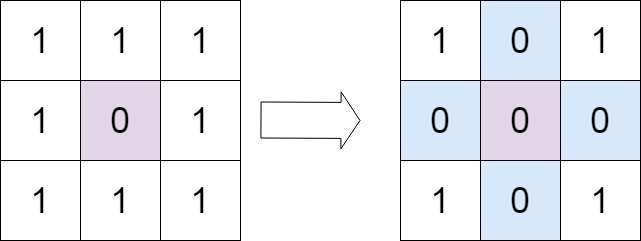

**输入：**matrix = \[\[1,1,1\],\[1,0,1\],\[1,1,1\]\]
**输出：**\[\[1,0,1\],\[0,0,0\],\[1,0,1\]\]

**示例 2：**


**输入：**matrix = \[\[0,1,2,0\],\[3,4,5,2\],\[1,3,1,5\]\]
**输出：**\[\[0,0,0,0\],\[0,4,5,0\],\[0,3,1,0\]\]

**提示：**

- `m == matrix.length`

- `n == matrix[0].length`

- `1 <= m, n <= 200`

- `-2(31) <= matrix[i][j] <= 2(31) - 1`

**进阶：**

- 一个直观的解决方案是使用  `O(`*`mn`*`)` 的额外空间，但这并不是一个好的解决方案。

- 一个简单的改进方案是使用 `O(`*`m`*` + `*`n`*`)` 的额外空间，但这仍然不是最好的解决方案。

- 你能想出一个仅使用常量空间的解决方案吗？

answer：

 用：

```text
第一行 + 第一列
```

来当“标记位”

---

 举个感觉

当你发现：

```text
matrix[i][j] == 0
```

你可以：

```text
把 matrix[i][0] 设为 0  → 表示第 i 行要清零
把 matrix[0][j] 设为 0  → 表示第 j 列要清零
```

 相当于“借用第一行第一列做标记”

---

#### （容易踩坑的点！）

[注意] 问题来了：

如果第一行本来就有 0 怎么办？

如果第一列本来就有 0 怎么办？

 你需要两个变量：

```text
row0 = 第一行是否原本有0
col0 = 第一列是否原本有0
```

---

#### 操作顺序（很关键）

整个流程其实是：

```text
1 先扫描一遍 → 用第一行第一列做标记
2 再根据标记，把中间区域置0（注意 不要把第一行和第一列归零了 从1开始）
3 最后处理第一行、第一列
```

---

#### 中间区域怎么处理？

从：

```text
i = 1 开始
j = 1 开始
```

 如果：

```text
matrix[i][0] == 0 或 matrix[0][j] == 0
```

 就把：

```text
matrix[i][j] = 0
```

```java

public class Solution {
    public void setZeroes(int[][] matrix) {
        boolean isRow = false;
        boolean isCol = false;
        for (int i = 0; i < matrix.length; i++) {
            for (int j = 0; j < matrix[i].length; j++) {
                if (i == 0 && matrix[i][j] == 0) {
                    isRow = true;
                }
                if (j == 0 && matrix[i][j] == 0) {
                    isCol = true;
                }
                if (i != 0 && j != 0 && matrix[i][j] == 0) {
                    matrix[0][j] = 0;
                    matrix[i][0] = 0;
                }
            }
        }
        for (int i = 1; i < matrix.length; i++) {
            if (matrix[i][0] == 0) {
                for (int j = 1; j < matrix[i].length; j++) {
                    matrix[i][j] = 0;
                }
            }
        }
        for (int i = 1; i < matrix[0].length; i++) {
            if (matrix[0][i] == 0) {
                for (int j = 1; j < matrix.length; j++) {
                    matrix[j][i] = 0;
                }
            }
        }
        if (isRow) {
            for (int i = 0; i < matrix[0].length; i++) {
                matrix[0][i] = 0;
            }
        }
        if (isCol) {
            for (int i = 0; i < matrix.length; i++) {
                matrix[i][0] = 0;
            }
        }
    }
}

```

<a id="problem-019"></a>

### [54. 螺旋矩阵](https://leetcode.cn/problems/spiral-matrix/) mid

<https://leetcode.cn/problems/spiral-matrix/description/?envType=study-plan-v2&envId=top-100-liked>

给你一个 `m` 行 `n` 列的矩阵 `matrix` ，请按照 **顺时针螺旋顺序** ，返回矩阵中的所有元素。

**示例 1：**

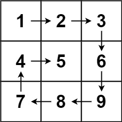

**输入：**matrix = \[\[1,2,3\],\[4,5,6\],\[7,8,9\]\]
**输出：**\[1,2,3,6,9,8,7,4,5\]

**示例 2：**


**输入：**matrix = \[\[1,2,3,4\],\[5,6,7,8\],\[9,10,11,12\]\]
**输出：**\[1,2,3,4,8,12,11,10,9,5,6,7\]

**提示：**

- `m == matrix.length`

- `n == matrix[i].length`

- `1 <= m, n <= 10`

- `-100 <= matrix[i][j] <= 100`

answer：

#### 提示一：不要想着“走”，要想着“收边界”

与其模拟方向（右→下→左→上），不如换个更稳的视角：

>  用四条边把当前“还没遍历的区域”圈起来
>
>

```text
top    → 上边界
bottom → 下边界
left   → 左边界
right  → 右边界
```

---

#### 提示二：每一轮干四件事（顺时针）

在当前边界内，依次走：

```text
1 从 left → right  （top 行）
2 从 top+1 → bottom（right 列）
3 从 right-1 → left（bottom 行）
4 从 bottom-1 → top（left 列）
```

 一圈走完，相当于“剥掉一层壳”

---

#### 提示三：每走完一条边，要“收缩边界”

```text
top++
right--
bottom--
left++
```

像把框往里收紧一圈

---

#### [注意] 提示四：最容易错的地方（重点！！）

不是每一圈都有 4 条边！

比如：

```text
只有一行 或 只有一列
```

 所以在走第 3、4 步之前要判断：

```text
if (top <= bottom) 才能走第3步
if (left <= right) 才能走第4步
```

---

#### 提示五：循环什么时候结束？

```text
while (top <= bottom && left <= right)
```

 边界“撞上了”，就结束

```java
class Solution {
    public List<Integer> spiralOrder(int[][] matrix) {
        int top = 0;
        int right = matrix[0].length - 1;
        int bottom = matrix.length - 1;
        int left = 0;
        List<Integer> res = new ArrayList<>();
        while (top <= bottom && left <= right) {
            //走top
            for (int i = left; i <= right; i++) {
                res.add(matrix[top][i]);
            }
            top++;
            **//走right
            for (int i = top; i <= bottom; i++) {
                res.add(matrix[i][right]);
            }
            right--;
            **//3,4步要判断是否越界  因为1,2步总是可以走的
            //注意走bottom判断的是top<=bottom
            //走bottom
            if (top <= bottom) {
                for (int i = right; i >= left; i--) {
                    res.add(matrix[bottom][i]);
                }
            }
            bottom--;
            **//走left
            if (left <= right) {
                for (int i = bottom; i >= top; i--) {
                    res.add(matrix[i][left]);
                }
            }
            left++;
        }
        return res;
    }
}
```

<a id="problem-020"></a>

### [48. 旋转图像](https://leetcode.cn/problems/rotate-image/) mid

<https://leetcode.cn/problems/rotate-image/description/?envType=study-plan-v2&envId=top-100-liked>

给定一个 *n *× *n* 的二维矩阵 `matrix` 表示一个图像。请你将图像顺时针旋转 90 度。

你必须在[**原地**](https://baike.baidu.com/item/%E5%8E%9F%E5%9C%B0%E7%AE%97%E6%B3%95) 旋转图像，这意味着你需要直接修改输入的二维矩阵。**请不要** 使用另一个矩阵来旋转图像。

**示例 1：**


**输入：**matrix = \[\[1,2,3\],\[4,5,6\],\[7,8,9\]\]
**输出：**\[\[7,4,1\],\[8,5,2\],\[9,6,3\]\]

**示例 2：**

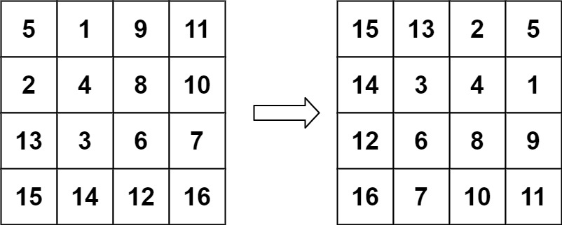

**输入：**matrix = \[\[5,1,9,11\],\[2,4,8,10\],\[13,3,6,7\],\[15,14,12,16\]\]
**输出：**\[\[15,13,2,5\],\[14,3,4,1\],\[12,6,8,9\],\[16,7,10,11\]\]

**提示：**

- `n == matrix.length == matrix[i].length`

- `1 <= n <= 20`

- `-1000 <= matrix[i][j] <= 1000`

answer：

我们观察最终结果：

```text
[7 4 1]
[8 5 2]
[9 6 3]
```

 第一列 `[7,4,1]`
 其实是原来的第一行 `[1,2,3]` **反过来变成一列**

上下翻转 + 主对角线转置（左上到右下那条）

```java
public class Solution {
    public void rotate(int[][] matrix) {

        //上下反转
        for (int i = 0, j = matrix.length - 1; i <= j; i++, j--) {
            for (int x = 0; x < matrix[i].length; x++) {
                int t = matrix[j][x];
                matrix[j][x] = matrix[i][x];
                matrix[i][x] = t;
            }
        }

        //主对角线转置
        for (int i = 0; i < matrix.length; i++) {
            for (int j = 0; j <= i; j++) {
                int t = matrix[j][i];
                matrix[j][i] = matrix[i][j];
                matrix[i][j] = t;
            }
        }
    }
}

```

<a id="problem-021"></a>

### [240. 搜索二维矩阵 II](https://leetcode.cn/problems/search-a-2d-matrix-ii/) mid

<https://leetcode.cn/problems/search-a-2d-matrix-ii/description/?envType=study-plan-v2&envId=top-100-liked>

编写一个高效的算法来搜索 *`m`*` x `*`n`* 矩阵 `matrix` 中的一个目标值 `target` 。该矩阵具有以下特性：

- 每行的元素从左到右升序排列。

- 每列的元素从上到下升序排列。

**示例 1：**

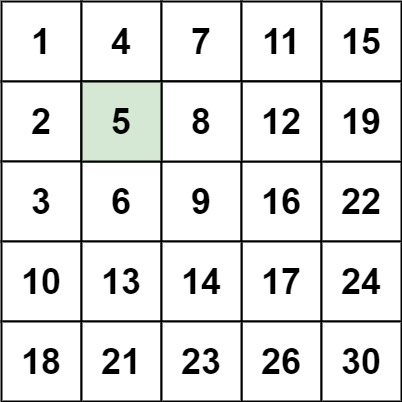

**输入：**matrix = \[\[1,4,7,11,15\],\[2,5,8,12,19\],\[3,6,9,16,22\],\[10,13,14,17,24\],\[18,21,23,26,30\]\], target = 5
**输出：**true

**示例 2：**

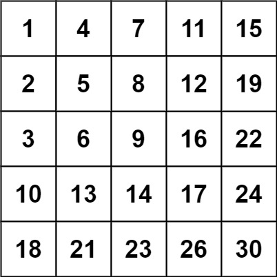

**输入：**matrix = \[\[1,4,7,11,15\],\[2,5,8,12,19\],\[3,6,9,16,22\],\[10,13,14,17,24\],\[18,21,23,26,30\]\], target = 20
**输出：**false

**提示：**

- `m == matrix.length`

- `n == matrix[i].length`

- `1 <= n, m <= 300`

- `-10(9) <= matrix[i][j] <= 10(9)`

- 每行的所有元素从左到右升序排列

- 每列的所有元素从上到下升序排列

- `-10(9) <= target <= 10(9)`

answer：

不要从左上角开始（信息不够），

选这个位置：右上角  (0, n-1)

拆成只有左和下两个方向

#### 三种情况：

##### ① 找到了

```text
cur == target → return true
```

---

##### ② cur 太大

```text
cur > target
```

 当前这一列下面都更大 [错误]

 所以：

```text
向左走（j--）
```

---

##### ③ cur 太小

```text
cur < target
```

 当前这一行左边都更小 [错误]

 所以：

```text
向下走（i++）
```

---

#### 提示三：什么时候结束？

当：

```text
i 越界（>= m）
或 j 越界（< 0）
```

 说明已经没路可走了 → return false

复杂度O(m+n)

```java

public class Solution {
    public boolean searchMatrix(int[][] matrix, int target) {
        for (int i = 0, j = matrix[0].length - 1; i < matrix.length && j >= 0; ) {
            int cur = matrix[i][j];
            if (cur == target) {
                return true;
            }
            if (cur > target) {
                j--;
                continue;
            }
            if (cur < target) {
                i++;
            }
        }
        return false;
    }
}

```

<a id="chapter-07"></a>

## 7. 链表

<a id="problem-022"></a>

### [160. 相交链表](https://leetcode.cn/problems/intersection-of-two-linked-lists/) easy

<https://leetcode.cn/problems/intersection-of-two-linked-lists/description/?envType=study-plan-v2&envId=top-100-liked>

给你两个单链表的头节点 `headA` 和 `headB` ，请你找出并返回两个单链表相交的起始节点。如果两个链表不存在相交节点，返回 `null` 。

图示两个链表在节点 `c1` 开始相交**：**

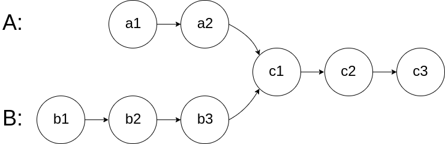

题目数据 **保证** 整个链式结构中不存在环。

**注意**，函数返回结果后，链表必须**保持其原始结构** 。

**自定义评测：**

**评测系统**的输入如下（你设计的程序** 不适用** 此输入）：

- `intersectVal` - 相交的起始节点的值。如果不存在相交节点，这一值为 `0`

- `listA` - 第一个链表

- `listB` - 第二个链表

- `skipA` - 在 `listA` 中（从头节点开始）跳到交叉节点的节点数

- `skipB` - 在 `listB` 中（从头节点开始）跳到交叉节点的节点数

评测系统将根据这些输入创建链式数据结构，并将两个头节点 `headA` 和 `headB` 传递给你的程序。如果程序能够正确返回相交节点，那么你的解决方案将被 **视作正确答案** 。

**示例 1：**


**输入：**intersectVal = 8, listA = \[4,1,8,4,5\], listB = \[5,6,1,8,4,5\], skipA = 2, skipB = 3
**输出：**Intersected at '8'
**解释：**相交节点的值为 8 （注意，如果两个链表相交则不能为 0）。
从各自的表头开始算起，链表 A 为 \[4,1,8,4,5\]，链表 B 为 \[5,6,1,8,4,5\]。
在 A 中，相交节点前有 2 个节点；在 B 中，相交节点前有 3 个节点。
— 请注意相交节点的值不为 1，因为在链表 A 和链表 B 之中值为 1 的节点 (A 中第二个节点和 B 中第三个节点) 是不同的节点。换句话说，它们在内存中指向两个不同的位置，而链表 A 和链表 B 中值为 8 的节点 (A 中第三个节点，B 中第四个节点) 在内存中指向相同的位置。

**示例 2：**

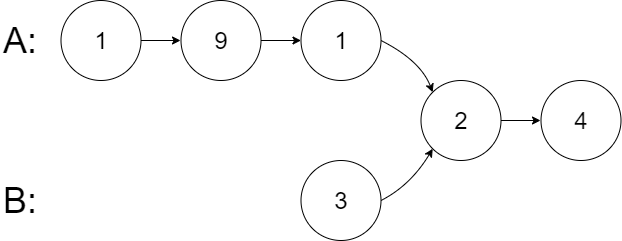

**输入：**intersectVal = 2, listA = \[1,9,1,2,4\], listB = \[3,2,4\], skipA = 3, skipB = 1
**输出：**Intersected at '2'
**解释：**相交节点的值为 2 （注意，如果两个链表相交则不能为 0）。
从各自的表头开始算起，链表 A 为 \[1,9,1,2,4\]，链表 B 为 \[3,2,4\]。
在 A 中，相交节点前有 3 个节点；在 B 中，相交节点前有 1 个节点。

**示例 3：**

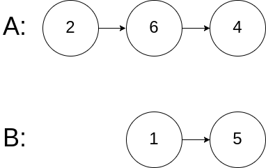

**输入：**intersectVal = 0, listA = \[2,6,4\], listB = \[1,5\], skipA = 3, skipB = 2
**输出：**No intersection
**解释：**从各自的表头开始算起，链表 A 为 \[2,6,4\]，链表 B 为 \[1,5\]。
由于这两个链表不相交，所以 intersectVal 必须为 0，而 skipA 和 skipB 可以是任意值。
这两个链表不相交，因此返回 null 。

**提示：**

- `listA` 中节点数目为 `m`

- `listB` 中节点数目为 `n`

- `1 <= m, n <= 3 * 10(4)`

- `1 <= Node.val <= 10(5)`

- `0 <= skipA <= m`

- `0 <= skipB <= n`

- 如果 `listA` 和 `listB` 没有交点，`intersectVal` 为 `0`

- 如果 `listA` 和 `listB` 有交点，`intersectVal == listA[skipA] == listB[skipB]`

**进阶：**你能否设计一个时间复杂度 `O(m + n)` 、仅用 `O(1)` 内存的解决方案？

answer：

常规方法 hashset 略 空间复杂度O(m) 时间复杂度O(m+n)

#### 双指针 空间复杂度O(1)  时间复杂度O(m+n):

！注意 相交节点是同一个 意味着在这之后a与b是一条链

pA: a1 → a2 → c1 → c2 → c3 → null → b1 → b2 → b3 → c1 ...

pB: b1 → b2 → b3 → c1 → c2 → c3 → null → a1 → a2 → c1 ...

pA 走的总路径 = A + B

pB 走的总路径 = B + A  总长度一样！

pA = (pA == null) ? headB : pA.next;

pB = (pB == null) ? headA : pB.next;

```java
public class Solution {
    public ListNode getIntersectionNode(ListNode headA, ListNode headB) {
        ListNode pA = headA;
        ListNode pB = headB;
        while (headA != null || headB != null) {
            if (pA == pB) {
                return pA;
            }
            pA = pA == null ? headB : pA.next;
            pB = pB == null ? headA : pB.next;
        }
        return null;
    }
}
```

<a id="problem-023"></a>

### [206. 反转链表](https://leetcode.cn/problems/reverse-linked-list/)  easy

<https://leetcode.cn/problems/reverse-linked-list/description/?envType=study-plan-v2&envId=top-100-liked>

给你单链表的头节点 `head` ，请你反转链表，并返回反转后的链表。

**示例 1：**

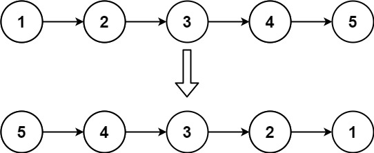

**输入：**head = \[1,2,3,4,5\]
**输出：**\[5,4,3,2,1\]

**示例 2：**


**输入：**head = \[1,2\]
**输出：**\[2,1\]

**示例 3：**

**输入：**head = \[\]
**输出：**\[\]

**提示：**

- 链表中节点的数目范围是 `[0, 5000]`

- `-5000 <= Node.val <= 5000`

**进阶：**链表可以选用迭代或递归方式完成反转。你能否用两种方法解决这道题？

answer：

不要想着把下个节点放到pre前面去  想着把下个节点指向pre，cur是当前节点（要改指向的）  pre是新头结点  next是cur的next

#### 先想象链表长这样

```text
1 -> 2 -> 3 -> 4 -> null
```

你想把它变成：

```text
4 -> 3 -> 2 -> 1 -> null
```

本质上你在干嘛？

就是把每个节点的“手”（next 指针）**掰向前一个人**。

---

#### 三个角色（一定记住）

```text
pre   cur   next
```

可以理解成：

- `pre`：前任（已经反转好的部分）

- `cur`：现任（正在处理的人）

- `next`：备胎（先存着，不然等会找不到了）

哈哈虽然名字怪，但特别好记。

---

#### 初始状态：

```text
null <- pre    cur -> 1 -> 2 -> 3 -> 4
               ^
```

代码：

```text
ListNode pre = null;
ListNode cur = head;
```

---

#### 每一步干啥？

就三件事：

#### ① 先存 next（怕丢）

```text
next = cur.next;
```

因为你马上要改 `cur.next`，不存就断链了。

---

#### ② 掰方向

原来：

```text
1 -> 2
```

改成：

```text
1 -> null
```

代码：

```text
cur.next = pre;
```

---

#### ③ 整体往前走

```text
pre = cur;
cur = next;
```

意思：

- pre 扩大地盘

- cur 去处理下一个

---

#### 动画感受一下

---

第一轮：

```text
null <- 1    2 -> 3 -> 4
```

---

第二轮：

```text
null <- 1 <- 2    3 -> 4
```

---

第三轮：

```text
null <- 1 <- 2 <- 3    4
```

---

第四轮：

```text
null <- 1 <- 2 <- 3 <- 4
```

结束。

`pre` 就是新头节点。

```java
public class Solution {
    public ListNode reverseList(ListNode head) {
        if (head == null) {
            return null;
        }
        ListNode p = head;
        ListNode q = p.next;
        head.next = null;//断开原链 不然会形成环
        while (q != null) {
            ListNode next = q.next;
            q.next = p;
            p = q;
            q = next;
        }
        return p;
    }
}
```

<a id="problem-024"></a>

### [234. 回文链表](https://leetcode.cn/problems/palindrome-linked-list/) easy

<https://leetcode.cn/problems/palindrome-linked-list/description/?envType=study-plan-v2&envId=top-100-liked>

给你一个单链表的头节点 `head` ，请你判断该链表是否为回文链表。如果是，返回 `true` ；否则，返回 `false` 。

**示例 1：**


**输入：**head = \[1,2,2,1\]
**输出：**true

**示例 2：**


**输入：**head = \[1,2\]
**输出：**false

**提示：**

- 链表中节点数目在范围`[1, 10(5)]` 内

- `0 <= Node.val <= 9`

**进阶：**你能否用 `O(n)` 时间复杂度和 `O(1)` 空间复杂度解决此题？

answer：

O(1)解法：快慢指针找中点

#### 提示一：怎么找“中点”？

用经典快慢指针：

```text
slow 一步
fast 两步
```

 当 fast 走到头：

```text
slow 就在中点
```

---

 注意奇偶：

```text
[1,2,2,1]   → slow 在第一个 2
[1,2,3,2,1] → slow 在 3
```

 如果是奇数长度：

```text
可以跳过中间那个点（它不用比）
```

---

#### 提示二：反转后半段

从 slow 开始：

```text
slow → end
```

 把这一段反转（就是你刚写的反转链表那题！）

---

#### 提示三：开始对比

现在结构变成：

```text
前半段：head → ...
后半段：newHead → ...
```

 一起走：

```text
逐个比较值是否相等
```

---

#### 提示四：什么时候停？

```text
只需要走“后半段长度”
```

 因为后半段更短或相等

```java
class Solution {
    public boolean isPalindrome(ListNode head) {
        ListNode slow = head;
        ListNode fast = head;
        boolean isOdd = false;
        while (fast != null) {
            if (fast.next != null) {
                if (fast.next.next != null) {
                    fast = fast.next.next;
                    slow = slow.next;
                } else {
                    fast = fast.next;
                    slow = slow.next;
                    break;
                }
            } else {//容易思考奇偶的判定逻辑
                isOdd = true;
                break;
            }
        }
        if (isOdd) {//容易思考奇偶的反转(slow)位置
            fast = reverse(slow.next);
        } else {
            fast = reverse(slow);
        }//复用slow和fast
        slow = head;
        while (fast != null) {//遍历的次数是反转的后半截链表的长度
            if (fast.val != slow.val) {
                return false;
            }
            slow = slow.next;
            fast = fast.next;
        }
        return true;
    }

    public ListNode reverse(ListNode head) {
        ListNode pre = null;
        ListNode cur = head;
        while (cur != null) {
            ListNode t = cur.next;
            cur.next = pre;
            pre = cur;
            cur = t;
        }
        return pre;
    }
}
```

<a id="problem-025"></a>

### [141. 环形链表](https://leetcode.cn/problems/linked-list-cycle/) easy

[https://leetcode.cn/problems/linked-list-cycle/description/?envType=study-plan-v2&envId=top-100-liked](https://leetcode.cn/problems/linked-list-cycle/description/?envType=study-plan-v2&envId=top-100-liked)

给你一个链表的头节点 `head` ，判断链表中是否有环。

如果链表中有某个节点，可以通过连续跟踪 `next` 指针再次到达，则链表中存在环。 为了表示给定链表中的环，评测系统内部使用整数 `pos` 来表示链表尾连接到链表中的位置（索引从 0 开始）。注意：`pos` 不作为参数进行传递 。仅仅是为了标识链表的实际情况。

*如果链表中存在环* ，则返回 `true` 。 否则，返回 `false` 。

**示例 1：**


**输入：**head = \[3,2,0,-4\], pos = 1
**输出：**true
**解释：**链表中有一个环，其尾部连接到第二个节点。

**示例 2：**


**输入：**head = \[1,2\], pos = 0
**输出：**true
**解释：**链表中有一个环，其尾部连接到第一个节点。

**示例 3：**


**输入：**head = \[1\], pos = -1
**输出：**false
**解释：**链表中没有环。

**提示：**

- 链表中节点的数目范围是 `[0, 10(4)]`

- `-10(5) <= Node.val <= 10(5)`

- `pos` 为 `-1` 或者链表中的一个 **有效索引** 。

**进阶：**你能用 `O(1)`（即，常量）内存解决此问题吗？

answer：

快慢指针秒了  如果没环，慢指针永远不会追上快指针，快指针永远不会为null

```java
public class Solution {
    public boolean hasCycle(ListNode head) {
        if (head == null) return false;
        ListNode slow = head;
        ListNode fast = head;
        while (fast != null) {
            slow = slow.next;
            fast = fast.next;
            if (fast == null) return false;
            fast = fast.next;
            if (slow == fast) return true;
        }
        return false;
    }
}
```

<a id="problem-026"></a>

### [142. 环形链表 II](https://leetcode.cn/problems/linked-list-cycle-ii/) mid

<https://leetcode.cn/problems/linked-list-cycle-ii/description/?envType=study-plan-v2&envId=top-100-liked>

给定一个链表的头节点  `head` ，返回链表开始入环的第一个节点。 *如果链表无环，则返回 **`null`**。*

如果链表中有某个节点，可以通过连续跟踪 `next` 指针再次到达，则链表中存在环。 为了表示给定链表中的环，评测系统内部使用整数 `pos` 来表示链表尾连接到链表中的位置（索引从 0 开始）。如果 `pos` 是 `-1`，则在该链表中没有环。注意：`pos` 不作为参数进行传递，仅仅是为了标识链表的实际情况。

**不允许修改** 链表。

**示例 1：**


**输入：**head = \[3,2,0,-4\], pos = 1
**输出：**返回索引为 1 的链表节点
**解释：**链表中有一个环，其尾部连接到第二个节点。

**示例 2：**


**输入：**head = \[1,2\], pos = 0
**输出：**返回索引为 0 的链表节点
**解释：**链表中有一个环，其尾部连接到第一个节点。

**示例 3：**


**输入：**head = \[1\], pos = -1
**输出：**返回 null
**解释：**链表中没有环。

**提示：**

- 链表中节点的数目范围在范围 `[0, 10(4)]` 内

- `-10(5) <= Node.val <= 10(5)`

- `pos` 的值为 `-1` 或者链表中的一个有效索引

**进阶：**你是否可以使用 `O(1)` 空间解决此题？

answer：

先快慢指针，让它们在环上的同一节点相遇 然后：

#### 我们先把过程“定量化”一点点

设几个距离（就像在画一张温柔的小地图）：

- 头节点 → 入环点：**a**

- 入环点 → 相遇点：**b**

- 环剩下那一段：**c**

整个环长度：
  `b + c`

---

#### 第一步：相遇那一刻发生了什么？

- slow 每次走 1 步

- fast 每次走 2 步

假设相遇时：

 slow 走了：`a + b`
  fast 走了：`2(a + b)`

但注意——

fast 是在“绕圈追人”，所以它其实多走了若干圈：

 fast 走的路 = slow + n圈环

写成式子就是：

```text
2(a + b) = (a + b) + n(b + c)
```

---

#### 第二步：化简这个关系

我们轻轻整理一下：

```text
a + b = n(b + c)
```

再变一下：

```text
a = n(b + c) - b
a = (n-1)(b + c) + c
```

---

#### 这一行就是“奇迹”

```text
a = (n-1)(环长度) + c
```

什么意思？

 **从头走到入口的距离 a**
  等于：

- 绕 (n-1) 圈

- 再走一段 **c**

---

#### 把它翻译成人话

现在你有两个指针：

#### 指针1（从 head 出发）

走 **a 步** → 到入口

---

#### 指针2（从相遇点出发）

它现在在“相遇点”，距离入口还有：

 **c 步**

但注意！

它可以在环里继续绕：

 `(n-1)圈 + c`

---

#### 然后神奇的事情发生了

如果两个人都“一步一步走”：

- 指针1：走 a 步 → 到入口

- 指针2：走 `(n-1)圈 + c` → 也到入口

 **两人同时到达入口！**

---

#### 直觉版本（不用公式的理解）

你可以这样记：

> 快指针比慢指针多跑的“那些圈”，
>  刚好把距离补成——从头走到入口。
>
>

所以：

- 一个从 head 出发

- 一个从相遇点出发

- 同速前进

```java
class Solution {
    public ListNode detectCycle(ListNode head) {
        ListNode slow = head;
        ListNode fast = head;
        while (true) {
            if (fast != null && fast.next != null) {
                fast = fast.next.next;
                slow = slow.next;
            } else {
                return null;
            }
            if (fast == slow) {
                break;
            }
        }
        slow = head;
        while (true) {
            if (slow == fast) {
                return slow;
            }
            slow = slow.next;
            fast = fast.next;
        }
    }
}
```

<a id="problem-027"></a>

### [21. 合并两个有序链表](https://leetcode.cn/problems/merge-two-sorted-lists/) easy

将两个升序链表合并为一个新的 **升序** 链表并返回。新链表是通过拼接给定的两个链表的所有节点组成的。

**示例 1：**


**输入：**l1 = \[1,2,4\], l2 = \[1,3,4\]
**输出：**\[1,1,2,3,4,4\]

**示例 2：**

**输入：**l1 = \[\], l2 = \[\]
**输出：**\[\]

**示例 3：**

**输入：**l1 = \[\], l2 = \[0\]
**输出：**\[0\]

**提示：**

- 两个链表的节点数目范围是 `[0, 50]`

- `-100 <= Node.val <= 100`

- `l1` 和 `l2` 均按 **非递减顺序** 排列

answer：

永远只操作“尾节点 next”，不乱改已有结构

用一个哑节点开头 然后返回它的next  尾节点始终指向当前链表尾

```java
class Solution {
    public ListNode mergeTwoLists(ListNode list1, ListNode list2) {
        ListNode dummy = new ListNode(-1);
        ListNode tail = dummy;

        ListNode p1 = list1;
        ListNode p2 = list2;

        while (p1 != null && p2 != null) {
            if (p1.val < p2.val) {
                tail.next = p1;
                p1 = p1.next;
            } else {
                tail.next = p2;
                p2 = p2.next;
            }
            tail = tail.next;
        }

        // 接上剩余部分
        tail.next = (p1 != null) ? p1 : p2;

        return dummy.next;
    }
}

```

```java
class Solution {
    public ListNode mergeTwoLists(ListNode list1, ListNode list2) {
        ListNode virtual = new ListNode();
        ListNode cur = virtual;
        ListNode cur1 = list1;
        ListNode cur2 = list2;
        while (cur1 != null && cur2 != null) {
            if (cur1.val < cur2.val) {
                cur.next = cur1;
                ListNode t = cur1.next;
                cur1.next = null;
                cur1 = t;
                cur = cur.next;
            } else {
                cur.next = cur2;
                ListNode t = cur2.next;
                cur2.next = null;
                cur2 = t;
                cur = cur.next;
            }
        }
        if (cur1 == null && cur2 != null) {
            cur.next = cur2;
        } else if (cur1 != null && cur2 == null) {
            cur.next = cur1;
        }
        return virtual.next;
    }
}
```

<a id="problem-028"></a>

### [2. 两数相加](https://leetcode.cn/problems/add-two-numbers/) mid

<https://leetcode.cn/problems/add-two-numbers/description/?envType=study-plan-v2&envId=top-100-liked>

给你两个 **非空**的链表，表示两个非负的整数。它们每位数字都是按照** 逆序**的方式存储的，并且每个节点只能存储** 一位** 数字。

请你将两个数相加，并以相同形式返回一个表示和的链表。

你可以假设除了数字 0 之外，这两个数都不会以 0 开头。

**示例 1：**

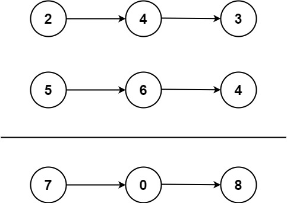

**输入：**l1 = \[2,4,3\], l2 = \[5,6,4\]
**输出：**\[7,0,8\]
**解释：**342 + 465 = 807.

**示例 2：**

**输入：**l1 = \[0\], l2 = \[0\]
**输出：**\[0\]

**示例 3：**

**输入：**l1 = \[9,9,9,9,9,9,9\], l2 = \[9,9,9,9\]
**输出：**\[8,9,9,9,0,0,0,1\]

**提示：**

- 每个链表中的节点数在范围 `[1, 100]` 内

- `0 <= Node.val <= 9`

- 题目数据保证列表表示的数字不含前导零

answer：

你就想象两个链表是这样：

```text
2 -> 4 -> 3   （342）
5 -> 6 -> 4   （465）
```

 从头开始加：

```text
2 + 5 = 7
4 + 6 = 10 → 写0，进1
3 + 4 + 1 = 8
```

用carry表示进位的数

```java
class Solution {
    public ListNode addTwoNumbers(ListNode l1, ListNode l2) {
        int carry = 0;
        int sum = 0;
        ListNode virtual = new ListNode();
        ListNode cur = virtual;
        while (l1 != null || l2 != null) {
            sum = (l1 == null ? 0 : l1.val) + (l2 == null ? 0 : l2.val) + carry;
            carry = sum / 10;
            cur.next = new ListNode(sum % 10);
            cur = cur.next;
            l1 = l1 == null ? null : l1.next;
            l2 = l2 == null ? null : l2.next;
        }
        if (carry != 0) {
            cur.next = new ListNode(carry);
        }
        return virtual.next;
    }
}
```

<a id="problem-029"></a>

### [19. 删除链表的倒数第 N 个结点](https://leetcode.cn/problems/remove-nth-node-from-end-of-list/) mid

<https://leetcode.cn/problems/remove-nth-node-from-end-of-list/description/?envType=study-plan-v2&envId=top-100-liked>

给你一个链表，删除链表的倒数第 `n`* *个结点，并且返回链表的头结点。

**示例 1：**


**输入：**head = \[1,2,3,4,5\], n = 2
**输出：**\[1,2,3,5\]

**示例 2：**

**输入：**head = \[1\], n = 1
**输出：**\[\]

**示例 3：**

**输入：**head = \[1,2\], n = 1
**输出：**\[1\]

**提示：**

- 链表中结点的数目为 `sz`

- `1 <= sz <= 30`

- `0 <= Node.val <= 100`

- `1 <= n <= sz`

**进阶：**你能尝试使用一趟扫描实现吗？

answer：

核心：快慢指针   快指针先走n次 步长1  快指针走到头 慢指针刚好在倒数第n节点前一个

因为我们要做：slow.next = slow.next.next

 所以 slow 必须停在“前一个位置”

#### 但有个很关键的坑（必须注意）

如果要删除的是：

 **头节点（比如 n = 链表长度）**

那： slow 根本没有“前一个”  而且fast会空指针

 所以有个经典技巧

#### 加一个 **dummy（虚拟头节点）**

```text
dummy -> head
```

这样：

- 删除头节点也统一处理

- 不需要特殊判断

- 注意是fast先走n  再开始同时动

```java
class Solution {
    public ListNode removeNthFromEnd(ListNode head, int n) {
        ListNode virtual = new ListNode();
        virtual.next = head;
        ListNode pre = virtual;
        ListNode slow = virtual;
        ListNode fast = virtual;
        for (int i = 1; i <= n; i++) {
            if (fast == null) {
                break;
            }
            fast = fast.next;
        }
        while (fast != null) {
            fast = fast.next;
            pre = slow;
            slow = slow.next;
        }
        pre.next = slow.next;
        return virtual.next;
    }
}
```

<a id="problem-030"></a>

### [24. 两两交换链表中的节点](https://leetcode.cn/problems/swap-nodes-in-pairs/) mid

<https://leetcode.cn/problems/swap-nodes-in-pairs/description/?envType=study-plan-v2&envId=top-100-liked>

给你一个链表，两两交换其中相邻的节点，并返回交换后链表的头节点。你必须在不修改节点内部的值的情况下完成本题（即，只能进行节点交换）。

**示例 1：**

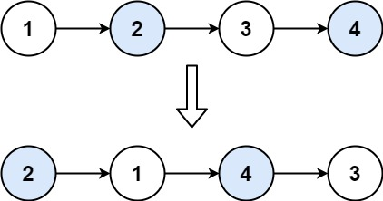

**输入：**head = \[1,2,3,4\]
**输出：**\[2,1,4,3\]

**示例 2：**

**输入：**head = \[\]
**输出：**\[\]

**示例 3：**

**输入：**head = \[1\]
**输出：**\[1\]

**提示：**

- 链表中节点的数目在范围 `[0, 100]` 内

- `0 <= Node.val <= 100`

answer：

#### 正确思路（非常关键）

你需要 3 个角色：

- `dummy`  虚拟头（掌控全局）

- `prev`  前一个节点（负责连接）

- `cur`  当前处理的第一个节点

---

#### 每一轮你要做什么？

假设现在是：

```text
prev -> a -> b -> next
```

你要变成：

```text
prev -> b -> a -> next
```

---

#### 操作顺序（顺序不能错！）

```text
1. prev.next = b
2. a.next = next
3. b.next = a
```

然后：

```text
prev = a
cur = a.next
```

#### 1. dummy 解决头节点问题

 不用纠结“第一个节点怎么办”

---

#### 2. prev 永远指向“已处理部分的尾巴”

 每次都能接上新结构

---

#### 3. 每次只处理一对

 不会把链表搞乱

```java
public class Solution {
    public ListNode swapPairs(ListNode head) {
        if (head == null) {
            return null;
        }
        ListNode virtual = new ListNode(0);
        virtual.next = head;
        ListNode pre = virtual;
        ListNode next = null;
        ListNode cur = virtual.next;
        while (cur != null && cur.next != null) {
            pre.next = cur.next;
            next = cur.next.next;
            cur.next.next = cur;
            cur.next = next;
            pre = cur;
            cur = cur.next;
        }
        return virtual.next;
    }
}
```

仔细思考  很好想通  交换过后 l下一个为新l  再下一个为新r  pre从virtual开始

```java
class Solution {
    public ListNode swapPairs(ListNode head) {
        if (head == null || head.next == null) {
            return head;
        }
        ListNode virtual = new ListNode();
        ListNode pre = virtual;
        ListNode l = head;
        ListNode r = l.next;
        while (r != null) {
            ListNode rn = r.next;
            r.next = l;
            l.next = rn;
            pre.next = r;
            pre = l;
            l = l.next;
            if (l == null) {
                break;
            }
            r = l.next;
        }
        return virtual.next;
    }
}
```

<a id="problem-031"></a>

### [25. K 个一组翻转链表](https://leetcode.cn/problems/reverse-nodes-in-k-group/) hard

给你链表的头节点 `head` ，每 `k`* *个节点一组进行翻转，请你返回修改后的链表。

`k` 是一个正整数，它的值小于或等于链表的长度。如果节点总数不是 `k`* *的整数倍，那么请将最后剩余的节点保持原有顺序。

你不能只是单纯的改变节点内部的值，而是需要实际进行节点交换。

**示例 1：**

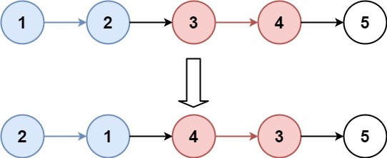

**输入：**head = \[1,2,3,4,5\], k = 2
**输出：**\[2,1,4,3,5\]

**示例 2：**


**输入：**head = \[1,2,3,4,5\], k = 3
**输出：**\[3,2,1,4,5\]

**提示：**

- 链表中的节点数目为 `n`

- `1 <= k <= n <= 5000`

- `0 <= Node.val <= 1000`

**进阶：**你可以设计一个只用 `O(1)` 额外内存空间的算法解决此问题吗？

answer：

#### 正确的节奏应该是这样

像呼吸一样平稳：

**先让 fast 走 k 步**

1. 判断够不够一组

2. slow 才是当前组起点

3. 反转 `[slow, fast]`

4. pre 移到 slow（反转后变尾）

好好理解 容易思考的

重点：反转后 slow和left位置会交换 注意更新它们的逻辑 不要忘记pre

```java
class Solution {
    public ListNode reverseKGroup(ListNode head, int k) {
        ListNode virtual = new ListNode();
        virtual.next = head;
        ListNode slow = virtual;
        ListNode fast = virtual;
        ListNode pre = virtual;
        while (true) {
            for (int i = 1; i <= k; i++) {
                fast = fast.next;
                if (fast == null) {
                    return virtual.next;
                }
            }
            ListNode next = fast.next;
            slow = slow.next;
            pre.next = reverse(slow, fast);
            fast = slow;
            pre = slow;
            fast.next = next;
            if (slow.next == null) {
                break;
            }
        }
        return virtual.next;
    }

    public ListNode reverse(ListNode slow, ListNode fast) {
        ListNode cur = slow;
        ListNode pre = null;
        while (true) {
            ListNode next = cur.next;
            cur.next = pre;
            pre = cur;
            if (cur == fast) {
                break;
            }
            cur = next;
        }
        return pre;
    }
}
```

<a id="problem-032"></a>

### [138. 随机链表的复制](https://leetcode.cn/problems/copy-list-with-random-pointer/) mid

<https://leetcode.cn/problems/copy-list-with-random-pointer/description/?envType=study-plan-v2&envId=top-100-liked>

给你一个长度为 `n` 的链表，每个节点包含一个额外增加的随机指针 `random` ，该指针可以指向链表中的任何节点或空节点。

构造这个链表的 [**深拷贝**](https://baike.baidu.com/item/%E6%B7%B1%E6%8B%B7%E8%B4%9D/22785317?fr=aladdin)。 深拷贝应该正好由 `n` 个**全新** 节点组成，其中每个新节点的值都设为其对应的原节点的值。新节点的 `next` 指针和 `random` 指针也都应指向复制链表中的新节点，并使原链表和复制链表中的这些指针能够表示相同的链表状态。**复制链表中的指针都不应指向原链表中的节点** 。

例如，如果原链表中有 `X` 和 `Y` 两个节点，其中 `X.random --> Y` 。那么在复制链表中对应的两个节点 `x` 和 `y` ，同样有 `x.random --> y` 。

返回复制链表的头节点。

用一个由 `n` 个节点组成的链表来表示输入/输出中的链表。每个节点用一个 `[val, random_index]` 表示：

- `val`：一个表示 `Node.val` 的整数。

- `random_index`：随机指针指向的节点索引（范围从 `0` 到 `n-1`）；如果不指向任何节点，则为  `null` 。

你的代码 **只** 接受原链表的头节点 `head` 作为传入参数。

**示例 1：**


**输入：**head = \[\[7,null\],\[13,0\],\[11,4\],\[10,2\],\[1,0\]\]
**输出：**\[\[7,null\],\[13,0\],\[11,4\],\[10,2\],\[1,0\]\]

**示例 2：**


**输入：**head = \[\[1,1\],\[2,1\]\]
**输出：**\[\[1,1\],\[2,1\]\]

**示例 3：**


**输入：**head = \[\[3,null\],\[3,0\],\[3,null\]\]
**输出：**\[\[3,null\],\[3,0\],\[3,null\]\]

**提示：**

- `0 <= n <= 1000`

- `-10(4) <= Node.val <= 10(4)`

- `Node.random` 为 `null` 或指向链表中的节点。

answer：

```text
HashMap
```

做法是：

#### 最经典解法

时间复杂度：

```text
O(n)
```

空间复杂度：

```text
O(n)
```

因为用了 map。

---

但这题还有一个很神仙的：

#### O(1) 额外空间解法

也是面试很爱问的。

第一次看到会有种：

> “还能这样玩？！”
>
>

的感觉。

---

核心思想

把复制节点插进原链表里

比如原来：

```text
A -> B -> C
```

复制后不是单独建新链表。

而是变成：

```text
A -> A' -> B -> B' -> C -> C'
```

每个复制节点都紧跟原节点后面。

---

##### 第一步：复制并插入

遍历原链表：

```text
A.next = A'
A'.next = B
```

于是：

```text
A -> A' -> B
```

---

##### 第二步最妙

原来：

```text
A.random -> C
```

那么：

```text
A'.random -> C'
```

怎么找？

注意：

```text
C' 就在 C 后面！
```

所以：

```text
A'.random = A.random.next
```

卧槽是不是突然很优雅

---

因为：

```text
A.random       = C
A.random.next  = C'
```

直接拿到了复制节点。

---

##### 第三步

最后再把：

```text
A A' B B'
```

拆开。

恢复原链表，并抽出复制链表。

---

##### 复杂度

###### 时间

还是：

```text
O(n)
```

因为只遍历几遍链表。

---

###### 空间

```text
O(1)
```

因为没用 HashMap。

好好理解merge  要拼的不只是单节点 还可能不一样长

```java
class Solution {
    public Node copyRandomList(Node head) {
        Node cur = head;
        Node virtual = new Node(0);
        Node pre = virtual;
        while (cur != null) {
            Node next = cur.next;
            Node copy = new Node(cur.val);
            cur.next = copy;
            copy.next = next;
            cur = copy.next;
        }
        cur = head;
        while (cur != null) {
            Node copy = cur.next;
            copy.random = cur.random == null ? null : cur.random.next;
            cur = copy.next;
        }
        cur = head;
        while (cur != null) {
            Node copy = cur.next;
            pre.next = copy;
            cur.next = copy.next;
            pre = copy;
            cur = copy.next;
        }
        return virtual.next;
    }
}

```

<a id="problem-033"></a>

### [148. 排序链表](https://leetcode.cn/problems/sort-list/) mid  （重点看）

<https://leetcode.cn/problems/sort-list/description/?envType=study-plan-v2&envId=top-100-liked>

给你链表的头结点 `head` ，请将其按 **升序**排列并返回** 排序后的链表** 。

**示例 1：**


**输入：**head = \[4,2,1,3\]
**输出：**\[1,2,3,4\]

**示例 2：**


**输入：**head = \[-1,5,3,4,0\]
**输出：**\[-1,0,3,4,5\]

**示例 3：**

**输入：**head = \[\]
**输出：**\[\]

**提示：**

- 链表中节点的数目在范围 `[0, 5 * 10(4)]` 内

- `-10(5) <= Node.val <= 10(5)`

**进阶：**你可以在 `O(n log n)` 时间复杂度和常数级空间复杂度下，对链表进行排序吗？

answer：

#### 选择排序不适合这题

这题要求：

- 时间复杂度 O(n log n)

- 常数空间

而选择排序：O(n²)

5 \* 10^4 会超时。

#### 这题真正的标准答案：归并排序

链表特别适合归并排序，因为：

- 不需要随机访问

- 拆分链表很方便

- 合并有序链表也很方便

时间复杂度：O(n log n)

空间：递归版 O(log n)

---

#### 链表归并排序核心思想

像这样：

```text
4 -> 2 -> 1 -> 3

拆：

4 -> 2
1 -> 3

继续拆：

4    2
1    3

合并：

2 -> 4
1 -> 3

最后：

1 -> 2 -> 3 -> 4
```

“为啥不是 `fast = head`？”

答案先给你：

> **为了把链表尽量均匀地切成两半，并且避免某些情况下死递归。**
>
> ① 保证偶数长度时能均分
>
> ② 防止长度为 2 时死循环
>
>

```java
class Solution {
    public ListNode sortList(ListNode head) {
        if (head == null || head.next == null) {
            return head;
        }
        ListNode slow = head;
        ListNode fast = head.next;
        while (fast != null && fast.next != null) {
            fast = fast.next.next;
            slow = slow.next;
        }
        ListNode rightHead = slow.next;
        slow.next = null;
        ListNode left = sortList(head);
        ListNode right = sortList(rightHead);
        return merge(left, right);
    }

    public ListNode merge(ListNode l1, ListNode l2) {
        ListNode virtual = new ListNode();
        ListNode pre = virtual;
        while (l1 != null && l2 != null) {
            if (l1.val < l2.val) {
                pre.next = l1;
                pre = pre.next;
                l1 = l1.next;
            } else {
                pre.next = l2;
                pre = pre.next;
                l2 = l2.next;
            }
        }
        pre.next = l1 == null ? l2 : l1;
        return virtual.next;
    }
}
```

<a id="problem-034"></a>

### [23. 合并 K 个升序链表](https://leetcode.cn/problems/merge-k-sorted-lists/) hard 重点看

<https://leetcode.cn/problems/merge-k-sorted-lists/description/?envType=study-plan-v2&envId=top-100-liked>

给你一个链表数组，每个链表都已经按升序排列。

请你将所有链表合并到一个升序链表中，返回合并后的链表。

**示例 1：**

**输入：**lists = \[\[1,4,5\],\[1,3,4\],\[2,6\]\]
**输出：**\[1,1,2,3,4,4,5,6\]
**解释：**链表数组如下：
\[
  1-\>4-\>5,
  1-\>3-\>4,
  2-\>6
\]
将它们合并到一个有序链表中得到。
1-\>1-\>2-\>3-\>4-\>4-\>5-\>6

**示例 2：**

**输入：**lists = \[\]
**输出：**\[\]

**示例 3：**

**输入：**lists = \[\[\]\]
**输出：**\[\]

**提示：**

- `k == lists.length`

- `0 <= k <= 10^4`

- `0 <= lists[i].length <= 500`

- `-10^4 <= lists[i][j] <= 10^4`

- `lists[i]` 按 **升序** 排列

- `lists[i].length` 的总和不超过 `10^4`

answer：

这题其实是上一题「排序链表」的亲戚呀

因为本质就是：把多个有序链表不断合并

#### 但这里有个问题

如果你：

```text
一个一个合并
```

复杂度会偏高。

因为：

```text
每次都越来越长
```

---

#### 更优雅的方法：分治

像归并排序一样：

```text
8个链表

分：

4 + 4

再分：

2 + 2

再分：

1 + 1
```

最后再两两 merge。

---

#### 你现在应该想到：

上一题：

```text
一个链表排序
↓
拆成两半
↓
merge
```

这题：

```text
多个链表
↓
拆成两半
↓
merge
```

##### 你现在只需要写两个东西

###### ① merge(l1,l2)

这个你已经会了。

---

###### ② mergeK(lists, left, right)

思路：

```text
mid = (left + right) / 2

左边排好
右边排好

再merge
```

---

##### 递归结构长这样

```text
ListNode mergeKLists(ListNode[] lists, int l, int r)
```

里面：

```text
如果 l == r
说明只剩一个链表
直接返回
```

否则：

```text
递归处理左边
递归处理右边
最后merge
```

k 个链表  总节点数 n  复杂度：O(n log k)

```java
public class Solution {
    public ListNode mergeKLists(ListNode[] lists) {
        if (lists.length == 0) {
            return null;
        }
        return devide(lists, 0, lists.length - 1);
    }

    private ListNode devide(ListNode[] lists, int left, int right) {
        if (left == right) {
            return lists[left];
        }
        int mid = (left + right) / 2;
        ListNode leftList = devide(lists, left, mid);
        ListNode rightList = devide(lists, mid + 1, right);
        return merge(leftList, rightList);
    }

    private ListNode merge(ListNode list1, ListNode list2) {

        ListNode virtual = new ListNode(0);
        ListNode cur = virtual;
        while (list1 != null && list2 != null) {
            if (list1.val < list2.val) {
                cur.next = list1;
                list1 = list1.next;
                cur = cur.next;
            } else {
                cur.next = list2;
                list2 = list2.next;
                cur = cur.next;
            }
        }
        if (list1 == null) {
            cur.next = list2;
        }
        if (list2 == null) {
            cur.next = list1;
        }
        return virtual.next;
    }
}
```

<a id="problem-035"></a>

### [146. LRU 缓存](https://leetcode.cn/problems/lru-cache/) mid

<https://leetcode.cn/problems/lru-cache/description/?envType=study-plan-v2&envId=top-100-liked>

请你设计并实现一个满足  [LRU (最近最少使用) 缓存](https://baike.baidu.com/item/LRU) 约束的数据结构。

实现 `LRUCache` 类：

- `LRUCache(int capacity)` 以 **正整数** 作为容量 `capacity` 初始化 LRU 缓存

- `int get(int key)` 如果关键字 `key` 存在于缓存中，则返回关键字的值，否则返回 `-1` 。

- `void put(int key, int value)` 如果关键字 `key` 已经存在，则变更其数据值 `value` ；如果不存在，则向缓存中插入该组 `key-value` 。如果插入操作导致关键字数量超过 `capacity` ，则应该 **逐出** 最久未使用的关键字。

函数 `get` 和 `put` 必须以 `O(1)` 的平均时间复杂度运行。

**示例：**

**输入**
\["LRUCache", "put", "put", "get", "put", "get", "put", "get", "get", "get"\]
\[\[2\], \[1, 1\], \[2, 2\], \[1\], \[3, 3\], \[2\], \[4, 4\], \[1\], \[3\], \[4\]\]
**输出**
\[null, null, null, 1, null, -1, null, -1, 3, 4\]

**解释**
LRUCache lRUCache = new LRUCache(2);
lRUCache.put(1, 1); // 缓存是 \{1=1\}
lRUCache.put(2, 2); // 缓存是 \{1=1, 2=2\}
lRUCache.get(1);    // 返回 1
lRUCache.put(3, 3); // 该操作会使得关键字 2 作废，缓存是 \{1=1, 3=3\}
lRUCache.get(2);    // 返回 -1 (未找到)
lRUCache.put(4, 4); // 该操作会使得关键字 1 作废，缓存是 \{4=4, 3=3\}
lRUCache.get(1);    // 返回 -1 (未找到)
lRUCache.get(3);    // 返回 3
lRUCache.get(4);    // 返回 4

**提示：**

- `1 <= capacity <= 3000`

- `0 <= key <= 10000`

- `0 <= value <= 10(5)`

- 最多调用 `2 * 10(5)` 次 `get` 和 `put`

answer：

HashMap负责 O(1) 查找，双向链表负责 O(1) 调整顺序

#### 经典结构：

```text
dummyHead <-> node <-> dummyTail
```

然后：

#### 永远头插

```text
插到 dummyHead 后面
```

#### 永远尾删

```text
删 dummyTail 前面
```

这样：

```text
head 和 tail 永远不动
```

不难 重在细节 定义双向node map\<Integer,Node\> 重点为虚拟头尾 永远头插尾删  注意逻辑完备

```java
public class LRUCache {
    Map<Integer, Node> map;
    int capacity;
    Node virtualHead;
    Node virtualTail;

    public LRUCache(int capacity) {
        this.map = new HashMap<>();
        this.capacity = capacity;
        this.virtualHead = new Node(0, 0);
        this.virtualTail = new Node(0, 0);
        virtualHead.next = virtualTail;
        virtualTail.pre = virtualHead;
    }

    public int get(int key) {
        Node res = map.get(key);
        if (res == null) {
            return -1;
        }
        moveToHead(res);
        return res.val;
    }

    public void put(int key, int value) {
        Node n = map.get(key);
        if (n != null) {
            n.val = value;
            moveToHead(n);
            return;
        }
        Node node = new Node(key, value);
        addHead(node);
        map.put(key, node);
        if (map.size() > capacity) {
            Node d = deleteTail();
            map.remove(d.key);
        }
    }

    public void moveToHead(Node node) {
        node.pre.next = node.next;
        node.next.pre = node.pre;
        node.pre = virtualHead;
        node.next = virtualHead.next;
        virtualHead.next.pre = node;
        virtualHead.next = node;
    }

    public void addHead(Node node) {
        node.pre = virtualHead;
        node.next = virtualHead.next;
        virtualHead.next.pre = node;
        virtualHead.next = node;
    }

    public Node deleteTail() {
        Node d = virtualTail.pre;
        virtualTail.pre = virtualTail.pre.pre;
        virtualTail.pre.next = virtualTail;
        return d;
    }
}

class Node {
    int key;
    int val;
    Node pre;
    Node next;

    public Node(int key, int val) {
        this.val = val;
        this.key = key;
    }
}
```

<a id="chapter-08"></a>

## 8. 二叉树

<a id="problem-036"></a>

### [94. 二叉树的中序遍历](https://leetcode.cn/problems/binary-tree-inorder-traversal/) easy

<https://leetcode.cn/problems/binary-tree-inorder-traversal/description/?envType=study-plan-v2&envId=top-100-liked>

给定一个二叉树的根节点 `root` ，返回 它的 中序 遍历 。

**示例 1：**

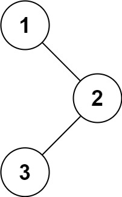

**输入：**root = \[1,null,2,3\]
**输出：**\[1,3,2\]

**示例 2：**

**输入：**root = \[\]
**输出：**\[\]

**示例 3：**

**输入：**root = \[1\]
**输出：**\[1\]

**提示：**

- 树中节点数目在范围 `[0, 100]` 内

- `-100 <= Node.val <= 100`

**进阶:** 递归算法很简单，你可以通过迭代算法完成吗？

answer：

递归秒了

```java
class Solution {
    public List<Integer> inorderTraversal(TreeNode root) {
        List<Integer> res = new ArrayList<>();
        dfs(res, root);
        return res;
    }

    public void dfs(List<Integer> res, TreeNode root) {
        if (root == null) {
            return;
        }
        if (root.left != null) {
            dfs(res, root.left);
        }
        res.add(root.val);
        if (root.right != null) {
            dfs(res, root.right);
        }
    }
}
```

<a id="problem-037"></a>

### [104. 二叉树的最大深度](https://leetcode.cn/problems/maximum-depth-of-binary-tree/) easy

<https://leetcode.cn/problems/maximum-depth-of-binary-tree/?envType=study-plan-v2&envId=top-100-liked>

给定一个二叉树 `root` ，返回其最大深度。

二叉树的 **最大深度** 是指从根节点到最远叶子节点的最长路径上的节点数。

**示例 1：**


**输入：**root = \[3,9,20,null,null,15,7\]
**输出：**3

**示例 2：**

**输入：**root = \[1,null,2\]
**输出：**2

**提示：**

- 树中节点的数量在 `[0, 10(4)]` 区间内。

- `-100 <= Node.val <= 100`

answer：

注意java是值传递 基本类型只传值

#### 一个树的最大深度

等于：

```text
max(左子树深度, 右子树深度) + 1
```

树递归更经典的思维是：“子问题返回答案”

##### 看这棵树

3
     / \\
    9  20
       / \\
      15  7

---

##### 最底层先开始

递归其实是：

```text
一路钻到底
再往回算
```

---

##### 先看节点 15

```text
15
```

它左右都没了：

```text
left = null
right = null
```

所以：

```text
maxDepth(null) = 0
```

于是：

```text
15 的深度：

max(0,0)+1 = 1
```

---

##### 节点 7 也是一样

```text
depth = 1
```

---

##### 然后回到节点 20

现在：

```text
左边 15 已经算出来了 = 1
右边 7 已经算出来了 = 1
```

所以：

```text
20 的深度：

max(1,1)+1
= 2
```

---

##### 然后回到根节点 3

左边：

```text
9 的深度 = 1
```

右边：

```text
20 的深度 = 2
```

所以：

```text
3 的深度：

max(1,2)+1
= 3
```

保持手感  返回当前深度+1(当前节点的1个深度) 空节点原样返回

```java
class Solution {
    public int maxDepth(TreeNode root) {
        return dfs(root, 0);
    }

    public int dfs(TreeNode root, int depth) {
        if (root == null) {
            return depth;
        }
        int left = 0;
        int right = 0;
        if (root.left != null) {
            left = dfs(root.left, depth);
        }
        if (root.right != null) {
            right = dfs(root.right, depth);
        }
        return Math.max(left, right) + 1;
    }
}
```

<a id="problem-038"></a>

### [226. 翻转二叉树](https://leetcode.cn/problems/invert-binary-tree/) easy

<https://leetcode.cn/problems/invert-binary-tree/description/?envType=study-plan-v2&envId=top-100-liked>

给你一棵二叉树的根节点 `root` ，翻转这棵二叉树，并返回其根节点。

**示例 1：**


**输入：**root = \[4,2,7,1,3,6,9\]
**输出：**\[4,7,2,9,6,3,1\]

**示例 2：**


**输入：**root = \[2,1,3\]
**输出：**\[2,3,1\]

**示例 3：**

**输入：**root = \[\]
**输出：**\[\]

**提示：**

- 树中节点数目范围在 `[0, 100]` 内

- `-100 <= Node.val <= 100`

answer：

核心：递归先把左右孩子翻转了  再翻转自己的左右孩子

```java
class Solution {
    public TreeNode invertTree(TreeNode root) {
        return dfs(root);
    }
    public TreeNode dfs(TreeNode root) {
        if (root == null) {
            return null;
        }
        if (root.left != null) {
            dfs(root.left);
        }
        if (root.right != null) {
            dfs(root.right);
        }
        TreeNode t = root.left;
        root.left = root.right;
        root.right = t;
        return root;
    }
}
```

<a id="problem-039"></a>

### [101. 对称二叉树](https://leetcode.cn/problems/symmetric-tree/)  easy

<https://leetcode.cn/problems/symmetric-tree/description/?envType=study-plan-v2&envId=top-100-liked>

给你一个二叉树的根节点 `root` ， 检查它是否轴对称。

**示例 1：**

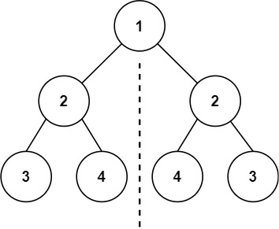

**输入：**root = \[1,2,2,3,4,4,3\]
**输出：**true

**示例 2：**

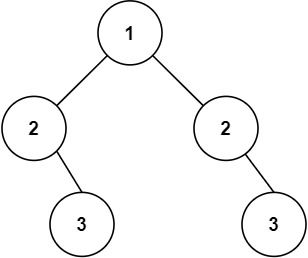

**输入：**root = \[1,2,2,null,3,null,3\]
**输出：**false

answer：

#### 正确递归思路

真正的“对称”：

```text
左子树的左边 == 右子树的右边
左子树的右边 == 右子树的左边
```

所以本质上：

#### 是两棵树互相比较

---

#### 递归模板（超级经典）

```text
check(left, right)
```

比较：

```text
left.val == right.val
left.left  和 right.right
left.right 和 right.left
```

核心记住：是两棵树在比 dfs(left,right) 左左和右右，左右和右左

```java
class Solution {
    public boolean isSymmetric(TreeNode root) {
        return dfs(root.left, root.right);
    }

    public boolean dfs(TreeNode left, TreeNode right) {
        if (left == null && right == null) {
            return true;
        }
        if (left == null || right == null) {
            return false;
        }
        if (left.val != right.val) {
            return false;
        }
        boolean isLeft = dfs(left.left, right.right);
        boolean isRight = dfs(left.right, right.left);
        return isLeft && isRight;
    }
}
```

<a id="problem-040"></a>

### [543. 二叉树的直径](https://leetcode.cn/problems/diameter-of-binary-tree/) easy 重点看

<https://leetcode.cn/problems/diameter-of-binary-tree/description/?envType=study-plan-v2&envId=top-100-liked>

给你一棵二叉树的根节点，返回该树的 **直径** 。

二叉树的 **直径**是指树中任意两个节点之间最长路径的** 长度** 。这条路径可能经过也可能不经过根节点 `root` 。

两节点之间路径的 **长度** 由它们之间边数表示。

**示例 1：**


**输入：**root = \[1,2,3,4,5\]
**输出：**3
**解释：**3 ，取路径 \[4,2,1,3\] 或 \[5,2,1,3\] 的长度。

**示例 2：**

**输入：**root = \[1,2\]
**输出：**1

**提示：**

- 树中节点数目在范围 `[1, 10(4)]` 内

- `-100 <= Node.val <= 100`

answer：

#### 这题真正的核心

二叉树直径：

> 任意两点最长路径（边数）
>
>

而一个节点的最长路径：

其实就是：左子树最大深度 + 右子树最大深度

#### 所以递归函数应该返回什么？

应该返回：当前节点的最大深度

重点理解 直径是两节点最大长度 应该枚举每个节点的最长路径

本质后序遍历

经典做法：DFS + 全局最大值

```java
public class Solution {

    int max = 0;

    public int diameterOfBinaryTree(TreeNode root) {
        depth(root);
        return max;
    }

    public int depth(TreeNode root) {
        if (root == null) {
            return 0;
        }

        int left = depth(root.left);
        int right = depth(root.right);

        // 更新直径
        max = Math.max(max, left + right);

        // 返回当前最大深度
        return Math.max(left, right) + 1;
    }
}
```

<a id="problem-041"></a>

### [102. 二叉树的层序遍历](https://leetcode.cn/problems/binary-tree-level-order-traversal/) mid

<https://leetcode.cn/problems/binary-tree-level-order-traversal/description/?envType=study-plan-v2&envId=top-100-liked>

给你二叉树的根节点 `root` ，返回其节点值的 **层序遍历** 。 （即逐层地，从左到右访问所有节点）。

**示例 1：**


**输入：**root = \[3,9,20,null,null,15,7\]
**输出：**\[\[3\],\[9,20\],\[15,7\]\]

**示例 2：**

**输入：**root = \[1\]
**输出：**\[\[1\]\]

**示例 3：**

**输入：**root = \[\]
**输出：**\[\]

**提示：**

- 树中节点数目在范围 `[0, 2000]` 内

- `-1000 <= Node.val <= 1000`

answer：

相当于广度优先搜索

#### 一、层序遍历的本质

层序遍历：

```text
先遍历第1层
再遍历第2层
再遍历第3层
```

它和：

- 前序遍历

- 中序遍历

- 后序遍历

不同。

DFS（深度优先）：一路往下走到底 （递归）

而层序遍历属于：

#### BFS（广度优先搜索）

即：一层一层扩散 （迭代）

层序遍历本质是：BFS（广度优先），它天然适合：while + queue，而不是递归。

---

#### 二、为什么要用队列

BFS 的核心数据结构：

#### Queue（队列）

队列特点：

```text
先进先出
```

例如：

```text
加入：3 → 9 → 20
取出顺序：
3 → 9 → 20
```

这非常符合：

```text
按层访问
```

---

#### 三、整体思路

##### 根节点入队

开始时：

```text
queue = [3]
```

---

##### 循环处理队列

只要队列不为空：

```text
while (!queue.isEmpty())
```

说明还有节点没遍历。

---

##### 处理当前层

关键：

```text
int size = queue.size();
```

意义：

```text
当前队列中的所有节点
就是当前层节点
```

例如：

```text
queue = [9,20]
```

说明当前层有：

```text
2 个节点
```

所以：

```text
for (int i = 0; i < size; i++)
```

只处理这一层。

---

#### 四、处理一个节点需要做什么

对于每个节点：

##### 从队列取出

```text
TreeNode node = queue.poll();
```

poll：

```text
删除并返回队头元素
```

---

##### 保存节点值

```text
level.add(node.val);
```

---

##### 将下一层加入队列

```text
if (node.left != null)
    queue.offer(node.left);

if (node.right != null)
    queue.offer(node.right);
```

offer：

```text
加入队尾
```

#### 正确思路（非常重要）

层序遍历：

外层 while负责：一层一层处理

内层 for负责：处理当前层所有节点

这是bfs模版  容易理解 要记住

还可用linkedlist优化

```java
public class Solution {
    public List<List<Integer>> levelOrder(TreeNode root) {
        Queue<TreeNode> queue = new LinkedList<>();
        List<List<Integer>> res = new ArrayList<>();
        if (root == null) {
            return res;
        }
        queue.offer(root);
        while (!queue.isEmpty()) {
            int size = queue.size();
            List<Integer> list = new ArrayList<>();
            while (size > 0) {
                TreeNode node = queue.poll();
                if (node.left != null) {
                    queue.offer(node.left);
                }
                if (node.right != null) {
                    queue.offer(node.right);
                }
                list.add(node.val);
                size--;
            }
            res.add(list);
        }
        return res;
    }
}

```

<a id="problem-042"></a>

### [108. 将有序数组转换为二叉搜索树](https://leetcode.cn/problems/convert-sorted-array-to-binary-search-tree/) easy

<https://leetcode.cn/problems/convert-sorted-array-to-binary-search-tree/description/?envType=study-plan-v2&envId=top-100-liked>

给你一个整数数组 `nums` ，其中元素已经按 **升序** 排列，请你将其转换为一棵 平衡 二叉搜索树。

**示例 1：**


**输入：**nums = \[-10,-3,0,5,9\]
**输出：**\[0,-3,9,-10,null,5\]
**解释：**\[0,-10,5,null,-3,null,9\] 也将被视为正确答案：

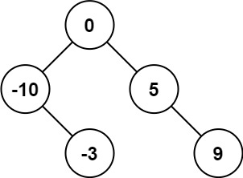

**示例 2：**


**输入：**nums = \[1,3\]
**输出：**\[3,1\]
**解释：**\[1,null,3\] 和 \[3,1\] 都是高度平衡二叉搜索树。

**提示：**

- `1 <= nums.length <= 10(4)`

- `-10(4) <= nums[i] <= 10(4)`

- `nums` 按 **严格递增** 顺序排列

Answer：

递归三部曲：

- 确定递归函数返回值及其参数

- 确定递归终止条件

- 确定单层递归的逻辑

删除二叉树节点，增加二叉树节点，都是用递归函数的返回值来完成，这样是比较方便的。

理解：每一个根节点是取当前区间中点  左右区间是-1和+1

mid直接除以二即可 左右子树高度相差不超过1

如果left\>right 说明这边以构建完 直接返回

```java
public class Solution {
    public TreeNode sortedArrayToBST(int[] nums) {
        return build(nums, 0, nums.length - 1);
    }

    public TreeNode build(int[] nums, int left, int right) {
        if (left > right) {
            return null;
        }
        int mid = (left + right) / 2;
        TreeNode root = new TreeNode(nums[mid]);
        root.left = build(nums, left, mid - 1);
        root.right = build(nums, mid + 1, right);
        return root;

    }
}

```

<a id="problem-043"></a>

### [98. 验证二叉搜索树](https://leetcode.cn/problems/validate-binary-search-tree/) mid

<https://leetcode.cn/problems/validate-binary-search-tree/description/?envType=study-plan-v2&envId=top-100-liked>

给你一个二叉树的根节点 `root` ，判断其是否是一个有效的二叉搜索树。

**有效** 二叉搜索树定义如下：

- 节点的左子树只包含**严格小于** 当前节点的数。

- 节点的右子树只包含 **严格大于** 当前节点的数。

- 所有左子树和右子树自身必须也是二叉搜索树。

**示例 1：**


**输入：**root = \[2,1,3\]
**输出：**true

**示例 2：**


**输入：**root = \[5,1,4,null,null,3,6\]
**输出：**false
**解释：**根节点的值是 5 ，但是右子节点的值是 4 。

**提示：**

- 树中节点数目范围在`[1, 10(4)]` 内

- `-2(31) <= Node.val <= 2(31) - 1`

answer：

#### 真正要维护的是：

 每个节点都有一个「取值范围」

比如：

- 根节点：(-∞, +∞)

- 左子树节点：必须 `< 根节点值`

- 右子树节点：必须 `> 根节点值`

递归往下传限制。先判断当前节点是否合法，再递归左右子树

```java
public class Solution {

    public boolean isValidBST(TreeNode root) {
        return dfs(root, Long.MIN_VALUE, Long.MAX_VALUE);
    }

    public boolean dfs(TreeNode root, long min, long max) {
        if (root == null) {
            return true;
        }
        if (root.val <= min || root.val >= max) {
            return false;
        }
        boolean left = dfs(root.left, min, root.val);
        boolean right = dfs(root.right, root.val, max);
        return left && right;
    }
}

```

<a id="problem-044"></a>

### [230. 二叉搜索树中第 K 小的元素](https://leetcode.cn/problems/kth-smallest-element-in-a-bst/) mid

<https://leetcode.cn/problems/kth-smallest-element-in-a-bst/description/?envType=study-plan-v2&envId=top-100-liked>

给定一个二叉搜索树的根节点 `root` ，和一个整数 `k` ，请你设计一个算法查找其中第 `k`** **小的元素（`k` 从 1 开始计数）。

**示例 1：**


**输入：**root = \[3,1,4,null,2\], k = 1
**输出：**1

**示例 2：**


**输入：**root = \[5,3,6,2,4,null,null,1\], k = 3
**输出：**3

**提示：**

- 树中的节点数为 `n` 。

- `1 <= k <= n <= 10(4)`

- `0 <= Node.val <= 10(4)`

**进阶：**如果二叉搜索树经常被修改（插入/删除操作）并且你需要频繁地查找第 `k` 小的值，你将如何优化算法？

answer：

```java
public class Solution {
    int count = 0;
    int res = 0;

    public int kthSmallest(TreeNode root, int k) {
        get(root, k);
        return res;
    }

    public void get(TreeNode root, int k) {
        if (root == null||count>k) {//剪枝
            return;
        }
        if (root.left != null) {
            get(root.left, k);
        }
        count++;
        if (count == k) {
            res = root.val;
        }
        get(root.right, k);
    }
}
```

<a id="problem-045"></a>

### [199. 二叉树的右视图](https://leetcode.cn/problems/binary-tree-right-side-view/) mid

<https://leetcode.cn/problems/binary-tree-right-side-view/?envType=study-plan-v2&envId=top-100-liked>

给定一个二叉树的 **根节点** `root`，想象自己站在它的右侧，按照从顶部到底部的顺序，返回从右侧所能看到的节点值。

**示例 1：**

**输入：**root = \[1,2,3,null,5,null,4\]

**输出：**\[1,3,4\]

**解释：**

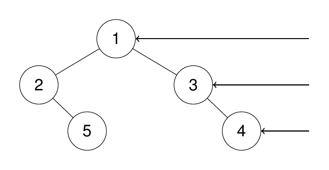

**示例 2：**

**输入：**root = \[1,2,3,4,null,null,null,5\]

**输出：**\[1,3,4,5\]

**解释：**

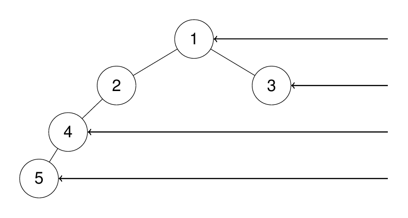

**示例 3：**

**输入：**root = \[1,null,3\]

**输出：**\[1,3\]

**示例 4：**

**输入：**root = \[\]

**输出：**\[\]

**提示:**

- 二叉树的节点个数的范围是 `[0,100]`

- `-100 <= Node.val <= 100`

answer：

#### BFS

优点：

- 好理解

- 层级问题天然适配

- 不容易绕

缺点：

- 宽树比较占内存

队列里放节点。

每次：

```text
先记录当前层有几个节点
```

比如：

```text
int size = queue.size();
```

然后循环这一层：

```text
for (int i = 0; i < size; i++)
```

重点来了

当：

```text
i == size - 1
```

说明当前节点是：

```text
这一层最后一个节点
```

加入答案即可。

```java
public class Solution {
    public List<Integer> rightSideView(TreeNode root) {
        List<Integer> res = new ArrayList<>();
        if (root == null) {
            return res;
        }
        Queue<TreeNode> queue = new LinkedList<>();
        queue.offer(root);
        while (!queue.isEmpty()) {
            int size = queue.size();
            for (int i = 0; i < size; i++) {
                TreeNode cur = queue.poll();
                // 当前层最后一个节点
                if (i == size - 1) {
                    res.add(cur.val);
                }
                if (cur.left != null) {
                    queue.offer(cur.left);
                }
                if (cur.right != null) {
                    queue.offer(cur.right);
                }
            }
        }
        return res;
    }
}
```

---

#### DFS

优点：

- 写法优雅

- 对平衡树空间更省

- 很适合“第一次到达某层”这种题

缺点：

- 容易递归绕晕

- 极深树可能栈溢出

思路是：

```text
第一次到达某一层的节点
一定是这一层最右边的
```

因为你：

```text
先递归右子树
再递归左子树
```

比如：

```text
1
├── 3
│    └── 4
└── 2
     └── 5
```

访问顺序：

```text
1 -> 3 -> 4 -> 2 -> 5
```

每层第一次看到的：

```text
1
3
4
```

就是右视图。

所以 DFS 的关键是：

 记录当前深度 depth

如果：

```text
depth == res.size()
```

说明这是这一层第一次访问。

加入答案。

```java
public class Solution {
    List<Integer> res = new ArrayList<>();

    public List<Integer> rightSideView(TreeNode root) {
        int depth = -1;
        dfs(root, depth);
        return res;
    }

    public void dfs(TreeNode root, int depth) {
        if (root == null) {
            return;
        }
        depth++;
        if (res.size() == depth) {
            res.add(root.val);
        }
        dfs(root.right, depth);
        dfs(root.left, depth);
    }
}
```

<a id="problem-046"></a>

### [114. 二叉树展开为链表](https://leetcode.cn/problems/flatten-binary-tree-to-linked-list/) mid

<https://leetcode.cn/problems/flatten-binary-tree-to-linked-list/description/?envType=study-plan-v2&envId=top-100-liked>

给你二叉树的根结点 `root` ，请你将它展开为一个单链表：

- 展开后的单链表应该同样使用 `TreeNode` ，其中 `right` 子指针指向链表中下一个结点，而左子指针始终为 `null` 。

- 展开后的单链表应该与二叉树 [**先序遍历**](https://baike.baidu.com/item/%E5%85%88%E5%BA%8F%E9%81%8D%E5%8E%86/6442839?fr=aladdin) 顺序相同。

**示例 1：**

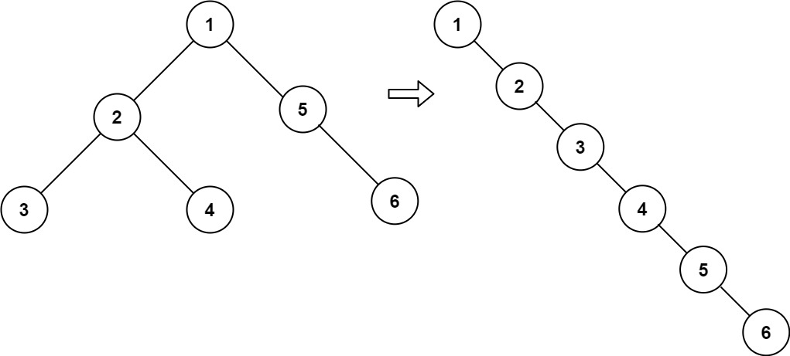

**输入：**root = \[1,2,5,3,4,null,6\]
**输出：**\[1,null,2,null,3,null,4,null,5,null,6\]

**示例 2：**

**输入：**root = \[\]
**输出：**\[\]

**示例 3：**

**输入：**root = \[0\]
**输出：**\[0\]

**提示：**

- 树中结点数在范围 `[0, 2000]` 内

- `-100 <= Node.val <= 100`

**进阶：**你可以使用原地算法（`O(1)` 额外空间）展开这棵树吗？

answer：

不会这个 好难

二刷 理解了  好好理解 先序的顺序 就是把左子树插到右边 右子树插到左子树最后一个节点右边

```java
public class Solution {
    public void flatten(TreeNode root) {
        dfs(root);
    }

    public void dfs(TreeNode root) {
        if (root == null) {
            return;
        }
        // 先展开左右子树
        dfs(root.left);
        dfs(root.right);
        TreeNode left = root.left;
        TreeNode right = root.right;
        // 左子树为空就不用拼接
        if (left == null) {
            return;
        }
        // 左子树移到右边
        root.right = left;
        root.left = null;                       
        // 找左链最后一个节点
        TreeNode cur = left;
        while (cur.right != null) {
            cur = cur.right;
        }
        // 接上原来的右子树
        cur.right = right;
    }
}
```

<a id="problem-047"></a>

### [105. 从前序与中序遍历序列构造二叉树](https://leetcode.cn/problems/construct-binary-tree-from-preorder-and-inorder-traversal/) mid

<https://leetcode.cn/problems/construct-binary-tree-from-preorder-and-inorder-traversal/description/?envType=study-plan-v2&envId=top-100-liked>

给定两个整数数组 `preorder` 和 `inorder` ，其中 `preorder` 是二叉树的**先序遍历**， `inorder` 是同一棵树的**中序遍历**，请构造二叉树并返回其根节点。

**示例 1:**


**输入:** preorder = \[3,9,20,15,7\], inorder = \[9,3,15,20,7\]
**输出:** \[3,9,20,null,null,15,7\]

**示例 2:**

**输入:** preorder = \[-1\], inorder = \[-1\]
**输出:** \[-1\]

**提示:**

- `1 <= preorder.length <= 3000`

- `inorder.length == preorder.length`

- `-3000 <= preorder[i], inorder[i] <= 3000`

- `preorder` 和 `inorder` 均 **无重复** 元素

- `inorder` 均出现在 `preorder`

- `preorder` **保证** 为二叉树的前序遍历序列

- `inorder` **保证** 为二叉树的中序遍历序列

answer：

先序里根后面 leftSize 个是左子树。

第一层：

根是 `3`

于是：

```text
3
       / \
      ?   ?
```

左右还没建，只知道坑位。

---

然后把左边递归：

左子树数据：

```text
pre = [9]
in  = [9]
```

再调用自己：

```text
root.left = build(...)
```

进去后：

发现根是 `9`

于是返回：

```text
9
```

所以：

```text
3
       /
      9
```

左边好了。

---

再搞右边：

右子树数据：

```text
pre = [20,15,7]
in  = [15,20,7]
```

再递归：

```text
root.right = build(...)
```

---

进去：

根是 `20`

先搭架子：

```text
20
     /  \
    ?    ?
```

---

继续递归左：

```text
pre = [15]
in  = [15]
```

返回：

```text
15
```

变成：

```text
20
     /
    15
```

---

递归右：

```text
pre = [7]
in  = [7]
```

返回：

```text
7
```

变成：

```text
20
     /  \
    15   7
```

---

然后把这个返回给上一层：

```text
3
       / \
      9   20
         /  \
        15   7
```

结束。

所以递归模板就是：

```text
TreeNode build(...) {
    // 1. 结束条件
    if (...) return null;

    // 2. 找根
    TreeNode root = new TreeNode(...);

    // 3. 递归左边
    root.left = build(...);

    // 4. 递归右边
    root.right = build(...);

    // 5. 返回根
    return root;
}
```

我们定义一个函数：

```text
build(preorder, ps, pe, inorder, is, ie)
```

意思是：

> “帮我用 preorder 的 `ps~pe` 和 inorder 的 `is~ie` 这两段，构造一棵树。”
>
>

比如：

```text
pre = [3, 9, 20, 15, 7]
       0  1  2   3  4

in  = [9, 3, 15, 20, 7]
       0  1   2   3  4
```

第一次调用就是整段：

```text
build(pre, 0, 4, in, 0, 4)
```

意思：整个数组都拿来建树。

---

#### 第一步：找到根

```text
int rootVal = preorder[ps];
```

因为前序第一个就是根。

这里：

```text
rootVal = 3
```

---

#### 第二步：去 inorder 找根位置

假设找到了：

```text
rootIndex = 1;
```

（因为 `in[1]=3`）

---

#### 第三步：算左子树大小

```text
leftSize = rootIndex - is;
```

这里：

```text
1 - 0 = 1
```

说明左边有一个节点。

---

#### 第四步：递归左边

左子树要传啥？

##### preorder

根是 `ps`

左边从根后面开始：

```text
ps + 1
```

结束位置：

```text
ps + leftSize
```

所以：

```text
1 ~ 1
```

就是 `[9]`

---

##### inorder

左边天然就是：

```text
is ~ rootIndex-1
```

也就是：

```text
0 ~ 0
```

---

所以左递归：

```text
root.left =
    build(pre, ps+1, ps+leftSize,
          in,  is,   rootIndex-1);
```

---

#### 第五步：递归右边

preorder：

左子树占了 leftSize 个，

所以右边从：

```text
ps + leftSize + 1
```

开始。

到：

```text
pe
```

就是：

```text
2 ~ 4
```

---

inorder：

```text
rootIndex+1 ~ ie
```

就是：

```text
2 ~ 4
```

---

所以：

```text
root.right =
    build(pre, ps+leftSize+1, pe,
          in,  rootIndex+1, ie);
```

容易理解的  重点在build的参数 有六个 理解好  不要忘记终止条件

应该用map保存inorder中下标的位置 优化while循环  能从on2变成on

```java
public class Solution {
    public TreeNode buildTree(int[] preorder, int[] inorder) {
        return build(preorder, 0, preorder.length - 1, inorder, 0, inorder.length - 1);
    }

    public TreeNode build(int[] preorder,
                          int ps,
                          int pe,
                          int[] inorder,
                          int is,
                          int ie) {
        if (ps > pe || is > ie) {
            return null;
        }
        int rootVal = preorder[ps];
        int rootIndexIn = is;
        while (inorder[rootIndexIn] != rootVal) {
            rootIndexIn++;
        }
        int leftSize = rootIndexIn - is;
        TreeNode root = new TreeNode(rootVal);
        TreeNode left = build(preorder, ps + 1, ps + leftSize, inorder, is, rootIndexIn - 1);
        TreeNode right = build(preorder, ps + leftSize + 1, pe, inorder, rootIndexIn + 1, ie);
        root.left = left;
        root.right = right;
        return root;
    }
}
```

```java
public class Solution {
    Map<Integer, Integer> inMap = new HashMap<>();

    public TreeNode buildTree(int[] preorder, int[] inorder) {

        for (int i = 0; i < inorder.length; i++) {
            inMap.put(inorder[i], i);
        }

        return build(
                preorder, 0, preorder.length - 1,
                inorder, 0, inorder.length - 1
        );
    }

    public TreeNode build(
            int[] pre, int ps, int pe,
            int[] in, int is, int ie
    ) {
        if (ps > pe || is > ie) {
            return null;
        }
        //找根
        TreeNode root = new TreeNode(pre[ps]);
        int inRootIndex = inMap.get(root.val);
        int leftsize = inRootIndex - is;
        //递归左子树
        root.left = build(
                pre, ps + 1, ps + leftsize,
                in, is, inRootIndex - 1
        );
        //递归右子树
        root.right = build(
                pre, ps + leftsize + 1, pe,
                in, inRootIndex + 1, ie
        );

        //返回当前root
        return root;
    }
}
```

<a id="problem-048"></a>

### [437. 路径总和 III](https://leetcode.cn/problems/path-sum-iii/) mid

<https://leetcode.cn/problems/path-sum-iii/description/?envType=study-plan-v2&envId=top-100-liked>

给定一个二叉树的根节点 `root` ，和一个整数 `targetSum` ，求该二叉树里节点值之和等于 `targetSum` 的 **路径** 的数目。

**路径** 不需要从根节点开始，也不需要在叶子节点结束，但是路径方向必须是向下的（只能从父节点到子节点）。

**示例 1：**

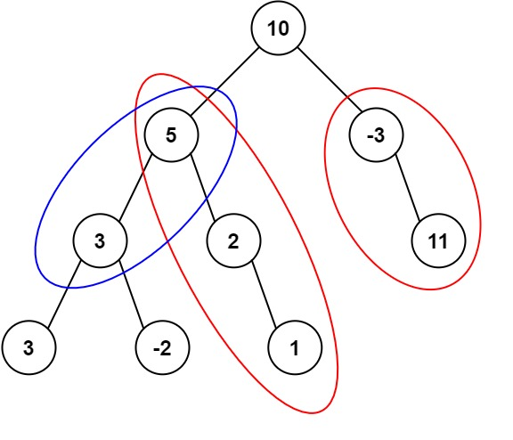

**输入：**root = \[10,5,-3,3,2,null,11,3,-2,null,1\], targetSum = 8
**输出：**3
**解释：**和等于 8 的路径有 3 条，如图所示。

**示例 2：**

**输入：**root = \[5,4,8,11,null,13,4,7,2,null,null,5,1\], targetSum = 22
**输出：**3

**提示:**

- 二叉树的节点个数的范围是 `[0,1000]`

- `-10(9) <= Node.val <= 10(9)`

- `-1000 <= targetSum <= 1000`

answer：

#### 思路 1：枚举每个节点作为起点 O(n2)

#### **思路2：O(n) 的前缀和写法**

先回忆一下数组里的“和为 k 的子数组”：

```text
prefix[j] - prefix[i] = target
```

变形：

```text
prefix[i] = prefix[j] - target
```

意思是：

> 如果当前前缀和是 `curSum`，
>  只要之前出现过 `curSum - target`，
>  就说明存在一条路径和等于 `target`。
>
>

---

放到树里也是一样，只不过：

- 数组是线性的

- 树是一条“从根到当前节点”的路径

比如：

```text
10
      /
     5
    /
   3
```

走到 `3` 时：

```text
前缀和 = 10 + 5 + 3 = 18
```

如果 target = 8

找：

```text
18 - 8 = 10
```

发现之前有前缀和 `10`（根节点）

说明：

```text
5 -> 3
```

这条路径和就是 8

---

所以需要一个 `HashMap`

```text
Map<前缀和, 出现次数>
```

因为可能重复。

---

dfs 时做四件事：

##### ① 更新当前和

```text
sum += root.val;
```

---

##### ② 看有没有答案

```text
ans += map.getOrDefault(sum - target, 0);
```

这一步是核心！！！

---

##### ③ 把自己放进 map

```text
map.put(sum, map.getOrDefault(sum,0)+1);
```

让孩子能用。

---

##### ④ 回溯（重点）

左右子树结束后：

```text
map.put(sum, map.get(sum)-1);
```

为什么？

因为走完左边要“退回来”，

不能让右边看到左边路径。

##### 节点不能和自己配对：

正确顺序应该是：

```text
sum += root.val;

// 先查
res += map.getOrDefault(sum - tar, 0);

// 再放
map.put(sum, map.getOrDefault(sum, 0) + 1);
```

如果先放再查 会导致自己匹配自己 也就是空路径  和为0 题目不允许空路径

很好理解 整体思路是前缀和+回溯  注意前缀和要用long存 不然会溢出  回溯时机在最终

```java
public class Solution {
    Map<Long, Integer> map = new HashMap<>();
    int res = 0;
    Long tar = 0L;

    public int pathSum(TreeNode root, int targetSum) {
        tar = (long) targetSum;
        map.put(0L, 1);
        Long sum = 0L;
        dfs(root, sum);

        return res;
    }

    public void dfs(TreeNode root, Long sum) {
        if (root == null) {
            return;
        }
        sum += root.val;
        res += map.getOrDefault(sum - tar, 0);
        map.put(sum, map.getOrDefault(sum, 0) + 1);
        dfs(root.left, sum);
        dfs(root.right, sum);
        map.put(sum, map.get(sum) - 1);
    }
}
```

<a id="problem-049"></a>

### [236. 二叉树的最近公共祖先](https://leetcode.cn/problems/lowest-common-ancestor-of-a-binary-tree/) mid

<https://leetcode.cn/problems/lowest-common-ancestor-of-a-binary-tree/description/?envType=study-plan-v2&envId=top-100-liked>

给定一个二叉树, 找到该树中两个指定节点的最近公共祖先。

[百度百科](https://baike.baidu.com/item/%E6%9C%80%E8%BF%91%E5%85%AC%E5%85%B1%E7%A5%96%E5%85%88/8918834?fr=aladdin)中最近公共祖先的定义为：“对于有根树 T 的两个节点 p、q，最近公共祖先表示为一个节点 x，满足 x 是 p、q 的祖先且 x 的深度尽可能大（**一个节点也可以是它自己的祖先**）。”

**示例 1：**


```text
**输入：**root = [3,5,1,6,2,0,8,null,null,7,4], p = 5, q = 1
**输出：**3
**解释：**节点 5 和节点 1 的最近公共祖先是节点 3 。
```

**示例 2：**


```text
**输入：**root = [3,5,1,6,2,0,8,null,null,7,4], p = 5, q = 4
**输出：**5
**解释：**节点 5 和节点 4 的最近公共祖先是节点 5 。因为根据定义最近公共祖先节点可以为节点本身。
```

**示例 3：**

**输入：**root = \[1,2\], p = 1, q = 2
**输出：**1

**提示：**

- 树中节点数目在范围 `[2, 10(5)]` 内。

- `-10(9) <= Node.val <= 10(9)`

- 所有 `Node.val` `互不相同` 。

- `p != q`

- `p` 和 `q` 均存在于给定的二叉树中。

answer：

#### 提示 1：想想“答案可能在哪”

对于当前节点 `root`，最近公共祖先只有三种可能：

106. **在左子树里**

107. **在右子树里**

108. **就是当前这个 root**

所以天然适合递归：

“去左边找一次，去右边找一次”。

---

#### 提示 2：什么时候停（递归出口）？

如果：

- `root == null` → 没找到，返回 `null`

- `root == p` → 找到 p，直接返回 p

- `root == q` → 找到 q，直接返回 q

是不是很像：“我找到目标了，往上汇报”。

---

#### 提示 3：拿左右子树的结果做判断

假设：

```text
TreeNode left = dfs(root.left);
TreeNode right = dfs(root.right);
```

现在有几种情况：

##### 情况①：左右都不空

```text
left != null && right != null
```

说明啥？

说明 `p` 和 `q` 一个在左边，一个在右边。

那当前 `root` 就是最近公共祖先

---

##### 情况②：只有左边有

```text
left != null && right == null
```

说明两个节点都在左边，答案直接返回 `left`

---

##### 情况③：只有右边有

同理，返回 `right`

---

##### 情况④：都没有

返回 `null`

理解逻辑 每个节点 如果是p\|\|q 返回 否则一直递归到返回空 由于一定存在公共祖先 故只有三种情况 是root  左或右孩子

```java
public class Solution {

    public TreeNode lowestCommonAncestor(TreeNode root, TreeNode p, TreeNode q) {

        return dfs(root, p, q);
    }

    public TreeNode dfs(TreeNode root, TreeNode p, TreeNode q) {
        if (root == null) {
            return null;
        }
        if (root == p) {
            return p;
        }
        if (root == q) {
            return q;
        }
        TreeNode left = dfs(root.left, p, q);
        TreeNode right = dfs(root.right, p, q);
        if (left != null && right != null) {
            return root;
        }
        return left != null ? left : right;
    }
}

```

<a id="problem-050"></a>

### [124. 二叉树中的最大路径和](https://leetcode.cn/problems/binary-tree-maximum-path-sum/) hard 重点看

<https://leetcode.cn/problems/binary-tree-maximum-path-sum/description/?envType=study-plan-v2&envId=top-100-liked>

二叉树中的**路径** 被定义为一条节点序列，序列中每对相邻节点之间都存在一条边。同一个节点在一条路径序列中**至多出现一次** 。该路径**至少包含一个** 节点，且不一定经过根节点。

**路径和** 是路径中各节点值的总和。

给你一个二叉树的根节点 `root` ，返回其 **最大路径和** 。

**示例 1：**

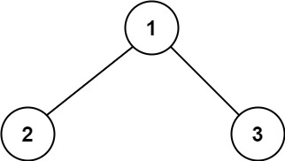

**输入：**root = \[1,2,3\]
**输出：**6
**解释：**最优路径是 2 -\> 1 -\> 3 ，路径和为 2 + 1 + 3 = 6

**示例 2：**


**输入：**root = \[-10,9,20,null,null,15,7\]
**输出：**42
**解释：**最优路径是 15 -\> 20 -\> 7 ，路径和为 15 + 20 + 7 = 42

**提示：**

- 树中节点数目范围是 `[1, 3 * 10(4)]`

- `-1000 <= Node.val <= 1000`

answer：

```java
public class Solution {
    int max = Integer.MIN_VALUE;

    public int maxPathSum(TreeNode root) {
        dfs(root);
        return max;
    }

    public int dfs(TreeNode root) {
        if (root == null) {
            return 0;
        }
        int leftMax = Math.max(dfs(root.left), 0);
        int rightMax = Math.max(dfs(root.right), 0);
        int lrMax = Math.max(leftMax, rightMax);
        int curMax = Math.max(lrMax + root.val, leftMax + rightMax + root.val);
        max = Math.max(curMax, max);
        return lrMax + root.val;
    }
}
```

```java
public class Solution {
    int max = Integer.MIN_VALUE;

    public int maxPathSum(TreeNode root) {
        dfs(root);
        return max;
    }

    private int dfs(TreeNode root) {
        if (root == null) {
            return 0;
        }

        // 左右子树能提供的最大贡献（负数直接舍弃）
        int left = Math.max(0, dfs(root.left));
        int right = Math.max(0, dfs(root.right));

        // 以当前节点为“拐点”的最大路径
        int curPath = root.val + left + right;

        // 更新全局最大值
        max = Math.max(max, curPath);

        // 返回给父节点：只能选一条路
        return root.val + Math.max(left, right);
    }
}
```

<a id="chapter-09"></a>

## 9. 图论

<a id="problem-051"></a>

### [200. 岛屿数量](https://leetcode.cn/problems/number-of-islands/) mid

<https://leetcode.cn/problems/number-of-islands/description/?envType=study-plan-v2&envId=top-100-liked>

给你一个由 `'1'`（陆地）和 `'0'`（水）组成的的二维网格，请你计算网格中岛屿的数量。

岛屿总是被水包围，并且每座岛屿只能由水平方向和/或竖直方向上相邻的陆地连接形成。

此外，你可以假设该网格的四条边均被水包围。

**示例 1：**

**输入：**grid = \[
  \['1','1','1','1','0'\],
  \['1','1','0','1','0'\],
  \['1','1','0','0','0'\],
  \['0','0','0','0','0'\]
\]
**输出：**1

**示例 2：**

**输入：**grid = \[
  \['1','1','0','0','0'\],
  \['1','1','0','0','0'\],
  \['0','0','1','0','0'\],
  \['0','0','0','1','1'\]
\]
**输出：**3

**提示：**

- `m == grid.length`

- `n == grid[i].length`

- `1 <= m, n <= 300`

- `grid[i][j]` 的值为 `'0'` 或 `'1'`

answer：

#### **DFS淹岛**

##### 提示 1：遍历整个地图

你得把每个格子都看一遍：

```text
for i
   for j
```

当看到 `'1'`（陆地）时，说明发现了一座**新岛屿**。

于是：

```text
count++
```

---

##### 提示 2：发现岛后，要把整座岛“淹掉”

什么意思？

比如：

```text
1 1 0
1 0 0
```

如果你只数左上角那个 `1`，后面还会再数到旁边那个 `1`，重复了 [错误]

所以发现一个 `'1'` 后：

把和它连着的所有 `'1'` 都改成 `'0'`。

像这样：

```text
dfs(i, j)
```

---

##### 提示 3：dfs 干什么？

当前点 `(i,j)`：

先判断越界：

```text
i < 0
i >= m
j < 0
j >= n
```

或者：

```text
grid[i][j] == '0'
```

就直接返回。

否则：

把自己淹掉：

```text
grid[i][j] = '0';
```

然后往四个方向扩散：

```text
上
下
左
右
```

```java
public class Solution {
    public int numIslands(char[][] grid) {
        int count = 0;
        for (int i = 0; i < grid.length; i++) {
            for (int j = 0; j < grid[i].length; j++) {
                if (grid[i][j] == '1') {
                    count++;
                    dfs(grid, i, j);
                }
            }
        }
        return count;
    }

    public void dfs(char[][] grid, int i, int j) {
        if (i < 0 || i >= grid.length || j < 0 || j >= grid[i].length || grid[i][j] == '0') {
            return;
        }
        grid[i][j] = '0';
        dfs(grid, i - 1, j);
        dfs(grid, i + 1, j);
        dfs(grid, i, j + 1);
        dfs(grid, i, j - 1);
    }
}
```

<a id="problem-052"></a>

### [994. 腐烂的橘子](https://leetcode.cn/problems/rotting-oranges/) mid

<https://leetcode.cn/problems/rotting-oranges/description/?envType=study-plan-v2&envId=top-100-liked>

在给定的 `m x n` 网格 `grid` 中，每个单元格可以有以下三个值之一：

- 值 `0` 代表空单元格；

- 值 `1` 代表新鲜橘子；

- 值 `2` 代表腐烂的橘子。

每分钟，腐烂的橘子 **周围 4 个方向上相邻** 的新鲜橘子都会腐烂。

返回 直到单元格中没有新鲜橘子为止所必须经过的最小分钟数。如果不可能，返回 `-1` 。

**示例 1：**


**输入：**grid = \[\[2,1,1\],\[1,1,0\],\[0,1,1\]\]
**输出：**4

**示例 2：**

**输入：**grid = \[\[2,1,1\],\[0,1,1\],\[1,0,1\]\]
**输出：**-1
**解释：**左下角的橘子（第 2 行， 第 0 列）永远不会腐烂，因为腐烂只会发生在 4 个方向上。

**示例 3：**

**输入：**grid = \[\[0,2\]\]
**输出：**0
**解释：**因为 0 分钟时已经没有新鲜橘子了，所以答案就是 0 。

**提示：**

- `m == grid.length`

- `n == grid[i].length`

- `1 <= m, n <= 10`

- `grid[i][j]` 仅为 `0`、`1` 或 `2`

answer：

这题一眼看过去就该想到：**BFS（广度优先）** ⏳

因为题目关键词：

> “**每分钟**，周围 4 个方向都会腐烂”
>
>

这不就是“**一层一层扩散**”嘛，天然 BFS。

---

#### 提示 1：先把所有腐烂橘子丢进队列

遍历整个 grid：

- 遇到 `2` → 加入队列（多个起点）

- 遇到 `1` → 统计新鲜橘子数量 `fresh++`

比如：

```text
2 1 1
1 1 0
0 1 1
```

队列初始：

```text
[(0,0)]
```

fresh = 6

---

#### 提示 2：按“层”做 BFS

每一层表示 **1 分钟**。

所以：

```text
int size = queue.size();
for (int k = 0; k < size; k++) {
    ...
}
minutes++;
```

这一层处理完，时间 +1。

---

#### 提示 3：向四个方向扩散

当前腐烂橘子 `(x,y)`：

看：

```text
上 (x-1,y)
下 (x+1,y)
左 (x,y-1)
右 (x,y+1)
```

如果是新鲜橘子：

```text
grid[nx][ny] == 1
```

就：

615. 改成 `2`

616. fresh--

617. 加入队列

像传染病一样

---

#### 提示 4：什么时候结束？

BFS 结束后：

如果：

```text
fresh == 0
```

说明全烂了，返回分钟数。

否则：

```text
return -1;
```

说明有孤岛，永远感染不到。

---

整体框架：

```text
1. 遍历 grid，初始化 queue 和 fresh
2. while(queue不空 && fresh > 0)
      按层 BFS
      minutes++
3. fresh == 0 ? minutes : -1
```

---

小提示

这题和“岛屿数量”区别：

- 岛屿数量：DFS 淹岛

- 腐烂橘子：BFS 扩散（因为有“分钟”概念）

看到“最短时间 / 最少步数 / 一层层传播” → 条件反射想到 **BFS**

用arraydeque能快点

```java
public class Solution {
    public int orangesRotting(int[][] grid) {
        int time = 0;
        Queue<int[]> queue = new ArrayDeque<>();
        int fresh = 0;
        for (int i = 0; i < grid.length; i++) {
            for (int j = 0; j < grid[i].length; j++) {
                if (grid[i][j] == 1) {
                    fresh++;
                } else if (grid[i][j] == 2) {
                    queue.offer(new int[]{i, j});
                }
            }
        }

        while (!queue.isEmpty() && fresh > 0) {
            int size = queue.size();
            for (int i = 0; i < size; i++) {
                int[] cur = queue.poll();
                int x = cur[0];
                int y = cur[1];
                if (x - 1 >= 0 && grid[x - 1][y] == 1) {
                    grid[x - 1][y] = 2;
                    queue.offer(new int[]{x - 1, y});
                    fresh--;
                }
                if (x + 1 < grid.length && grid[x + 1][y] == 1) {
                    grid[x + 1][y] = 2;
                    queue.offer(new int[]{x + 1, y});
                    fresh--;
                }
                if (y - 1 >= 0 && grid[x][y - 1] == 1) {
                    grid[x][y - 1] = 2;
                    queue.offer(new int[]{x, y - 1});
                    fresh--;
                }
                if (y + 1 < grid[x].length && grid[x][y + 1] == 1) {
                    grid[x][y + 1] = 2;
                    queue.offer(new int[]{x, y + 1});
                    fresh--;
                }
            }
            time++;
            if (fresh == 0) {
                return time;
            }
        }

        return fresh == 0 ? 0 : -1;
    }
}
```

```java
public class Solution {
    public int orangesRotting(int[][] grid) {
        Queue<int[]> queue = new ArrayDeque<>();
        int fresh = 0;
        int time = 0;

        for (int i = 0; i < grid.length; i++) {
            for (int j = 0; j < grid[0].length; j++) {
                if (grid[i][j] == 1) fresh++;
                if (grid[i][j] == 2) queue.offer(new int[]{i, j});
            }
        }

        int[][] dirs = {
            {1,0}, {-1,0}, {0,1}, {0,-1}
        };

        while (!queue.isEmpty() && fresh > 0) {
            int size = queue.size();

            for (int i = 0; i < size; i++) {
                int[] cur = queue.poll();

                for (int[] d : dirs) {
                四次循环走完四个方向
                    int nx = cur[0] + d[0];
                    int ny = cur[1] + d[1];

                    if (nx >= 0 && nx < grid.length &&
                        ny >= 0 && ny < grid[0].length &&
                        grid[nx][ny] == 1) {

                        grid[nx][ny] = 2;
                        queue.offer(new int[]{nx, ny});
                        fresh--;
                    }
                }
            }
            time++;
        }

        return fresh == 0 ? time : -1;
    }
}
```

<a id="problem-053"></a>

### [207. 课程表](https://leetcode.cn/problems/course-schedule/) mid 重点看

<https://leetcode.cn/problems/course-schedule/description/?envType=study-plan-v2&envId=top-100-liked>

你这个学期必须选修 `numCourses` 门课程，记为 `0` 到 `numCourses - 1` 。

在选修某些课程之前需要一些先修课程。 先修课程按数组 `prerequisites` 给出，其中 `prerequisites[i] = [a(i), b(i)]` ，表示如果要学习课程 `a(i)` 则 **必须** 先学习课程  `b(i)`( )。

- 例如，先修课程对 `[0, 1]` 表示：想要学习课程 `0` ，你需要先完成课程 `1` 。

请你判断是否可能完成所有课程的学习？如果可以，返回 `true` ；否则，返回 `false` 。

**示例 1：**

**输入：**numCourses = 2, prerequisites = \[\[1,0\]\]
**输出：**true
**解释：**总共有 2 门课程。学习课程 1 之前，你需要完成课程 0 。这是可能的。

**示例 2：**

**输入：**numCourses = 2, prerequisites = \[\[1,0\],\[0,1\]\]
**输出：**false
**解释：**总共有 2 门课程。学习课程 1 之前，你需要先完成课程 0 ；并且学习课程 0 之前，你还应先完成课程 1 。这是不可能的。

**提示：**

- `1 <= numCourses <= 2000`

- `0 <= prerequisites.length <= 5000`

- `prerequisites[i].length == 2`

- `0 <= a(i), b(i) < numCourses`

- `prerequisites[i]` 中的所有课程对 **互不相同**

answer：

#### 这题本质是什么？

这是经典的 **有向图判环**。

课程：

```text
1 -> 0
```

意思是：

“学 1 之前必须学 0”

画成图：

```text
0 → 1
```

所以问题变成：

> 这个有向图里有没有环？
>
>

有环：

```text
0 → 1 → 2 → 0
```

那就永远学不完。

#### 解法一：拓扑排序（最经典）

核心思想：

734. 统计每个节点的入度（多少前置课）

735. 找入度为 0 的（可以直接学）

736. 学完后，把它指向的课程入度减 1

737. 看最后能不能学完全部课程

---

图示一下

例子：

```text
[1,0]
[2,0]
[3,1]
[3,2]
```

图：

```text
0 → 1
0 → 2
1 → 3
2 → 3
```

入度：

```text
0:0
1:1
2:1
3:2
```

先学 `0`

变：

```text
1:0
2:0
3:2
```

再学 `1`,`2`

最后 `3`

全部学完 → true

---

核心在于，图和入度用什么数据结构存

图用List\<List\<Integer\>\>存，里面的list的索引就是每个先修课（索引只能是整数，且内层需要先初始化，给每个节点的索引位置都建一个空list，否则空指针），存入它指向的所有节点   入度用一维数组统计  下标对应节点 值对应入度

重点 用一个queue来进行拓扑排序 初始化放入入度为0的节点  做bfs 如果下个节点入度减为零 则入队

##### Java代码

```java
public class Solution {
    public boolean canFinish(int numCourses, int[][] prerequisites) {
        List<List<Integer>> graph = new ArrayList<>();
        int[] indgree = new int[numCourses];//入度
        for (int i = 0; i < numCourses; i++) {
            graph.add(new ArrayList<>());//初始化图
        }
        for (int[] p : prerequisites) {//创建图
            int a = p[0];
            int b = p[1];
            graph.get(b).add(a);//b的list里面加入a  表示b的下一个节点list
            indgree[a]++;
        }
        Queue<Integer> queue = new ArrayDeque<>();//放入度为0的节点
        for (int i = 0; i < numCourses; i++) {//初始化queue
            if (indgree[i] == 0) {
                queue.offer(i);
            }
        }
        int count = 0;//可以学的课程
        while (!queue.isEmpty()) {
            int c = queue.poll();
            count++;
            for (int next : graph.get(c)) {//每个入度为0的下个节点  入度--
                indgree[next]--;
                if (indgree[next] == 0) {//如果入度减为零 入队
                    queue.offer(next);
                }
            }
        }

        return count == numCourses;
    }
}
```

---

##### 时间复杂度

建图：

```text
O(E)
```

遍历：

```text
O(V+E)
```

总：

```text
O(V+E)
```

这里：

- V = numCourses

- E = prerequisites.length

#### 解法二：DFS判环（也很经典）

用三个状态：

```text
0 未访问
1 正在访问
2 已访问完
```

如果 DFS 时再次遇到 `1`：

说明绕回来了，有环。

---

代码：

```java
public class Solution {

    List<List<Integer>> graph = new ArrayList<>();
    int[] visited;

    public boolean canFinish(int numCourses, int[][] prerequisites) {

        for (int i = 0; i < numCourses; i++) {
            graph.add(new ArrayList<>());
        }

        for (int[] p : prerequisites) {
            graph.get(p[1]).add(p[0]);
        }

        visited = new int[numCourses];

        for (int i = 0; i < numCourses; i++) {
            if (dfs(i)) {
                return false;
            }
        }

        return true;
    }

    private boolean dfs(int course) {
        if (visited[course] == 1) return true;   // 有环
        if (visited[course] == 2) return false;  // 已处理

        visited[course] = 1;

        for (int next : graph.get(course)) {
            if (dfs(next)) {
                return true;
            }
        }

        visited[course] = 2;
        return false;
    }
}
```

也是O(V+E)

推荐拓扑排序

<a id="problem-054"></a>

### [208. 实现 Trie (前缀树)](https://leetcode.cn/problems/implement-trie-prefix-tree/) mid 重点看

<http://leetcode.cn/problems/implement-trie-prefix-tree/description/?envType=study-plan-v2&envId=top-100-liked>

[**Trie**](https://baike.baidu.com/item/%E5%AD%97%E5%85%B8%E6%A0%91/9825209?fr=aladdin)（发音类似 "try"）或者说**前缀树** 是一种树形数据结构，用于高效地存储和检索字符串数据集中的键。这一数据结构有相当多的应用情景，例如自动补全和拼写检查。

请你实现 Trie 类：

- `Trie()` 初始化前缀树对象。

- `void insert(String word)` 向前缀树中插入字符串 `word` 。

- `boolean search(String word)` 如果字符串 `word` 在前缀树中，返回 `true`（即，在检索之前已经插入）；否则，返回 `false` 。

- `boolean startsWith(String prefix)` 如果之前已经插入的字符串 `word` 的前缀之一为 `prefix` ，返回 `true` ；否则，返回 `false` 。

**示例：**

**输入**
\["Trie", "insert", "search", "search", "startsWith", "insert", "search"\]
\[\[\], \["apple"\], \["apple"\], \["app"\], \["app"\], \["app"\], \["app"\]\]
**输出**
\[null, null, true, false, true, null, true\]

**解释**
Trie trie = new Trie();
trie.insert("apple");
trie.search("apple");   // 返回 True
trie.search("app");     // 返回 False
trie.startsWith("app"); // 返回 True
trie.insert("app");
trie.search("app");     // 返回 True

**提示：**

- `1 <= word.length, prefix.length <= 2000`

- `word` 和 `prefix` 仅由小写英文字母组成

- `insert`、`search` 和 `startsWith` 调用次数 **总计** 不超过 `3 * 10(4)` 次

answer：

#### Trie定义：

字典树又称前缀树或Trie树，是一种哈希树的变种树形数据结构。其核心特征是通过共享字符串的公共前缀减少存储空间和缩短查询时间，查询效率优于传统哈希树。每个节点存储单一字符，子节点字符互不相同，路径构成对应字符串。基本操作包括插入、查找和前缀匹配，节点通常包含标识字段用于标记单词结尾。

它有3个基本性质：

根节点不包含字符，除根节点外每一个节点都只包含一个字符； 从根节点到某一节点，路径上经过的字符连接起来，为该节点对应的字符串； 每个节点的所有子节点包含的字符都不相同。

#### 先想：Trie 长啥样？

插入：

```text
apple
app
```

会变成：

```text
(root)
  |
  a
  |
  p
  |
  p  ← "app"结束
  |
  l
  |
  e  ← "apple"结束
```

你发现了吗？

每个节点其实只关心两件事：

1. **我有哪些孩子？**

2. **我是不是某个单词的结尾？**

所以节点类应该长这样：

```text
class TrieNode {
    ??? children;
    boolean isEnd;
}
```

---

#### 第一个坑：children 用什么存？

因为题目说：

> 只有小写字母
>
>

也就是：

```text
a~z
```

只有 26 个。

所以你可以用：

```text
TrieNode[] children = new TrieNode[26];
```

为什么不用 HashMap？

因为数组更快

通过：

```text
c - 'a'
```

就能找到位置：

```text
'a' -> 0
'b' -> 1
'z' -> 25
```

---

#### insert 怎么想？

比如插入：

```text
apple
```

从 root 开始：

---

字符 `'a'`

看：

```text
children[0]
```

有没有？

没有：

```text
new TrieNode()
```

然后往下走。

---

字符 `'p'`

重复。

---

直到最后：

```text
e
```

记得：

```text
isEnd = true;
```

意思：

> 到这里是完整单词了。
>
>

注意：

不是每个节点都设！

只有最后一个。

---

#### search 怎么想？

和 insert 很像。

一路往下找：

```text
a -> p -> p -> l -> e
```

如果中途某个节点不存在：

直接 false。

最后到了以后，别急着 true！

要看：

```text
isEnd
```

为什么？

因为：

你可能只插了：

```text
apple
```

查：

```text
app
```

路径是存在的，

但 `"app"` 不是完整单词。

指的是：没有插入过这个单词 但是路径是存在的  故需要isEnd判断是不是有这个单词

所以要：

```text
return cur.isEnd;
```

---

#### startsWith 更简单

和 search 一样往下找。

区别：

不用看 `isEnd`

只要路径存在：

直接 true。

因为它只问：

> 有没有这个前缀
>
>

不是完整单词。

记死就行 node含TrieNode\[26\]和isEnd  逻辑也要记住

```java
public class Trie {
    TrieNode root;

    public Trie() {
        this.root = new TrieNode();
    }

    public void insert(String word) {
        TrieNode cur = root;
        char[] w = word.toCharArray();
        for (int i = 0; i < w.length; i++) {
            TrieNode node = cur.children[w[i] - 'a'];
            if (node == null) {
                node = new TrieNode();
                cur.children[w[i] - 'a'] = node;
            }
            cur = node;
        }
        cur.isEnd = true;
    }

    public boolean search(String word) {
        TrieNode cur = root;
        char[] w = word.toCharArray();
        for (char c : w) {
            TrieNode node = cur.children[c - 'a'];
            if (node == null) {
                return false;
            } else {
                cur = node;
            }
        }
        return cur.isEnd;
    }

    public boolean startsWith(String prefix) {
        TrieNode cur = root;
        char[] w = prefix.toCharArray();
        for (char c : w) {
            TrieNode node = cur.children[c - 'a'];
            if (node == null) {
                return false;
            } else {
                cur = node;
            }
        }
        return true;
    }
}

class TrieNode {
    TrieNode[] children;
    boolean isEnd;

    public TrieNode() {
        this.children = new TrieNode[26];
        this.isEnd = false;
    }
}
```

```java
class Trie {
    TrieNode root;

    public Trie() {
        this.root = new TrieNode();

    }

    public void insert(String word) {
        TrieNode cur = this.root;
        for (int i = 0; i < word.length(); i++) {
            int index = word.charAt(i) - 'a';
            if (cur.children[index] == null) {
                cur.children[index] = new TrieNode();
            }
            cur = cur.children[index];
        }
        cur.isEnd = true;
    }

    public boolean search(String word) {
        TrieNode cur = searchPrefix(word);
        return cur != null && cur.isEnd;
    }

    public boolean startsWith(String prefix) {

        return searchPrefix(prefix) != null;
    }

    private TrieNode searchPrefix(String s) {//给你一个字符串，返回最后走到的节点；走不到就 null。
        TrieNode cur = root;
        for (int i = 0; i < s.length(); i++) {
            int index = s.charAt(i) - 'a';
            if (cur.children[index] == null) {
                return null;
            }
            cur = cur.children[index];
        }
        return cur;
    }
}

class TrieNode {
    TrieNode[] children = new TrieNode[26];
    boolean isEnd = false;

    public TrieNode() {
    }
}
```

<a id="chapter-10"></a>

## 10. 回溯

<a id="problem-055"></a>

### [46. 全排列](https://leetcode.cn/problems/permutations/) mid

<https://leetcode.cn/problems/permutations/description/?envType=study-plan-v2&envId=top-100-liked>

给定一个不含重复数字的数组 `nums` ，返回其 *所有可能的全排列* 。你可以 **按任意顺序** 返回答案。

**示例 1：**

**输入：**nums = \[1,2,3\]
**输出：**\[\[1,2,3\],\[1,3,2\],\[2,1,3\],\[2,3,1\],\[3,1,2\],\[3,2,1\]\]

**示例 2：**

**输入：**nums = \[0,1\]
**输出：**\[\[0,1\],\[1,0\]\]

**示例 3：**

**输入：**nums = \[1\]
**输出：**\[\[1\]\]

**提示：**

- `1 <= nums.length <= 6`

- `-10 <= nums[i] <= 10`

- `nums` 中的所有整数 **互不相同**

answer：

Dfs  枚举每个数作为起点 维护used 结束时回溯

```java
public class Solution {
    List<List<Integer>> res = new ArrayList<>();

    public List<List<Integer>> permute(int[] nums) {
        dfs(nums, new ArrayList<>(), new boolean[nums.length]);
        return res;
    }

    void dfs(int[] nums, List<Integer> path, boolean[] used) {
        if (path.size() == nums.length) {//放入答案,返回
            res.add(new ArrayList<>(path));**//一定要放新建的 不然修改path会影响res里的
            return;
        }
        for (int i = 0; i < nums.length; i++) {//加入每个没用过的数字 递归
            if (used[i]) {
                continue;
            }
            path.add(nums[i]);
            used[i] = true;
            dfs(nums, path, used);
            **//回溯 去掉当前选择的
            path.removeLast();
            used[i] = false;
        }
    }
}
```

<a id="problem-056"></a>

### [78. 子集](https://leetcode.cn/problems/subsets/) mid

<https://leetcode.cn/problems/subsets/description/?envType=study-plan-v2&envId=top-100-liked>

给你一个整数数组 `nums` ，数组中的元素 **互不相同** 。返回该数组所有可能的子集（幂集）。

解集 **不能**包含重复的子集。你可以按** 任意顺序** 返回解集。

**示例 1：**

**输入：**nums = \[1,2,3\]
**输出：**\[\[\],\[1\],\[2\],\[1,2\],\[3\],\[1,3\],\[2,3\],\[1,2,3\]\]

**示例 2：**

**输入：**nums = \[0\]
**输出：**\[\[\],\[0\]\]

**提示：**

- `1 <= nums.length <= 10`

- `-10 <= nums[i] <= 10`

- `nums` 中的所有元素 **互不相同**

answer：

先想一下和 **46 全排列** 的区别：

全排列：

```text
[1,2]
[2,1]
```

不同。

所以需要：

```text
used[]
```

记录谁用过。

---

但子集：

```text
[1,2]
```

和

```text
[2,1]
```

是同一个。

所以我们不能“从头开始选”。

而是：

> **从当前位置往后选。**
>
>

这个叫 `startIndex`。天然去重！

---

举个栗子：

```text
nums = [1,2,3]
```

一开始：

```text
path = []
```

先把空集加入答案：

```text
[]
```

（注意！每一层都要加入答案，不是到叶子才加）

---

然后从 `0` 开始选：

选 `1`

```text
[1]
```

加入答案。

---

接着只能从 `1` 后面开始：

（不能再选 `1` 了）

选 `2`

```text
[1,2]
```

加入答案。

---

再从 `2` 后面开始：

选 `3`

```text
[1,2,3]
```

加入答案。

---

回溯：

删掉 `3`

变：

```text
[1,2]
```

没了，继续退。

每进入一层递归，就收集一次答案。

很好理解 就是上一题变种 used变成从start开始

```java
public class Solution {
    List<List<Integer>> res = new ArrayList<>();

    public List<List<Integer>> subsets(int[] nums) {
        dfs(nums, new ArrayList<>(), 0);
        return res;
    }

    public void dfs(int[] nums, List<Integer> cur, int start) {
        res.add(new ArrayList<>(cur));
        for (int i = start; i < nums.length; i++) {
            cur.addLast(nums[i]);
            dfs(nums, cur, i + 1);
            cur.removeLast();
        }
    }
}
```

<a id="problem-057"></a>

### [17. 电话号码的字母组合](https://leetcode.cn/problems/letter-combinations-of-a-phone-number/) mid

<https://leetcode.cn/problems/letter-combinations-of-a-phone-number/description/?envType=study-plan-v2&envId=top-100-liked>

给定一个仅包含数字 `2-9` 的字符串，返回所有它能表示的字母组合。答案可以按 **任意顺序** 返回。

给出数字到字母的映射如下（与电话按键相同）。注意 1 不对应任何字母。

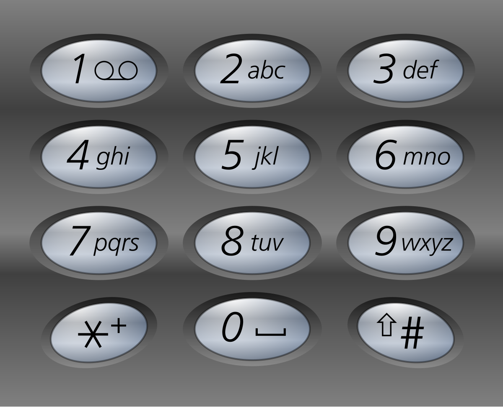

**示例 1：**

**输入：**digits = "23"
**输出：**\["ad","ae","af","bd","be","bf","cd","ce","cf"\]

**示例 2：**

**输入：**digits = "2"
**输出：**\["a","b","c"\]

**提示：**

- `1 <= digits.length <= 4`

- `digits[i]` 是范围 `['2', '9']` 的一个数字。

answer：

这题也是回溯，但和刚刚的“子集”“排列”味道不太一样～

它不是“选数字”，而是：

> **每一层固定选一个字符。**
>
>

---

先看：

```text
digits = "23"
```

电话映射：

```text
2 -> abc
3 -> def
```

于是：

第一位只能从：

```text
a b c
```

里选。

第二位只能从：

```text
d e f
```

里选。

所以树长这样：

```text
""
      /    |    \
     a     b     c
   / | \  /|\   /|\
  d  e f d e f d e f
```

叶子就是答案：

```text
ad ae af ...
```

---

所以你想：

递归参数应该是什么？

不是 `used[]`。

因为每一层位置固定：

```text
第0位
第1位
第2位
...
```

所以你需要：

```text
index
```

表示：

> 现在处理 digits 的第几个数字。
>
>

---

比如：

```text
digits = "23"
```

开始：

```text
index = 0
```

取：

```text
'2' -> "abc"
```

循环：

```text
选 a
选 b
选 c
```

---

假设选了 `a`

path：

```text
"a"
```

递归：

```text
index = 1
```

现在处理：

```text
'3' -> "def"
```

继续：

```text
ad
ae
af
```

---

什么时候结束？

当：

```text
path.length() == digits.length()
```

说明每一位都填完了。

加入答案。

几个小提示：

#### ① 映射怎么存？

最方便：

```text
String[] map = {
    "", 
    "",
    "abc",
    "def",
    "ghi",
    "jkl",
    "mno",
    "pqrs",
    "tuv",
    "wxyz"
};
```

这样：

```text
map[2] -> "abc"
```

很方便。

---

#### ② 用 `StringBuilder`

别用字符串拼接：

```text
path + c
```

会慢。

用：

```text
append()
deleteCharAt()
```

经典回溯操作。

---

#### ③ 特判空串

如果：

```text
digits = ""
```

应该返回：

```text
[]
```

不是 `[""]`

核心在于把digits变成int数组 用int找map 结果收集时机 以及参数怎么设置

now：当前是第几个号码（int数组下标）

```java
public class Solution {
    List<String> res = new ArrayList<>();
    String[] map = {
            "",
            "",
            "abc",
            "def",
            "ghi",
            "jkl",
            "mno",
            "pqrs",
            "tuv",
            "wxyz"
    };

    public List<String> letterCombinations(String digits) {
        if (digits.isEmpty()) {
            return res;
        }
        int[] d = new int[digits.length()];
        char[] c = digits.toCharArray();
        for (int i = 0; i < c.length; i++) {
            d[i] = c[i] - '0';
        }
        dfs(d, new StringBuilder(), 0);
        return res;
    }

    public void dfs(int[] d, StringBuilder cur, int now) {
        if (now == d.length) {
            res.add(cur.toString());
            return;
        }
        String str = map[d[now]];
        for (char c : str.toCharArray()) {
            cur.append(c);
            dfs(d, cur, now + 1);
            cur.deleteCharAt(cur.length() - 1);
        }
    }
}
```

<a id="problem-058"></a>

### [39. 组合总和](https://leetcode.cn/problems/combination-sum/) mid

<https://leetcode.cn/problems/combination-sum/description/?envType=study-plan-v2&envId=top-100-liked>

给你一个 无重复元素的整数数组 `candidates` 和一个目标整数 `target` ，找出 `candidates` 中可以使数字和为目标数 `target` 的 所有 不同组合，并以列表形式返回。你可以按 任意顺序 返回这些组合。

`candidates` 中的 **同一个**数字可以** 无限制重复被选取** 。如果至少一个数字的被选数量不同，则两种组合是不同的。

对于给定的输入，保证和为 `target` 的不同组合数少于 `150` 个。

**示例 1：**

**输入：**candidates = \[2,3,6,7\], target = 7
**输出：**\[\[2,2,3\],\[7\]\]
**解释：**
2 和 3 可以形成一组候选，2 + 2 + 3 = 7 。注意 2 可以使用多次。
7 也是一个候选， 7 = 7 。
仅有这两种组合。

**示例 2：**

**输入:** candidates = \[2,3,5\], target = 8
**输出:** \[\[2,2,2,2\],\[2,3,3\],\[3,5\]\]

**示例 3：**

**输入:** candidates = \[2\], target = 1
**输出:** \[\]

**提示：**

- `1 <= candidates.length <= 30`

- `2 <= candidates[i] <= 40`

- `candidates` 的所有元素 **互不相同**

- `1 <= target <= 40`

answer：

和上题类似，只是可以从start开始选  注意还是要从start开始

```java
public class Solution {
    List<List<Integer>> res = new ArrayList<>();

    public List<List<Integer>> combinationSum(int[] candidates, int target) {
        dfs(candidates, target, new ArrayList<>(), 0, 0);
        return res;
    }

    void dfs(int[] candidates, int tar, List<Integer> cur, int sum, int start) {
        if (sum == tar) {
            res.add(new ArrayList<>(cur));
            return;
        } else if (sum > tar) {
            return;
        }
        for (int i = start; i < candidates.length; i++) {
            cur.add(candidates[i]);
            sum += candidates[i];
            dfs(candidates, tar, cur, sum, i);
            cur.removeLast();
            sum -= candidates[i];
        }
    }
}
```

<a id="problem-059"></a>

### [22. 括号生成](https://leetcode.cn/problems/generate-parentheses/) mid

<https://leetcode.cn/problems/generate-parentheses/description/?envType=study-plan-v2&envId=top-100-liked>

数字 `n` 代表生成括号的对数，请你设计一个函数，用于能够生成所有可能的并且 **有效的** 括号组合。

**示例 1：**

**输入：**n = 3
**输出：**\["((()))","(()())","(())()","()(())","()()()"\]

**示例 2：**

**输入：**n = 1
**输出：**\["()"\]

**提示：**

- `1 <= n <= 8`

answer：

咱们先想：

假设 `n = 3`，总共要放 3个左括号 `(`和 3个右括号 `)`。

每一步你其实只有两种选择：

```text
放 "("
或者
放 ")"
```

比如：

```text
""
├── "("
│   ├── "(("
│   └── "()"
```

像不像一棵决策树

---

但是不能乱放，要满足两个规则：

#### 规则1：左括号数量不能超过 n

比如 n=3：

```text
(((   [正确]
((((  [错误] 多了
```

所以：

```text
if (left < n)
```

才能继续放 `"("`

---

#### 规则2：右括号不能比左括号先多

比如：

```text
")("   [错误]
"())"  [错误]
```

因为括号要合法。

所以只有：

```text
right < left
```

时，才能放 `")"`

---

于是状态就出来了：

你递归时需要记录：

```text
当前字符串 path
用了几个左括号 left
用了几个右括号 right
```

---

终止条件呢？

当：

```text
path.length() == 2 * n
```

说明放满了。

这时加入答案。

记住核心：每步的决策  什么时候能放左 什么时候能放右 先放左再放右

```java
public class Solution {
    List<String> res = new ArrayList<>();

    public List<String> generateParenthesis(int n) {
        dfs(n, 0, 0, new StringBuilder());
        return res;
    }

    void dfs(int n, int left, int right, StringBuilder cur) {
        if (cur.length() == 2 * n) {
            res.add(String.valueOf(cur));
            return;
        }
        if (left < n) { //先放左括号
            cur.append('(');
            left++;
            dfs(n, left, right, cur);
            cur.deleteCharAt(cur.length() - 1);
            left--;
        }//每步回溯
        if (right < left) {//再放右括号
            cur.append(')');
            right++;
            dfs(n, left, right, cur);
            cur.deleteCharAt(cur.length() - 1);
            right--;
        }
    }
}
```

<a id="problem-060"></a>

### [79. 单词搜索](https://leetcode.cn/problems/word-search/) mid  重点看

<https://leetcode.cn/problems/word-search/description/?envType=study-plan-v2&envId=top-100-liked>

给定一个 `m x n` 二维字符网格 `board` 和一个字符串单词 `word` 。如果 `word` 存在于网格中，返回 `true` ；否则，返回 `false` 。

单词必须按照字母顺序，通过相邻的单元格内的字母构成，其中“相邻”单元格是那些水平相邻或垂直相邻的单元格。同一个单元格内的字母不允许被重复使用。

**示例 1：**


**输入：**board = \[\['A','B','C','E'\],\['S','F','C','S'\],\['A','D','E','E'\]\], word = "ABCCED"
**输出：**true

**示例 2：**


**输入：**board = \[\['A','B','C','E'\],\['S','F','C','S'\],\['A','D','E','E'\]\], word = "SEE"
**输出：**true

**示例 3：**


**输入：**board = \[\['A','B','C','E'\],\['S','F','C','S'\],\['A','D','E','E'\]\], word = "ABCB"
**输出：**false

**提示：**

- `m == board.length`

- `n = board[i].length`

- `1 <= m, n <= 6`

- `1 <= word.length <= 15`

- `board` 和 `word` 仅由大小写英文字母组成

**进阶：**你可以使用搜索剪枝的技术来优化解决方案，使其在 `board` 更大的情况下可以更快解决问题？

answer：

#### 正确思路

---

##### 第一步：枚举起点

```text
for every cell
```

---

##### 第二步：dfs(i,j,k)

表示：

> 从 `(i,j)` 开始，能不能匹配 `word[k...]`
>
>

---

##### 第三步：

如果：

```text
k == word.length()
```

说明找完了：

return true

---

##### 第四步：

检查越界 / 已访问 / 字符不匹配

不行直接 false

---

##### 第五步：

标记访问

```text
visited[i][j] = true;
```

---

##### 第六步：

四个方向搜索

---

##### 第七步：

撤销

```text
visited[i][j] = false;
```

这就是经典回溯。

好好理解  cur是当前比较的是第几个字符  枚举每个起点 每个都调用dfs 剪枝

```java
public class Solution {
    char[][] board;
    String word;
    boolean[][] isVisited;

    public boolean exist(char[][] board, String word) {
        this.board = board;
        this.word = word;
        this.isVisited = new boolean[board.length][board[0].length];
        for (int i = 0; i < board.length; i++) {
            for (int j = 0; j < board[0].length; j++) {
                if (dfs(0, i, j)) {
                    return true;
                }
            }
        }
        return false;
    }

    boolean dfs(int cur, int x, int y) {
        if (cur == word.length()) {
            return true;
        }
        if (x < 0 || x >= board.length ||
                y < 0 || y >= board[x].length ||
                isVisited[x][y] ||
                board[x][y] != word.charAt(cur)) {
            return false;
        }

        isVisited[x][y] = true;
        cur++;
        boolean res = dfs(cur, x + 1, y) ||
                dfs(cur, x - 1, y) ||
                dfs(cur, x, y + 1) ||
                dfs(cur, x, y - 1);
        isVisited[x][y] = false;
        cur--;
        return res;
    }
}
```

<a id="problem-061"></a>

### [131. 分割回文串](https://leetcode.cn/problems/palindrome-partitioning/) mid

<https://leetcode.cn/problems/palindrome-partitioning/?envType=study-plan-v2&envId=top-100-liked>

给你一个字符串 `s`，请你将* *`s`* *分割成一些 子串，使每个子串都是 回文串 。返回 `s` 所有可能的分割方案。

**示例 1：**

**输入：**s = "aab"
**输出：**\[\["a","a","b"\],\["aa","b"\]\]

**示例 2：**

**输入：**s = "a"
**输出：**\[\["a"\]\]

**提示：**

- `1 <= s.length <= 16`

- `s` 仅由小写英文字母组成

answer：

不是“往上下左右走”，而是：

> **在字符串里决定“刀下在哪切”**
>
>

---

先看例子：

`s = "aab"`

你可以这样切：

```text
a | a | b
```

也可以：

```text
aa | b
```

但：

```text
a | ab
```

不行，因为 `"ab"` 不是回文。

---

所以回溯树长这样：

```text
"aab"
├── "a"
│    └── "a"
│         └── "b"   [正确]
└── "aa"
      └── "b"       [正确]
```

像不像“从左往右切蛋糕”

---

#### 状态是什么？

你需要记录：

```text
start：当前切到哪里了
path：已经切出来的子串
```

比如：

```text
["aa"]
```

说明前面已经切好了，下一刀从 index=2 开始。

---

#### dfs(start)

表示：

> 从 `start` 开始，把后面的字符串继续切完。
>
>

---

#### 每层做什么？

枚举：

```text
for (int end = start; end < s.length(); end++)
```

意思：

尝试切出：

```text
s[start...end]
```

比如：

```text
a
aa
aab
```

都试一遍。

---

#### 但不是所有刀都能下

先判断：

```text
isPalindrome(start, end)
```

如果不是回文：

直接跳过 [错误]

如果是：

加入 path：

```text
path.add(...)
```

递归：

```text
dfs(end + 1)
```

回来撤销：

```text
path.remove(...)
```

---

#### 终止条件

什么时候说明切完了？

```text
if (start == s.length())
```

说明：

字符串已经全部处理完。

把当前 path 加入答案。

```java
public class Solution {
    String s;
    List<List<String>> res = new ArrayList<>();

    public List<List<String>> partition(String s) {
        this.s = s;
        dfs(new ArrayList<>(), 0);
        return res;
    }

    void dfs(List<String> path, int start) {
        if (start == s.length()) {
         res.add(new ArrayList<>(path));        
             return;
        }
        for (int i = start; i < s.length(); i++) {//枚举下一刀到哪里
            if (!isOk(start, i)) {
                continue;
            }
            path.add(s.substring(start, i + 1));
            dfs(path, i+1);
            path.removeLast();
        }
    }

    boolean isOk(int left, int right) {
        while (left <= right) {
            if (s.charAt(left) != s.charAt(right)) {
                return false;
            }
            left++;
            right--;
        }
        return true;
    }
}
```

<a id="problem-062"></a>

### [51. N 皇后](https://leetcode.cn/problems/n-queens/) hard

<https://leetcode.cn/problems/n-queens/description/?envType=study-plan-v2&envId=top-100-liked>

按照国际象棋的规则，皇后可以攻击与之处在同一行或同一列或同一斜线上的棋子。

**n 皇后问题** 研究的是如何将 `n` 个皇后放置在 `n×n` 的棋盘上，并且使皇后彼此之间不能相互攻击。

给你一个整数 `n` ，返回所有不同的 n 皇后问题 的解决方案。

每一种解法包含一个不同的 **n 皇后问题** 的棋子放置方案，该方案中 `'Q'` 和 `'.'` 分别代表了皇后和空位。

**示例 1：**


**输入：**n = 4
**输出：**\[\[".Q..","...Q","Q...","..Q."\],\["..Q.","Q...","...Q",".Q.."\]\]
**解释：**如上图所示，4 皇后问题存在两个不同的解法。

**示例 2：**

**输入：**n = 1
**输出：**\[\["Q"\]\]

**提示：**

- `1 <= n <= 9`

answer：

来了，回溯界的大 boss —— **N-Queens**

别被“困难”吓到，它本质还是：

> **一行一行放皇后，放错了就撤回。**
>
>

还是那个熟悉的味道

---

#### 先想 simplest version

假设 `n = 4`：

棋盘一开始：

```text
....
....
....
....
```

第一行你可以放：

```text
Q...
.Q..
..Q.
...Q
```

四种选择。

---

然后进入第二行。

比如第一行放在 `(0,1)`：

```text
.Q..
....
....
....
```

第二行还能放哪里？

不能同列：

```text
第1列 [错误]
```

不能对角线：

```text
左下 [错误]
右下 [错误]
```

剩下合法位置才可以。

---

所以你会发现：

#### 每次只需要决定：

> **当前第 row 行，皇后放在哪一列 col**
>
>

于是状态就是：

```text
dfs(row)
```

表示：

> 正在处理第 row 行。
>
>

---

#### 终止条件

如果：

```text
row == n
```

说明：

1\~n 行都放完了。

找到一个解，加入答案 [正确]

---

#### 每层做什么

枚举这一行所有列：

```text
for (int col = 0; col < n; col++)
```

尝试：

```text
(row, col)
```

---

#### 怎么判断合法？

三个方向不能冲突：

##### ① 同列

比如：

```text
第 2 列已经有皇后
```

不能放。

---

##### ② 左上对角线

规律：

```text
row - col
```

一样说明在同一条 "" 对角线上。

---

##### ③ 右上对角线

规律：

```text
row + col
```

一样说明在同一条 "/" 对角线上。

---

所以常用三个集合：

```text
Set<Integer> cols
Set<Integer> diag1   // row - col
Set<Integer> diag2   // row + col
```

查一下：

```text
contains()
```

O(1)，很爽。

---

#### 放置流程

如果合法：

```text
放 Q
记录 cols/diag1/diag2
dfs(row + 1)
撤销
```

熟悉吗？

又是：

```text
选择
递归
撤销
```

永恒回溯模板

#### 小提示：棋盘怎么存？

推荐：

```text
char[][] board
```

初始化：

```text
'.'
```

放皇后：

```text
board[row][col] = 'Q';
```

撤销：

```text
board[row][col] = '.';
```

最后转成 `List<String>`。

```java
public class Solution {
    List<List<String>> res = new ArrayList<>();
    int n;
    Set<Integer> col = new HashSet<>();
    Set<Integer> diagLT2RB = new HashSet<>();
    Set<Integer> diagLB2RT = new HashSet<>();

    public List<List<String>> solveNQueens(int n) {
        this.n = n;
        char[][] cur = new char[n][n];
        for (char[] c : cur) {
            Arrays.fill(c, '.');
        }
        dfs(0, cur);
        return res;
    }

    void dfs(int row, char[][] cur) {
        if (row == n) {
            List<String> list = new ArrayList<>();
            for (char[] c : cur) {
                list.add(String.valueOf(c));
            }
            res.add(list);
            return;
        }

        for (int i = 0; i < n; i++) {
            if (col.contains(i) || diagLT2RB.contains(row - i) || diagLB2RT.contains(row + i)) {
                continue;
            }
            cur[row][i] = 'Q';
            col.add(i);
            diagLT2RB.add(row - i);
            diagLB2RT.add(row + i);
            dfs(row + 1, cur);
            cur[row][i] = '.';
            col.remove(i);
            diagLT2RB.remove(row - i);
            diagLB2RT.remove(row + i);
        }
    }
}
```

#### 如果用boolean数组优化set 下标i+j或i-j+n(防止负数)来访问 能更快:

```java
public class Solution {
    List<List<String>> res = new ArrayList<>();
    int n;
    boolean[] col;
    boolean[] diagLT2RB;
    boolean[] diagLB2RT;

    public List<List<String>> solveNQueens(int n) {
        this.n = n;
        this.col = new boolean[n];
        this.diagLT2RB = new boolean[2 * n];
        this.diagLB2RT = new boolean[2 * n];
        char[][] cur = new char[n][n];
        for (char[] c : cur) {
            Arrays.fill(c, '.');
        }
        dfs(0, cur);
        return res;
    }

    void dfs(int row, char[][] cur) {
        if (row == n) {
            List<String> list = new ArrayList<>();
            for (char[] c : cur) {
                list.add(String.valueOf(c));
            }
            res.add(list);
            return;
        }

        for (int i = 0; i < n; i++) {
            if (col[i] || diagLT2RB[row - i + n] || diagLB2RT[row + i]) {
                continue;
            }
            cur[row][i] = 'Q';
            col[i] = diagLT2RB[row - i + n] = diagLB2RT[row + i] = true;
            dfs(row + 1, cur);
            cur[row][i] = '.';
            col[i] = diagLT2RB[row - i + n] = diagLB2RT[row + i] = false;
        }
    }
}
```

<a id="chapter-11"></a>

## 11. 二分查找

<a id="problem-063"></a>

### [35. 搜索插入位置](https://leetcode.cn/problems/search-insert-position/) easy

<https://leetcode.cn/problems/search-insert-position/description/?envType=study-plan-v2&envId=top-100-liked>

给定一个排序数组和一个目标值，在数组中找到目标值，并返回其索引。如果目标值不存在于数组中，返回它将会被按顺序插入的位置。

请必须使用时间复杂度为 `O(log n)` 的算法。

**示例 1:**

**输入:** nums = \[1,3,5,6\], target = 5
**输出:** 2

**示例 2:**

**输入:** nums = \[1,3,5,6\], target = 2
**输出:** 1

**示例 3:**

**输入:** nums = \[1,3,5,6\], target = 7
**输出:** 4

**提示:**

- `1 <= nums.length <= 10(4)`

- `-10(4) <= nums[i] <= 10(4)`

- `nums` 为 **无重复元素**的 **升序** 排列数组

- `-10(4) <= target <= 10(4)`

answer：

因为二分每次必须 **排除 mid**

如果：

```text
nums[mid] < target
```

说明：

```text
mid 不可能是答案
```

所以应该：

```text
start = mid + 1;
```

不是 `mid`

---

同理：

```text
nums[mid] > target
```

应该：

```text
end = mid - 1;
```

不是 `mid`

#### 为什么最后返回 `left`？

这是这题灵魂

假设：

```text
nums = [1,3,5,6]
target = 2
```

最后会变成：

```text
left = 1
right = 0
```

循环结束。

此时：

```text
left 指向第一个 >= target 的位置
```

也就是：

```text
插入位置
```

刚好是答案。

这个思想叫：

> ### **lower\_bound（二分找第一个 \>= target）**
>
>

记住这个思想 lowerbound  二分 等于返回 小于left--，大于right--

```java
public class Solution {
    public int searchInsert(int[] nums, int target) {
        int left = 0;
        int right = nums.length - 1;
        while (left <= right) {
            int mid = left + (right - left) / 2;
            if (nums[mid] == target) {
                return mid;
            } else if (nums[mid] < target) {
                left = mid + 1;
            } else {
                right = mid - 1;
            }
        }
        return left;
    }
}
```

<a id="problem-064"></a>

### [74. 搜索二维矩阵](https://leetcode.cn/problems/search-a-2d-matrix/) mid

<https://leetcode.cn/problems/search-a-2d-matrix/description/?envType=study-plan-v2&envId=top-100-liked>

给你一个满足下述两条属性的 `m x n` 整数矩阵：

- 每行中的整数从左到右按非严格递增顺序排列。

- 每行的第一个整数大于前一行的最后一个整数。

给你一个整数 `target` ，如果 `target` 在矩阵中，返回 `true` ；否则，返回 `false` 。

**示例 1：**


**输入：**matrix = \[\[1,3,5,7\],\[10,11,16,20\],\[23,30,34,60\]\], target = 3
**输出：**true

**示例 2：**


**输入：**matrix = \[\[1,3,5,7\],\[10,11,16,20\],\[23,30,34,60\]\], target = 13
**输出：**false

**提示：**

- `m == matrix.length`

- `n == matrix[i].length`

- `1 <= m, n <= 100`

- `-10(4) <= matrix[i][j], target <= 10(4)`

answer：

matrix\[mid / n\]\[mid % n\]  映射二维到一维二分即可

```java
public class Solution {
    public boolean searchMatrix(int[][] matrix, int target) {
        int left = 0;
        int weight = matrix[0].length;
        int height = matrix.length;
        int right = height * weight - 1;
        while (left <= right) {
            int index = (left + right) / 2;
            int row = index / weight;
            int col = index % weight;
            if (matrix[row][col] == target) {
                return true;
            }
            if (matrix[row][col] > target) {
                right = index - 1;
                continue;
            }
            if (matrix[row][col] < target) {
                left = index + 1;
            }
        }
        return false;
    }
}
```

<a id="problem-065"></a>

### [34. 在排序数组中查找元素的第一个和最后一个位置](https://leetcode.cn/problems/find-first-and-last-position-of-element-in-sorted-array/) mid

<https://leetcode.cn/problems/find-first-and-last-position-of-element-in-sorted-array/description/?envType=study-plan-v2&envId=top-100-liked>

给你一个按照非递减顺序排列的整数数组 `nums`，和一个目标值 `target`。请你找出给定目标值在数组中的开始位置和结束位置。

如果数组中不存在目标值 `target`，返回 `[-1, -1]`。

你必须设计并实现时间复杂度为 `O(log n)` 的算法解决此问题。

**示例 1：**

```text
**输入：**nums = [5,7,7,8,8,10], target = 8
**输出：**[3,4]
```

**示例 2：**

```text
**输入：**nums = [5,7,7,8,8,10], target = 6
**输出：**[-1,-1]
```

**示例 3：**

**输入：**nums = \[\], target = 0
**输出：**\[-1,-1\]

**提示：**

- `0 <= nums.length <= 10(5)`

- `-10(9) <= nums[i] <= 10(9)`

- `nums` 是一个非递减数组

- `-10(9) <= target <= 10(9)`

answer：

#### 正确思路：二分两次

别找“某个 target”，而是找：

##### 第一次：第一个 `>= target` 的位置（左边界）

也叫 **lower\_bound**

---

例子：

```text
nums = [5,7,7,8,8,10]
target = 8
```

找：

```text
第一个 >= 8
```

答案：

```text
3
```

---

##### 第二次：第一个 `> target` 的位置（右边界+1）

找：

```text
第一个 > 8
```

答案：

```text
5
```

所以右边界：

```text
5 - 1 = 4
```

---

于是答案：

```text
[3,4]
```

是不是优雅很多

---

##### 写一个通用函数

```text
int lowerBound(int[] nums, int target)
```

意思：

> 返回第一个 `>= target` 的下标
>
>
>
>

模板：

```text
int left = 0, right = nums.length - 1;

while(left <= right){
    int mid = left + (right-left)/2;

    if(nums[mid] < target)
        left = mid + 1;
    else
        right = mid - 1;
}

return left;
```

记住：

最后 `left` 就是答案。

---

然后主函数：

```text
int l = lowerBound(nums, target);
```

先判断：

```text
if (l == nums.length || nums[l] != target)
    return [-1,-1];
```

说明根本不存在。

---

再找右边界：

```text
int r = lowerBound(nums, target + 1) - 1;
```

结束。

#### `lowerBound` 到底在干嘛？

定义：

> 找 第一个 `>= target` 的位置
>
>

不是找 target 本身。

是找：

```text
第一个满足 nums[i] >= target 的 i
```

永远返回：

```text
x 应该插进去的位置
```

这是不是突然像 Search Insert Position 了？

因为本来就是一个东西

#### 为什么最后返回 `left`？

看模板：

```text
while(left <= right){
    int mid = ...

    if(nums[mid] < target)
        left = mid + 1;
    else
        right = mid - 1;
}
return left;
```

---

注意：

如果：

```text
nums[mid] < target
```

说明：

```text
mid 不够大
```

所以答案一定在右边：

```text
left = mid + 1;
```

---

如果：

```text
nums[mid] >= target
```

说明：

“可能是答案”。

但我们想找 **第一个**。

所以不能停，要继续往左找：

```text
right = mid - 1;
```

---

最后循环结束时：

```text
left > right
```

而 `left` 正好卡在：

```text
第一个 >= target 的位置
```

这就是 magic

为什么不用“找最后一个 8”？

可以，但麻烦。

找 “第一个 9”，再减 1，更统一。

这叫：

> ### **用 lowerBound 解决 upperBound**
>
>

很多人都这么干。

这个模版也要记住

```java
public class Solution {
    public int[] searchRange(int[] nums, int target) {
        int l = lowerBound(nums, target);
        int r = lowerBound(nums, target + 1)-1;
        if (l == nums.length || nums[l] != target) {
            return new int[]{-1, -1};
        }
        return new int[]{l, r};
    }

    int lowerBound(int[] nums, int target) {
        int left = 0;
        int right = nums.length - 1;
        while (left <= right) {
            int index = (left + right) / 2;
            if (nums[index] < target) {
                left = index + 1;
            } else {
                right = index - 1;
            }
        }
        return left;
    }
}
```

代码

测试用例

测试用例

测试结果

<a id="problem-066"></a>

### [33. 搜索旋转排序数组](https://leetcode.cn/problems/search-in-rotated-sorted-array/) mid

<https://leetcode.cn/problems/search-in-rotated-sorted-array/description/?envType=study-plan-v2&envId=top-100-liked>

整数数组 `nums` 按升序排列，数组中的值 **互不相同** 。

在传递给函数之前，`nums` 在预先未知的某个下标 `k`（`0 <= k < nums.length`）上进行了 **向左旋转**，使数组变为 `[nums[k], nums[k+1], ..., nums[n-1], nums[0], nums[1], ..., nums[k-1]]`（下标**从 0 开始** 计数）。例如， `[0,1,2,4,5,6,7]` 下标 `3` 上向左旋转后可能变为 `[4,5,6,7,0,1,2]` 。

给你 **旋转后** 的数组 `nums` 和一个整数 `target` ，如果 `nums` 中存在这个目标值 `target` ，则返回它的下标，否则返回 `-1` 。

你必须设计一个时间复杂度为 `O(log n)` 的算法解决此问题。

**示例 1：**

**输入：**nums = \[4,5,6,7,0,1,2\], target = 0
**输出：**4

**示例 2：**

**输入：**nums = \[4,5,6,7,0,1,2\], target = 3
**输出：**-1

**示例 3：**

**输入：**nums = \[1\], target = 0
**输出：**-1

**提示：**

- `1 <= nums.length <= 5000`

- `-10(4) <= nums[i] <= 10(4)`

- `nums` 中的每个值都 **独一无二**

- 题目数据保证 `nums` 在预先未知的某个下标上进行了旋转

- `-10(4) <= target <= 10(4)`

answer：

#### 提示1：每次二分，至少有一半一定是有序的

比如：

```text
[4,5,6,7,0,1,2]
 l     m     r
```

`nums[mid]=7`

你观察：

```text
nums[left] <= nums[mid]
```

成立，说明：

```text
[4,5,6,7]
```

左半边是有序的。

---

#### 提示2：判断 target 在不在这个有序区间里

如果左边有序：

```text
[left ... mid]
```

那判断：

```text
nums[left] <= target && target < nums[mid]
```

如果成立，说明 target 在左边 → `right = mid - 1`

否则去右边 → `left = mid + 1`

---

#### 提示3：如果左边不是有序的，那右边一定有序

比如：

```text
[6,7,0,1,2,4,5]
 l   m       r
```

这时：

```text
nums[left] <= nums[mid]
```

不成立。

说明右边：

```text
[mid ... right]
```

一定有序。

然后判断：

```text
nums[mid] < target && target <= nums[right]
```

成立就去右边，否则去左边。

好好理解判断条件  有序则left一定比mid小  注意条件一定要写全

```java
public class Solution {
    public int search(int[] nums, int target) {
        int left = 0;
        int right = nums.length - 1;
        while (left <= right) {
            int mid = (left + right) / 2;
            if (nums[mid] == target) {
                return mid;
            }
            if (nums[left] <= nums[mid]) {
                if (target >= nums[left] && target <= nums[mid]) {
                    right = mid - 1;
                    continue;
                } else {
                    left = mid + 1;
                    continue;
                }

            } else {
                if (target >= nums[mid] && target <= nums[right]) {
                    left = mid + 1;
                } else {
                    right = mid - 1;
                }
            }
        }
        return -1;
    }
}
```

<a id="problem-067"></a>

### [153. 寻找旋转排序数组中的最小值](https://leetcode.cn/problems/find-minimum-in-rotated-sorted-array/) mid

<https://leetcode.cn/problems/find-minimum-in-rotated-sorted-array/description/?envType=study-plan-v2&envId=top-100-liked>

已知一个长度为 `n` 的数组，预先按照升序排列，经由 `1` 到 `n` 次 **旋转** 后，得到输入数组。例如，原数组 `nums = [0,1,2,4,5,6,7]` 在变化后可能得到：

- 若旋转 `4` 次，则可以得到 `[4,5,6,7,0,1,2]`

- 若旋转 `7` 次，则可以得到 `[0,1,2,4,5,6,7]`

注意，数组 `[a[0], a[1], a[2], ..., a[n-1]]` **旋转一次** 的结果为数组 `[a[n-1], a[0], a[1], a[2], ..., a[n-2]]` 。

给你一个元素值 **互不相同**的数组 `nums` ，它原来是一个升序排列的数组，并按上述情形进行了多次旋转。请你找出并返回数组中的** 最小元素** 。

你必须设计一个时间复杂度为 `O(log n)` 的算法解决此问题。

**示例 1：**

**输入：**nums = \[3,4,5,1,2\]
**输出：**1
**解释：**原数组为 \[1,2,3,4,5\] ，旋转 3 次得到输入数组。

**示例 2：**

**输入：**nums = \[4,5,6,7,0,1,2\]
**输出：**0
**解释：**原数组为 \[0,1,2,4,5,6,7\] ，旋转 4 次得到输入数组。

**示例 3：**

**输入：**nums = \[11,13,15,17\]
**输出：**11
**解释：**原数组为 \[11,13,15,17\] ，旋转 4 次得到输入数组。

**提示：**

- `n == nums.length`

- `1 <= n <= 5000`

- `-5000 <= nums[i] <= 5000`

- `nums` 中的所有整数 **互不相同**

- `nums` 原来是一个升序排序的数组，并进行了 `1` 至 `n` 次旋转

answer：

这题和刚刚那道 **33 搜索旋转数组** 是亲兄弟，只不过：

- 33 是：找某个 `target`

- 153 是：找“断点”（也就是最小值）

找到断点 = 找到旋转的位置

---

先看图：

```text
[4,5,6,7,0,1,2]
         ↑
        最小值
```

这个 `0` 很特别：

它左边都比它大，

它右边都比它大。

它就是“分界线”。

---

#### 提示1：拿 `mid` 和 `right` 比

为什么不是和 `left` 比？

因为：

```text
[4,5,6,7,0,1,2]
             r
```

右端点 `2` 永远在“后半段”（小值段）里，很适合当参照物。

---

假设：

```text
[4,5,6,7,0,1,2]
 l   m     r
```

`mid = 6`

比较：

```text
nums[mid] > nums[right]
```

成立：

```text
6 > 2
```

说明什么？

说明 `mid` 还在左半边（大值区）：

```text
[4,5,6,7] | [0,1,2]
      m
```

那最小值一定在 **右边**：

```text
left = mid + 1;
```

---

再看另一种：

```text
[4,5,6,7,0,1,2]
         m   r
```

`mid = 1`

比较：

```text
1 < 2
```

说明 `mid` 已经在右半边（小值区）了。

而最小值可能就是 `mid`，不能丢掉！

所以：

```text
right = mid;
```

注意不是 `mid - 1` [注意]

---

所以核心就一句：

```text
if (nums[mid] > nums[right])
    left = mid + 1;
else
    right = mid;
```

---

为什么循环条件是：

```text
while (left < right)
```

不是 `<=`？

因为最后会收敛成：

```text
left == right
```

那个位置就是答案。

直接：

```text
return nums[left];
```

核心在于理解判断的条件（小端和大端）  以及right怎么变

```java
public class Solution {
    public int findMin(int[] nums) {
        int left = 0;
        int right = nums.length - 1;
        while (left < right) { //最后left=right时 返回
            int mid = (left + right) / 2;
            if (nums[mid] < nums[right]) {
                right = mid;
            } else {
                left = mid + 1;
            }
        }
        return nums[left];
    }
}
```

<a id="problem-068"></a>

### [4. 寻找两个正序数组的中位数](https://leetcode.cn/problems/median-of-two-sorted-arrays/) hard

不会

<https://leetcode.cn/problems/median-of-two-sorted-arrays/description/?envType=study-plan-v2&envId=top-100-liked>

给定两个大小分别为 `m` 和 `n` 的正序（从小到大）数组 `nums1` 和 `nums2`。请你找出并返回这两个正序数组的 **中位数** 。

算法的时间复杂度应该为 `O(log (m+n))` 。

**示例 1：**

**输入：**nums1 = \[1,3\], nums2 = \[2\]
**输出：**2.00000
**解释：**合并数组 = \[1,2,3\] ，中位数 2

**示例 2：**

**输入：**nums1 = \[1,2\], nums2 = \[3,4\]
**输出：**2.50000
**解释：**合并数组 = \[1,2,3,4\] ，中位数 (2 + 3) / 2 = 2.5

**提示：**

- `nums1.length == m`

- `nums2.length == n`

- `0 <= m <= 1000`

- `0 <= n <= 1000`

- `1 <= m + n <= 2000`

- `-10(6) <= nums1[i], nums2[i] <= 10(6)`

answer：

假设：

```text
nums1 = [1,3]
nums2 = [2]
```

题目要中位数。

你脑子里第一反应是不是：

```text
合并：
[1,2,3]
```

中位数：

```text
2
```

对吧。

---

#### 但其实“中位数”本质是什么？

不是“某个神秘数字”，而是：

> **把整个数组分成左右两半的那个位置。**
>
>

比如：

```text
[1,2,3]
```

你在 `2` 这里切：

```text
[1 | 2 | 3]
```

左边有 1 个，右边有 1 个。

`2` 正好在中间。

---

再看偶数：

```text
[1,2,3,4]
```

切在中间：

```text
[1,2 | 3,4]
```

左边两个，右边两个。

中位数是：

```text
(2+3)/2
```

也就是：

> 左边最大值 + 右边最小值
>
>

除以 2。

---

所以你发现了吗：

我们根本不需要真的 merge 出：

```text
[1,2,3,4]
```

我们只需要知道：

```text
左边最大是谁
右边最小是谁
```

就够了。

**切完之后要把左右两边“合并看”**，不是分别看每个数组。

咱一步一步来。

---

数组：

```text
nums1 = [1,3]
nums2 = [2]
```

---

#### 第一次切：

```text
nums1: [1 | 3]
nums2: [ | 2]
```

注意：

- `nums1` 左边是 `[1]`

- `nums2` 左边是 `[]`

所以“总左边”是：

```text
[1] + [] = [1]
```

“总右边”是：

```text
[3] + [2] = [3,2]
```

所以：

```text
左：[1]
右：[3,2]
```

问题来了：

右边乱了！

因为 `2 < 3`，说明你切错了 [错误]

---

#### 第二次切：

换个位置：

```text
nums1: [1 | 3]
nums2: [2 | ]
```

现在：

`nums1` 左边：

```text
[1]
```

`nums2` 左边：

```text
[2]
```

合起来：

```text
[1,2]
```

右边：

```text
[3] + [] = [3]
```

于是：

```text
左：[1,2]
右：[3]
```

这次满足：

```text
左边所有 <= 右边所有
```

所以切对了 [正确]

#### 重点

我们不是看：

```text
nums1 自己有没有序
nums2 自己有没有序
```

而是看：

```text
(两个数组左半部分合起来)
和
(两个数组右半部分合起来)
```

是不是：

```text
左 <= 右
```

#### **怎么用二分找这个切口**

#### 第一步：先在短数组上切

为什么？

因为二分要在更短的数组上做，边界更好处理。

这里：

```text
nums2 更短
```

所以交换一下：

```text
A = [2]
B = [1,3]
```

记住：

```text
m = 1
n = 2
```

---

#### 第二步：目标是左右数量平衡

总长度：

```text
m+n = 3
```

左边应该放几个？

```text
(3+1)/2 = 2
```

为什么加 1？

因为奇数时让左边多一个。

所以目标：

```text
左边总共要有 2 个数
```

---

#### 第三步：假设 A 切了 i 个

比如先猜：

```text
i = 0
```

意思：

```text
A: [ | 2]
```

A 左边拿了 0 个。

那 B 必须拿：

```text
j = 2 - i = 2
```

所以：

```text
B: [1,3 | ]
```

---

于是整体：

```text
左边 = [] + [1,3] = [1,3]
右边 = [2] + []   = [2]
```

坏了：

```text
3 > 2
```

左边比右边还大，切错了。

说明：

```text
A切得太靠左
```

要往右移。

---

#### 再试：

```text
i = 1
```

即：

```text
A: [2 | ]
```

那：

```text
j = 2 - 1 = 1
```

所以：

```text
B: [1 | 3]
```

整体：

```text
左边 = [2] + [1] = [1,2]
右边 = [] + [3] = [3]
```

完美：

```text
左 <= 右
```

找到啦 [正确]

---

#### 怎么程序判断“切对没”？

只看边界四个数：

```text
A_left   = A[i-1]
A_right  = A[i]

B_left   = B[j-1]
B_right  = B[j]
```

检查：

```text
A_left <= B_right
B_left <= A_right
```

成立就是切对了。

---

刚刚那个正确例子：

```text
A=[2]
B=[1,3]
i=1
j=1
```

得到：

```text
A_left = 2
A_right = +∞   (因为右边空)

B_left = 1
B_right = 3
```

检查：

```text
2 <= 3 [正确]
1 <= ∞ [正确]
```

成功

---

所以代码里：

```text
int i = (left + right) / 2;
int j = (m + n + 1) / 2 - i;
```

然后判断这两个条件。

#### 完整步骤：

##### 第一步：保证 nums1 是短数组

这个你写对了：

```text
if (nums1.length > nums2.length) {
    return findMedianSortedArrays(nums2, nums1);
}
```

这样后面永远在短数组上二分。

假设：

```text
A = nums1
B = nums2
```

---

##### 第二步：初始化二分

```text
int m = nums1.length;
int n = nums2.length;

int left = 0;
int right = m;
```

注意：

这里是 `m`，不是 `m-1` [注意]

因为切口可以在：

```text
| 1 2 3
```

最左边（0个）

也可以：

```text
1 2 3 |
```

最右边（3个）

所以范围是：

```text
[0, m]
```

---

##### 第三步：二分找 i

```text
while (left <= right) {
    int i = left + (right - left) / 2;
```

---

##### 第四步：推出 j

因为左边总共要：

m+n+12\\frac\{m+n+1\}\{2\}2m+n+1

所以：

```text
int j = (m + n + 1) / 2 - i;
```

---

##### 第五步：取四个边界

这个是关键。

```text
int Aleft =
        (i == 0) ? Integer.MIN_VALUE : nums1[i - 1];

int Aright =
        (i == m) ? Integer.MAX_VALUE : nums1[i];

int Bleft =
        (j == 0) ? Integer.MIN_VALUE : nums2[j - 1];

int Bright =
        (j == n) ? Integer.MAX_VALUE : nums2[j];
```

为什么用 ±∞？

因为可能切到边界，比如：

```text
| 1 2 3
```

左边没数。

那就当：

```text
左边 = -∞
```

这样比较方便。

---

##### 第六步：判断切对没

```text
if (Aleft <= Bright && Bleft <= Aright)
```

切对了！

---

###### 如果总长度奇数

返回：

```text
return Math.max(Aleft, Bleft);
```

---

###### 如果偶数

返回：

```text
return (Math.max(Aleft, Bleft)
      + Math.min(Aright, Bright)) / 2.0;
```

注意 `2.0`，别写成 `2`，否则整除哭出来

---

##### 第七步：没切对就调整

如果：

```text
Aleft > Bright
```

说明：

```text
A切太多了
```

往左：

```text
right = i - 1;
```

否则：

```text
A切少了
```

往右：

```text
left = i + 1;
```

完整代码

```java
class Solution {
    public double findMedianSortedArrays(int[] nums1, int[] nums2) {

        if (nums1.length > nums2.length) {
            return findMedianSortedArrays(nums2, nums1);
        }

        int m = nums1.length;
        int n = nums2.length;

        int left = 0;
        int right = m;

        while (left <= right) {
            int i = left + (right - left) / 2;
            int j = (m + n + 1) / 2 - i;

            int Aleft =
                    (i == 0) ? Integer.MIN_VALUE : nums1[i - 1];
            int Aright =
                    (i == m) ? Integer.MAX_VALUE : nums1[i];

            int Bleft =
                    (j == 0) ? Integer.MIN_VALUE : nums2[j - 1];
            int Bright =
                    (j == n) ? Integer.MAX_VALUE : nums2[j];

            if (Aleft <= Bright && Bleft <= Aright) {
                if ((m + n) % 2 == 1) {
                    return Math.max(Aleft, Bleft);
                }
                return (Math.max(Aleft, Bleft)
                        + Math.min(Aright, Bright)) / 2.0;
            }

            if (Aleft > Bright) {
                right = i - 1;
            } else {
                left = i + 1;
            }
        }

        return 0;
    }
}
```

<a id="chapter-12"></a>

## 12. 栈

#### 栈顶 (Top)： 允许进行插入（Push/入栈）和删除（Pop/出栈）的操作端，是变化的一端。

#### 栈底 (Bottom)： 不允许操作的、固定的底部端，最先放入的元素位于此处。

<a id="problem-069"></a>

### [20. 有效的括号](https://leetcode.cn/problems/valid-parentheses/) easy

<http://leetcode.cn/problems/valid-parentheses/?envType=study-plan-v2&envId=top-100-liked>

给定一个只包括 `'('`，`')'`，`'{'`，`'}'`，`'['`，`']'` 的字符串 `s` ，判断字符串是否有效。

有效字符串需满足：

1. 左括号必须用相同类型的右括号闭合。

2. 左括号必须以正确的顺序闭合。

3. 每个右括号都有一个对应的相同类型的左括号。

**示例 1：**

**输入：**s = "()"

**输出：**true

**示例 2：**

**输入：**s = "()\[\]\{\}"

**输出：**true

**示例 3：**

**输入：**s = "(\]"

**输出：**false

**示例 4：**

**输入：**s = "(\[\])"

**输出：**true

**示例 5：**

**输入：**s = "(\[)\]"

**输出：**false

**提示：**

- `1 <= s.length <= 10(4)`

- `s` 仅由括号 `'()[]{}'` 组成

answer：

Java 用 `Deque` 当栈：

#### 为什么这里直接 `else`？

因为题目保证：

```text
s 仅由 ()[]{} 组成
```

所以：

不是左括号，那一定是右括号。

不用再写：

```text
if (c == ')' || ...)
```

```java
public class Solution {
    public boolean isValid(String s) {
        Deque<Character> stack = new ArrayDeque<>();
        for (char c : s.toCharArray()) {
            if (c == '(' || c == '{' || c == '[') {
                stack.push(c);
            } else {
                if (stack.isEmpty()) {
                    return false;
                }
                char top = stack.pop();
                if ((c == ')' && top != '(') ||
                        (c == '}' && top != '{') ||
                        (c == ']' && top != '[')) {
                    return false;
                }
            }
        }
        return stack.isEmpty();
    }
}
```

#### 再优化一版（超常见面试写法）

把“期待的右括号”压进去。

这个思路特别丝滑：

```java
public class Solution {

    public boolean isValid(String s) {
        Deque<Character> stack = new ArrayDeque<>();
        for (char c : s.toCharArray()) {
            if (c == '(') stack.push(')');
            else if (c == '{') stack.push('}');
            else if (c == '[') stack.push(']');
            else if (c == ')' || c == ']' || c == '}') {
                if (stack.isEmpty() || stack.pop() != c) {
                    return false;
                }
            }

        }
        return stack.isEmpty();
    }
}
```

<a id="problem-070"></a>

### [155. 最小栈](https://leetcode.cn/problems/min-stack/) mid

<https://leetcode.cn/problems/min-stack/description/?envType=study-plan-v2&envId=top-100-liked>

设计一个支持 `push` ，`pop` ，`top` 操作，并能在常数时间内检索到最小元素的栈。

实现 `MinStack` 类:

- `MinStack()` 初始化堆栈对象。

- `void push(int val)` 将元素val推入堆栈。

- `void pop()` 删除堆栈顶部的元素。

- `int top()` 获取堆栈顶部的元素。

- `int getMin()` 获取堆栈中的最小元素。

**示例 1:**

**输入：**
\["MinStack","push","push","push","getMin","pop","top","getMin"\]
\[\[\],\[-2\],\[0\],\[-3\],\[\],\[\],\[\],\[\]\]

**输出：**
\[null,null,null,null,-3,null,0,-2\]

**解释：**
MinStack minStack = new MinStack();
minStack.push(-2);
minStack.push(0);
minStack.push(-3);
minStack.getMin();   --\> 返回 -3.
minStack.pop();
minStack.top();      --\> 返回 0.
minStack.getMin();   --\> 返回 -2.

**提示：**

- `-2(31) <= val <= 2(31) - 1`

- `pop`、`top` 和 `getMin` 操作总是在 **非空栈** 上调用

- `push`, `pop`, `top`, and `getMin`最多被调用 `3 * 10(4)` 次

answer：

#### 思路1：辅助栈（经典）

准备两个栈：

```text
主栈：存正常数据
最小栈：存当前最小值
```

---

##### push(5)

主栈：

```text
5
```

最小栈：

```text
5
```

---

##### push(3)

主栈：

```text
5 3
```

最小栈：

```text
5 3
```

因为：

```text
min(5,3)=3
```

---

##### push(7)

主栈：

```text
5 3 7
```

最小栈：

```text
5 3 3
```

注意！

不是放 7，而是放：

```text
当前最小值 = 3
```

---

##### pop()

两个一起弹：

主栈：

```text
5 3
```

最小栈：

```text
5 3
```

于是新的最小值自动恢复成：

```text
3
```

#### 思路2：每个节点自己记住“到这里为止的最小值”

自己写链表嘛，那可以这样：

```text
class Node {
    int val;
    int min;
    Node next;
}
```

> ### **思路3：差值法（Difference Encoding）**
>
> 或者叫 **单栈 + min trick**
>
>

很多人第一次看到都会懵：

“啊？怎么只用一个栈还能记住最小值？”

别怕，我们拆开看

---

普通做法（双栈）

通常是：

```text
stack:    5 3 7
minStack: 5 3 3
```

空间：

O(n)O(n)O(n)

O(n)O(n)O(n)

---

而这个方法想干嘛？

> **只用一个栈，省掉 minStack**
>
>

于是它不直接存值。

存：

```text
diff = val - minValue
```

---

##### 为什么能行？

假设当前：

```text
min = 5
```

push(7)

存：

```text
7 - 5 = 2
```

栈：

```text
[2]
```

因为 diff \> 0，说明：

```text
新值不是最小值
```

min 还是 5。

---

再 push(3)

存：

```text
3 - 5 = -2
```

栈：

```text
[2, -2]
```

因为 diff \< 0：

说明：

```text
新值更小！
```

于是更新：

```text
min = 3
```

---

注意这个关键：

负数不仅表示：

> “我是新的最小值”
>
>

还隐含保存了：

> “旧最小值是多少”
>
>

因为：

```text
diff = val - oldMin
```

而此时：

```text
val = newMin
```

所以：

oldMin=newMin−diffoldMin = newMin - diffoldMin=newMin−diff

这就是 pop 时恢复的公式！

---

##### 看 pop

现在：

```text
stack = [2, -2]
min = 3
```

pop 出：

```text
-2
```

因为是负数，说明它曾经更新过 min。

恢复：

oldMin=3−(−2)=5oldMin = 3 - (-2)=5oldMin=3−(−2)=5

oldMin=newMin−diffoldMin = newMin - diffoldMin=newMin−diff

于是：

```text
min = 5
```

完美恢复。

---

##### top 为什么这么写？

代码：

```text
if(topDiff < 0)
    return minValue;
```

因为负数说明：

> 当前栈顶就是新的 min
>
>

所以直接返回：

```text
min
```

---

否则：

```text
return topDiff + minValue;
```

因为：

diff=val−mindiff = val - mindiff=val−min

所以：

val=diff+minval = diff + minval=diff+min

val=diff+minval = diff + minval=diff+min

辅助栈：

注意不要用错peek方法了

```java
class MinStack {

    Deque<Integer> stack;
    Deque<Integer> minStack;

    public MinStack() {
        stack = new ArrayDeque<>();
        minStack = new ArrayDeque<>();
    }

    public void push(int val) {
        stack.push(val);
        if (minStack.isEmpty()) {
            minStack.push(val);
        } else {
            minStack.push(Math.min(val, minStack.peek()));
        }
    }

    public void pop() {
        stack.pop();
        minStack.pop();
    }

    public int top() {
        return stack.peek();
    }

    public int getMin() {
        return minStack.peek();
    }
}
```

<a id="problem-071"></a>

### [394. 字符串解码](https://leetcode.cn/problems/decode-string/) mid

<https://leetcode.cn/problems/decode-string/description/?envType=study-plan-v2&envId=top-100-liked>

给定一个经过编码的字符串，返回它解码后的字符串。

编码规则为: `k[encoded_string]`，表示其中方括号内部的 `encoded_string` 正好重复 `k` 次。注意 `k` 保证为正整数。

你可以认为输入字符串总是有效的；输入字符串中没有额外的空格，且输入的方括号总是符合格式要求的。

此外，你可以认为原始数据不包含数字，所有的数字只表示重复的次数 `k` ，例如不会出现像 `3a` 或 `2[4]` 的输入。

测试用例保证输出的长度不会超过 `10(5)`。

**示例 1：**

**输入：**s = "3\[a\]2\[bc\]"
**输出：**"aaabcbc"

**示例 2：**

**输入：**s = "3\[a2\[c\]\]"
**输出：**"accaccacc"

**示例 3：**

**输入：**s = "2\[abc\]3\[cd\]ef"
**输出：**"abcabccdcdcdef"

**示例 4：**

**输入：**s = "abc3\[cd\]xyz"
**输出：**"abccdcdcdxyz"

**提示：**

- `1 <= s.length <= 30`

- `s` 由小写英文字母、数字和方括号 `'[]'` 组成

- `s` 保证是一个 **有效** 的输入。

- `s` 中所有整数的取值范围为 `[1, 300]`

answer：

#### 先想最简单情况

`3[a]`

读到 `3`：说明后面有东西要重复 3 次。
 读到 `[`：说明“要开始一个新的子任务了”。

那你是不是得先把“之前的状态”存起来？

比如：

- 当前已经拼好的字符串：`res`

- 当前数字：`num`

都得保存。

---

#### 举个复杂点的：

`3[a2[c]]`

一步一步看：

```text
3 [ a 2 [ c ] ]
```

当你走到第一个 `[`：

- 把 `3` 存起来

- 把当前字符串 `""` 存起来

继续往里。

然后遇到第二个 `[`：

- 把 `2` 存起来

- 把当前字符串 `"a"` 存起来

继续。

遇到 `]` 时怎么办？

把刚才存的拿出来：

```text
"c" * 2 = "cc"
```

和之前 `"a"` 拼起来：

```text
"a" + "cc" = "acc"
```

再遇到外层 `]`：

```text
"acc" * 3 = "accaccacc"
```

是不是就出来啦

---

#### 所以核心思路就是：

维护两个变量：

```text
num   当前数字
res   当前层字符串
```

再准备一个栈，存：

```text
(之前的res, 重复次数num)
```

---

#### 遍历字符时分四种情况：

##### 是数字

可能不止一位：

```text
num = num * 10 + (c-'0');
```

比如 `23[a]`

---

##### 是字母

直接拼：

```text
res += c
```

（Java里建议 StringBuilder）

---

##### 是 `[`

说明进入新层：

把当前状态压栈：

```text
(stack push: res, num)
```

然后重置：

```text
res = ""
num = 0
```

因为里面是新的世界～

---

##### 是 `]`

说明这一层结束：

弹栈：

```text
oldRes, k
```

然后：

```text
res = oldRes + res重复k次
```

---

#### 你可以先自己试着写：

```text
Stack< ? > stack = ...
StringBuilder res = ...
int num = 0;
```

提示：栈里存什么？

可以存：

```text
Stack<StringBuilder>
Stack<Integer>
```

两个栈。

注意\]的逻辑：以前的字符串 + (当前字符串 \* k)

注意细节！压栈判断sum是不是0  新建对象赋给cur

```java
public class Solution {

    public String decodeString(String s) {
        Deque<Integer> numStack = new ArrayDeque<>();
        Deque<StringBuilder> strStack = new ArrayDeque<>();
        int sum = 0;
        StringBuilder cur = new StringBuilder();
        for (char c : s.toCharArray()) {
            if (c >= '0' && c <= '9') {
                sum = sum * 10 + c - '0';
            } else if (c == '[') {
                numStack.push(sum == 0 ? 1 : sum);
                strStack.push(cur);
                cur = new StringBuilder();
                sum = 0;
            } else if (c == ']') {
                int n = numStack.pop();
                String ss = cur.toString().repeat(n);
                cur = new StringBuilder(strStack.pop());
                cur.append(ss);
            } else {
                cur.append(c);
            }
        }
        return cur.toString();
    }
}
```

<a id="problem-072"></a>

### [739. 每日温度](https://leetcode.cn/problems/daily-temperatures/) mid

<https://leetcode.cn/problems/daily-temperatures/description/?envType=study-plan-v2&envId=top-100-liked>

给定一个整数数组 `temperatures` ，表示每天的温度，返回一个数组 `answer` ，其中 `answer[i]` 是指对于第 `i` 天，下一个更高温度出现在几天后。如果气温在这之后都不会升高，请在该位置用 `0` 来代替。

**示例 1:**

**输入:** temperatures = \[73,74,75,71,69,72,76,73\]
**输出:** \[1,1,4,2,1,1,0,0\]

**示例 2:**

**输入:** temperatures = \[30,40,50,60\]
**输出:** \[1,1,1,0\]

**示例 3:**

**输入:** temperatures = \[30,60,90\]
**输出:** \[1,1,0\]

**提示：**

- `1 <= temperatures.length <= 10(5)`

- `30 <= temperatures[i] <= 100`

answer：

#### 单调栈（Monotonic Stack）

---

栈里存什么？

不是温度值，
 而是 **下标 index**。

因为最后要算：

```text
j - i
```

---

栈保持什么性质？

 **从栈顶到栈底，温度递减**

比如：

```text
[75, 71, 69]
```

为什么？

因为如果新来一个 `72`：

- 比 `69` 大 → `69` 可以出栈（答案确定）

- 比 `71` 大 → `71` 也出栈

- 比 `75` 小 → 停

所以：

```text
72 是 69 和 71 的“下一个更高温”
```

这就是它的魔法

---

#### 模板动作：

遍历 `i`：

while：

```text
temperatures[i] > temperatures[stack.peek()]
```

说明：

```text
当前元素帮栈顶找到了答案
```

于是：

```text
idx = stack.pop();
ans[idx] = i - idx;
```

然后把自己入栈：

```text
stack.push(i);
```

```java
public class Solution {
    public int[] dailyTemperatures(int[] temperatures) {
        Deque<Integer> stack = new ArrayDeque<>();
        int[] res = new int[temperatures.length];//默认全0 不用再处理最后没有的情况
        for (int i = 0; i < temperatures.length; i++) {
            if (!stack.isEmpty() &&
                    temperatures[i] > temperatures[stack.peek()]) {
                while (!stack.isEmpty() &&
                        temperatures[stack.peek()] < temperatures[i]) {
                    int index = stack.pop();
                    res[index] = i - index;
                }
            }
            stack.push(i);
        }
        return res;
    }
}
```

<a id="problem-073"></a>

### [84. 柱状图中最大的矩形](https://leetcode.cn/problems/largest-rectangle-in-histogram/) hard

<https://leetcode.cn/problems/largest-rectangle-in-histogram/description/?envType=study-plan-v2&envId=top-100-liked>

给定 *n* 个非负整数，用来表示柱状图中各个柱子的高度。每个柱子彼此相邻，且宽度为 1 。

求在该柱状图中，能够勾勒出来的矩形的最大面积。

**示例 1:**


**输入：**heights = \[2,1,5,6,2,3\]
**输出：**10
**解释：**最大的矩形为图中红色区域，面积为 10

**示例 2：**


**输入：** heights = \[2,4\]
**输出：** 4

**提示：**

- `1 <= heights.length <=10(5)`

- `0 <= heights[i] <= 10(4)`

answer：

#### 先看图

数组：

```text
[2,1,5,6,2,3]
```

画出来（柱子宽都 = 1）：

```text
|
        |      <- 6
      | |
      | |      <- 5
|     | |
|  |  | |  |   <- 2
--------------
```

---

##### 假设我们盯住 `5`

也就是：

```text
[2,1,5,6,2,3]
     ^
     i
```

现在问：

> 如果 **把 5 当成矩形高度**，最大能扩多宽？
>
>

---

##### 往左扩

左边是：

```text
1
```

`1 < 5`

说明到这里就不能扩了。

因为如果继续包含它：

```text
高度就得取 min(5,1)=1
```

那你就不是“以 5 为高”了。

所以左边停。

---

##### 往右扩

右边先是：

```text
6
```

`6 > 5`

可以包含。

再右边：

```text
2
```

`2 < 5`

停。

所以能覆盖：

```text
[5, 6]
```

宽度 = 2

面积：

```text
5 * 2 = 10
```

这就是答案。

---

#### 所以“面积”是谁的面积？

是这个矩形：

```text
| |
      | |
      | |
------
```

高度固定是 `5`，
 宽度尽量扩。

不是随便取几个柱子的面积。

---

#### 为什么高度是 `heights[i]`，不是 min？

因为：

我们是“枚举每一根柱子当最矮板”。

---

比如还看 `[5,6]`

真实最小值确实是：

```text
min(5,6)=5
```

所以高度就是 5。

为什么？

因为我们假设：

> “5 就是这块矩形里最矮的。”
>
>

那只要左右都 ≥ 5，

整个区域高度就都至少有 5。

于是能形成：

```text
高 = 5
```

懂了吗？

---

其实是在做：

```text
对于每根柱子 i：

假设它是最矮的
看看它能管多宽
```

然后：

```text
面积 = heights[i] * width
```

最后取最大。

---

#### 为什么 `right-left-1`

这个最容易绕。

看：

```text
[2,1,5,6,2,3]
     ^
     5
```

对于 `5`：

左边第一个更小的是：

```text
1   (index=1)
```

右边第一个更小的是：

```text
2   (index=4)
```

所以：

```text
left = 1
right = 4
```

但真正能用的是谁？

```text
index: 2, 3
value: 5, 6
```

只有中间这两个。

宽度：

```text
4 - 1 - 1 = 2
```

为什么减一？

因为：

```text
1 和 4 那两个位置不能算
```

它们比你矮。

所以不是：

```text
right-left
```

而是：

```text
(right-1) - (left+1) + 1
= right-left-1
```

数学化简后就这样。

#### ① 为什么会想到“固定一根柱子往左右扩”？

先看题目：

> 求最大矩形面积
>
>

你脑子里应该先蹦出公式：

S=h×wS = h \\times wS=h×w

那问题来了：

- 高怎么定？

- 宽怎么定？

---

有两种思路：

##### 思路 A：枚举宽度

比如：

```text
选 [5,6]
选 [1,5,6]
选 [6,2,3]
...
```

然后每次算：

```text
min * width
```

但区间太多：

```text
O(n²)
```

直接爆炸。

---

##### 思路 B：枚举高度（聪明）

每个矩形一定有个“最矮柱子”。

比如：

```text
[5,6]
```

最矮的是 `5`

比如：

```text
[2,1,5,6]
```

最矮的是 `1`

所以你会想：

> 那我干脆假设每根柱子都当一次“最矮柱子”不就行？
>
>

这叫：

```text
枚举贡献
```

很多题都这么想：

- 谁是最小值？

- 谁是最大值？

- 谁作为中心？

这是常见套路。

于是：

```text
固定 heights[i]
向左右找 >= heights[i] 的最大范围
```

自然就出来了。

---

---

#### ② 为什么会想到“找左右第一个更小”？

因为你想扩。

比如：

```text
高度 = 5
```

向左：

```text
6 可以
7 可以
3 不行（停）
```

你发现：

> “停”的条件是遇到第一个更小的。
>
>

所以：

```text
左边界 = 左侧第一个更小
右边界 = 右侧第一个更小
```

这句话一出来——

单调栈警报响了

---

---

#### ③ 为什么“找第一个更小”会想到单调栈？

因为这是它的招牌。

你见过：

- Daily Temperatures：右边第一个更大

- Next Greater Element：右边第一个更大

- Largest Rectangle in Histogram：左右第一个更小

它们本质都一样：

```text
找“下一个满足某条件的元素”
```

这种关键词一出现：

```text
第一个 greater/smaller
next
nearest
左右最近
```

脑子里立刻：

```text
单调栈！
```

像条件反射。

---

---

#### ④ 为什么单调栈能做到？

看：

```text
[2,1,5,6,2]
```

栈维护递增：

```text
[1,5,6]
```

新来 `2`：

发现：

```text
2 < 6
```

说明：

> 6 的右边第一个更小找到了，就是 2
>
>

弹。

继续：

```text
2 < 5
```

说明：

> 5 的右边第一个更小也是 2
>
>

再弹。

是不是一下帮两个元素找到答案？

这就是单调栈牛逼的地方：

```text
一次遍历，批量结算
```

从 O(n²) 变 O(n)

因为每个元素：

- 入栈一次

- 出栈一次

没了。

> ### **怎么用单调栈快速找到“左右第一个更小”**
>
>

---

先拿这个例子：

```text
[2,1,5,6,2,3]
```

我们在两边补 `0`（哨兵）：

```text
[0,2,1,5,6,2,3,0]
```

为什么补？

因为这样最后所有柱子都会被“逼着出栈”，不用单独收尾。

---

##### 栈里放什么？

放 **下标**，不是高度。

因为：

- 要取高度：`heights[stack.peek()]`

- 要算宽度：需要 index

所以：

```text
Deque<Integer> stack = new ArrayDeque<>();
```

---

##### 栈保持什么性质？

**递增栈**（从栈底到栈顶越来越大）

比如：

```text
[1,5,6]
```

意思：

```text
栈底    栈顶
 1  <  5  <  6
```

---

##### 为什么要递增？

因为一旦来了更小的：

比如新来 `2`

```text
[1,5,6]   + 2
```

发现：

```text
2 < 6
```

说明：

> `6` 的右边第一个更小找到了，就是 `2`
>
>

所以 `6` 可以结算了。

弹掉。

继续：

```text
2 < 5
```

说明：

> `5` 的右边第一个更小也是 `2`
>
>

继续弹。

直到：

```text
2 > 1
```

停。

然后把 `2` 入栈。

变成：

```text
[1,2]
```

还是递增。

---

所以模板就是：

```text
while (当前值 < 栈顶值) {
    栈顶出栈并结算
}
当前元素入栈
```

---

##### “结算”是什么？

假设弹出的是 `6`：

```text
[0,2,1,5,6,2,3,0]
          ^
```

现在：

- 当前 `2` 是它右边第一个更小 → `right = i`

- 弹出后栈顶是 `5` → 不对，再看：

弹出 `6` 后栈里是：

```text
[0,2,1,5]
```

栈顶 index 指向 `5`，而 `5` 是左边第一个更小吗？

不是值 5，是 **index=3 那根柱子，高度也是 5**，它确实比 6 小，所以是左边界。弹出来的那个才是“当前要结算的柱子”。

于是：

```text
left = stack.peek()
right = i
```

宽：

```text
width = right - left - 1
```

面积：

```text
area = h * width
```

#### 哨兵这个东西，第一次见都会懵：

“平白无故塞个 0 干嘛？”

其实它不是“参与计算”的，是个 **工具人**，专门帮你处理边界，超级好用

---

##### 先看不加哨兵会怎样

还是：

```text
[2,1,5,6,2,3]
```

假设你一路扫完。

到最后栈里可能还剩：

```text
[1,2,3]
```

对应：

```text
[1,2,3]
```

为什么还在？

因为这些柱子**右边一直没遇到更小的**。

比如最后那个 `3`：

```text
它右边没东西了
```

所以 while 触发不了，它出不了栈。

怎么办？

你就得手动写：

```text
while (!stack.isEmpty()) {
   ...
}
```

专门收尾。

麻烦。

---

##### 加右哨兵（末尾补 0）

变成：

```text
[2,1,5,6,2,3,0]
```

最后扫到这个 `0`：

发现：

```text
0 < 3
```

弹。

继续：

```text
0 < 2
```

弹。

继续：

```text
0 < 1
```

再弹。

一下把所有人都清空了。

于是：

```text
不用手动收尾
```

右哨兵作用：

> **强制所有柱子出栈**
>
>

---

---

##### 那左哨兵呢？

再补个左边：

```text
[0,2,1,5,6,2,3,0]
```

为什么？

因为弹栈时我们要算：

```text
left = stack.peek()
```

但如果栈空了呢？

比如：

```text
[2]
```

它被弹掉后：

```text
stack empty
```

你没法 `peek()`，程序炸了

---

加左哨兵后：

开始时栈里永远有个 `0`：

```text
[0]
```

所以永远不会空。

比如弹 `2` 后：

```text
left = 0
```

稳稳的。

左哨兵作用：

> **防止栈空，统一左边界**
>
> ### 记住这题的灵魂：
>
>

每根柱子都尝试当最矮柱

找左右第一个更矮

中间都归它

单调递增栈维护

```java
public class Solution {
    public int largestRectangleArea(int[] heights) {
        Deque<Integer> stack = new ArrayDeque<>();
        int max = 0;
        int[] h = new int[heights.length + 2];**//哨兵
        for (int i = 0; i < heights.length; i++) {
            h[i + 1] = heights[i];
        }
        stack.push(0);**//哨兵
        for (int i = 1; i < h.length; i++) {
            while (h[i] < h[stack.peek()]) {
                int height = h[stack.pop()];
                int left_index = stack.peek();
                int cur = height * (i - left_index - 1);
                max = Math.max(cur, max);
            }
            stack.push(i);
        }
        return max;
    }
}
```

<a id="chapter-13"></a>

## 13. 堆

#### 回顾：

#### 快速排序（Quick Sort）

核心：

> **我要把整个数组排好序。**
>
>

做法：

随便挑一个 `pivot`（基准值），把数组分成：

```text
小的 | pivot | 大的
```

然后：

- 左边继续排

- 右边继续排

直到排完。

比如：

```text
[4,1,6,3,2]
pivot=4
```

分完：

```text
[1,3,2] 4 [6]
```

再排左边：

```text
[1] 3 [2]
```

最后：

```text
[1,2,3,4,6]
```

---

口诀：

> **左右都要递归。**
>
>

因为目标是——整个有序。

---

复杂度：

平均：

O(nlog⁡n)

#### 快速选择（Quick Select）

核心：

> **我只找第 k 个，不想全排。**
>
>

还是一样先 partition：

```text
小的 | pivot | 大的
```

但不同的是：

只看一边。

比如：

找第 2 大：

```text
[3,2,1,5,6,4]
```

pivot = 4

变成：

```text
[3,2,1] 4 [5,6]
```

第 2 大明显在右边。

于是：

```text
左边直接扔掉
只递归 [5,6]
```

结束。

---

口诀：

> **只递归一边。**
>
>

因为目标只是一个数。

---

复杂度：

平均：

O(n)O(n)O(n)

为什么？

因为每次砍掉一半左右：

```text
n + n/2 + n/4 + ...
≈ 2n
```

##### 先看这个数组：

```text
[3,2,1,5,6,4]
```

假设我们要找：

```text
第 2 大
```

其实等价于：

```text
升序后的第 n-k 个
```

因为：

```text
升序：[1,2,3,4,5,6]
下标： 0 1 2 3 4 5
```

第 2 大是：

```text
5
```

下标：

```text
6-2 = 4
```

所以目标变成：

> 找下标 4 的元素。
>
>

---

###### 第一步：选 pivot

是的，**可以随便选**。

常见：

- 选第一个

- 选最后一个（最常见）

- 随机选（防止最坏情况）

比如我们选最后一个：

```text
pivot = 4
```

---

###### 第二步：partition（重排）

规则：

- 小于等于 4 放左边

- 大于 4 放右边

变成：

```text
[3,2,1] 4 [5,6]
```

注意：

这里不是排序！

左边内部可能乱：

```text
[2,1,3]
```

也没关系。

我们只关心：

> **pivot 的最终位置确定了。**
>
>

现在它在下标：3

因为：

```text
[?,?,?,4,?,?]
      ↑
      3
```

这件事非常重要。

意思是：

---

左边一定都：

```text
<= 4
```

右边一定都：

```text
> 4
```

所以：

```text
4 已经是整个数组第 4 小
```

（从 0 开始就是下标 3）

---

###### 然后比较

目标下标：4

pivot 下标：3

因为：

```text
4 > 3
```

说明目标在：

```text
右边
```

为什么？

因为：

左边 + pivot 一共只有 4 个数：

```text
[3,2,1,4]
```

它们最多只能占：

```text
下标 0~3
```

你要找的是下标 4。

那只能去右边。

懂了没？

不是“第 2 大一定在右边”。

而是：

> **目标下标比 pivot 大，所以去右边。**
>
>

---

如果目标是第 5 大呢？

第 5 大 = 下标：

```text
6-5 = 1
```

还是这个 pivot：

```text
下标 3
```

比较：

```text
1 < 3
```

那就去左边。

因为答案不可能在右边。

---

所以快选本质是：

```text
1. partition
2. 得到 pivot 的正确位置 p
3. 比较 p 和 target
   p == target -> 找到了
   p < target  -> 去右边
   p > target  -> 去左边
```

像二分，但不是按值二分。

是按 **位置** 二分。

---

代码里这句就是灵魂：

```text
if (p == target) return nums[p];
else if (p < target) l = p + 1;
else r = p - 1;
```

是不是突然顺眼多了。

**Quick Select**

它是从 Tony Hoare 的 Quicksort 变出来的“亲儿子”。

---

##### Lomuto Partition（洛穆托分区）

指的是你这个 partition 写法：

```text
int pivot = nums[right];
int i = left;

for (int j = left; j < right; j++) {
    if (nums[j] <= pivot) {
        swap(nums, i, j);
        i++;
    }
}
swap(nums, i, right);
```

特点：

```text
一个 i
一个 j
pivot 放最后
扫一遍
最后把 pivot 放中间
```

这叫：

**Lomuto partition scheme**

图：

```text
<= pivot | 未处理 | pivot
 ^
 i
```

j 一路扫过去。

很容易写。

所以面试最常见。

---

---

另一种叫：

##### Hoare Partition（霍尔分区）

长这样：

```text
int pivot = nums[left];
int i = left - 1;
int j = right + 1;

while (true) {
    do i++; while(nums[i] < pivot);
    do j--; while(nums[j] > pivot);

    if (i >= j) return j;

    swap(nums, i, j);
}
```

特点：

两个指针：

```text
← j     i →
```

从两边往中间撞。

优点：

- swap 更少

- 常数更优

- 更快一点

缺点：

```text
难写
容易错
```

所以面试不爱用。

---

---

你刚刚贴“别人”的那个：

```text
< pivot
= pivot
> pivot
```

叫：

##### Dutch National Flag Partition（三路划分）

也叫：

**3-way partition**

是 Edsger W. Dijkstra 提出的。

因为像荷兰国旗：

```text
红
白
蓝
```

三段。

对应：

```text
< pivot
= pivot
> pivot
```

特别适合：

```text
重复值很多
```

比如：

```text
[1,1,1,1,1]
```

一次结束。

---

所以你现在见过三兄弟：

#### 堆排序（Heap）

##### 核心：

> **维护“最值”。**
>
> 其实它本质就一句话：
>
> **堆 = 一个“永远能快速拿到最值”的结构。**
>
> #### 一、什么是堆？
>
> ##### 堆必须是一颗完全二叉树：
>
> ·完全二叉树只允许最后一行不为满
>
> ·且最后一行必须从左往右排序
>
> ·最后一行元素之间不可以有间隔
>
>
>
> ##### 堆有堆序性：大根堆和小根堆
>
> 即 最大堆和最小堆
>
> 节点下标为i
>
> 左子节点下标为2i+1
>
> 右子节点下标为2i+2
>
> ##### • 用最大堆实现升序排序：
>
> 堆顶是当前未排序部分的最大值，每次取出堆顶（最大元素）放到数组末尾，最终数组从小到大排序。
>
> #####
> • 用最小堆实现降序排序：
>
> 堆顶是当前未排序部分的最小值，每次取出堆顶（最小元素）放到数组末尾，最终数组从大到小排序。
>
>
>
> 先看最大堆（Max Heap）：
>
> ```Plain Text
> 9
>       /   \
>      7     6
>     / \
>    3   2
> ```
>
> 规则：
>
> 父节点 \>= 子节点
>
> 所以最大值永远在顶上：
>
> ```Plain Text
> 9
> ```
>
> ---
>
> 最小堆（Min Heap）：
>
> ```Plain Text
> 2
>       /   \
>      3     5
>     / \
>    7   9
> ```
>
> 规则：
>
> 父节点 \<= 子节点
>
> 所以最小值永远在顶上：
>
> ```Plain Text
> 2
> ```
>
> ---
>
> 记忆：
>
> ```Plain Text
> 最大堆：顶上最大
> 最小堆：顶上最小
> ```
>
> 是不是很呆萌。
>
> ---
>
> #### 二、为什么叫“堆”？
>
> 因为长得像一棵**完全二叉树**：
>
> ```Plain Text
> A
>       /   \
>      B     C
>     / \   /
>    D  E  F
> ```
>
> 特点：
>
> 除了最后一层，都满。
>
> 所以它可以用数组存，不用真建树。
>
> 比如：
>
> ```Plain Text
> 9
>       /   \
>      7     6
>     / \
>    3   2
> ```
>
> 数组：
>
> ```Plain Text
> [9,7,6,3,2]
> ```
>
> 下标关系：
>
> 父节点 `i`
>
> 左孩子：
>
> 2i+12i+12i+1
>
> 右孩子：
>
> 2i+22i+22i+2
>
> 比如：
>
> `i=0`
>
> ```Plain Text
> 左 = 1
> 右 = 2
> ```
>
> 对应：
>
> ```Plain Text
> 7 和 6
> ```
>
> ---
>
> #### 三、怎么维护？
>
> 就两招：
>
> ```Plain Text
> 上浮
> 下沉
> ```
>
> ---
>
> ##### 上浮（插入时）
>
> 比如最大堆：
>
> 原来：
>
> ```Plain Text
> 9
>       /   \
>      7     6
> ```
>
> 插入 `8`：
>
> 先放最后：
>
> ```Plain Text
> 9
>       /   \
>      7     6
>     /
>    8
> ```
>
> 发现：
>
> ```Plain Text
> 8 > 7
> ```
>
> 交换：
>
> ```Plain Text
> 9
>       /   \
>      8     6
>     /
>    7
> ```
>
> 这叫：
>
> **上浮（bubble up）**
>
> ---
>
> ##### 下沉（删除堆顶）
>
> 删除最大值 `9`。
>
> 先把最后一个 `2` 拿到顶：
>
> ```Plain Text
> 2
>       /   \
>      7     6
>     /
>    3
> ```
>
> 发现：
>
> ```Plain Text
> 2 太小
> ```
>
> 和更大的孩子交换：
>
> ```Plain Text
> 7
>       /   \
>      2     6
>     /
>    3
> ```
>
> 继续：
>
> ```Plain Text
> 7
>       /   \
>      3     6
>     /
>    2
> ```
>
> 这叫：
>
> **下沉（sink）**
>
> ---
>
> 所以：
>
> ```Plain Text
> 插入 -> 上浮
> 删除 -> 下沉
> ```
>
> ---
>
> #### 四、Java 的 PriorityQueue 是啥？
>
> 它就是现成的堆。
>
> 官方：[PriorityQueue documentation](https://docs.oracle.com/en/java/javase/21/docs/api/java.base/java/util/PriorityQueue.html?utm_source=chatgpt.com)
>
> 默认：
>
> **最小堆**
>
> ---
>
> 创建：
>
> ```Plain Text
> PriorityQueue<Integer> pq = new PriorityQueue<>();
> ```
>
> 放：
>
> ```Plain Text
> pq.offer(3);
> pq.offer(1);
> pq.offer(5);
> ```
>
> 内部变成：
>
> ```Plain Text
> 1
>       / \
>      3   5
> ```
>
> 虽然你看不到，但它是这样。
>
> ---
>
> 取堆顶：
>
> ```Plain Text
> pq.peek();
> ```
>
> 输出：
>
> ```Plain Text
> 1
> ```
>
> 不会删。
>
> ---
>
> 弹出：
>
> ```Plain Text
> pq.poll();
> ```
>
> 输出：
>
> ```Plain Text
> 1
> ```
>
> 同时删掉。
>
> 剩：
>
> ```Plain Text
> 3,5
> ```
>
> ---
>
> 判断空：
>
> ```Plain Text
> pq.isEmpty();
> ```
>
> ---
>
> 大小：
>
> ```Plain Text
> pq.size();
> ```
>
> ---
>
> #### 五、最大堆怎么写？
>
> 默认是最小堆。
>
> 想变最大堆：
>
> ```Plain Text
> PriorityQueue<Integer> maxHeap =
>         new PriorityQueue<>((a,b)->b-a);
> ```
>
> 现在：
>
> ```Plain Text
> offer(3)
> offer(1)
> offer(5)
> ```
>
> 堆顶：
>
> ```Plain Text
> peek() -> 5
> ```
>
> 因为变成：
>
> ```Plain Text
> 最大堆
> ```
>
> ---
>
> 口诀：
>
> ```Plain Text
> (a,b)->a-b   // 小的优先（最小堆）
> (a,b)->b-a   // 大的优先（最大堆）
> ```
>
> ---
>
> #### 六、第K大为什么用最小堆？
>
> 比如：
>
> ```Plain Text
> nums=[3,2,1,5,6,4]
> k=2
> ```
>
> 目标：
>
> 找第 2 大。
>
> 维护一个大小为 2 的最小堆。
>
> ---
>
> 先放：
>
> ```Plain Text
> [3]
> ```
>
> 再放：
>
> ```Plain Text
> [2,3]
> ```
>
> （堆顶是 2）
>
> ---
>
> 看到 1：
>
> ```Plain Text
> 1 < 2
> ```
>
> 没资格。
>
> 扔掉。
>
> ---
>
> 看到 5：
>
> ```Plain Text
> 5 > 2
> ```
>
> 把 2 踢掉：
>
> ```Plain Text
> [3,5]
> ```
>
> ---
>
> 看到 6：
>
> 踢 3：
>
> ```Plain Text
> [5,6]
> ```
>
> ---
>
> 看到 4：
>
> ```Plain Text
> 4 < 5
> ```
>
> 不要。
>
> ---
>
> 最后：
>
> 堆里：
>
> ```Plain Text
> [5,6]
> ```
>
> 最小的是：
>
> ```Plain Text
> 5
> ```
>
> 这就是：
>
> 第 2 大
>
> 因为比它大的只有一个：
>
> ```Plain Text
> 6
> ```
>
>
>
>

最大堆长这样：

```text
9
    /   \
   7     6
  / \
 3   2
```

特点：

> 根节点最大。
>
>

---

排序时：

把堆顶拿走：

```text
9
```

剩下重新调整：

```text
7
```

再拿：

```text
6
```

最后就是排序。

---

口诀：

> **不断取堆顶。**
>
>

---

复杂度：

建堆：

O(n)

每次调整：

O(log⁡n)

总：

O(nlog⁡n)

##### 堆不是排序机器，是“守门员”。

最小堆：守住最大的 k 个

最大堆：守住最小的 k 个

<a id="problem-074"></a>

### [215. 数组中的第K个最大元素](https://leetcode.cn/problems/kth-largest-element-in-an-array/) mid

<https://leetcode.cn/problems/kth-largest-element-in-an-array/description/?envType=study-plan-v2&envId=top-100-liked>

给定整数数组 `nums` 和整数 `k`，请返回数组中第 **`k`** 个最大的元素。

请注意，你需要找的是数组排序后的第 `k` 个最大的元素，而不是第 `k` 个不同的元素。

你必须设计并实现时间复杂度为 `O(n)` 的算法解决此问题。

**示例 1:**

```text
**输入:** [3,2,1,5,6,4], k = 2
**输出:** 5
```

**示例 2:**

```text
**输入:** [3,2,3,1,2,4,5,5,6], k = 4
**输出:** 4
```

**提示：**

- `1 <= k <= nums.length <= 10(5)`

- `-10(4) <= nums[i] <= 10(4)`

answer：

`Arrays.sort()` 的复杂度是 **O(n log n)**，不是 O(n)。

#### 方法1：快速选择（Quick Select） 推荐

思想来自快速排序。

快排不是每次选一个 pivot，然后分左右吗？

比如：

```text
[3,2,1,5,6,4]
pivot = 4
```

分完：

```text
[3,2,1] 4 [5,6]
```

如果我要找第 2 大：

右边 `[5,6]` 就够了，
 左边整个可以不要。

这就比完整排序省事。

平均复杂度：

O(n)

最坏：

O(n^2)

但一般 LeetCode 都默认这个。

```java
public class Solution {
    public int findKthLargest(int[] nums, int k) {
        return quickSelect(nums, nums.length - k, 0, nums.length - 1);
    }

    int quickSelect(int[] nums, int tar_index, int left, int right) {
        int rand = left + (int) (Math.random() * (right - left + 1));
        swap(nums, rand, right); //随机pivot 避免每次都是最坏情况
        int p = partition(nums, left, right);
        if (p == tar_index) {
            return nums[p];
        } else if (tar_index > p) {
            return quickSelect(nums, tar_index, p + 1, right);
        } else {
            return quickSelect(nums, tar_index, left, p - 1);
        }
    }

    int partition(int[] nums, int left, int right) {
        int pivot = nums[right];
        int i = left;//i指向pivot应该在的位置
        for (int j = left; j < right; j++) {
            if (nums[j] <= pivot) {
                swap(nums, i, j);
                i++;
            }
        }
        swap(nums, right, i);//最后让pivot和i换位置
        return i;
    }

    void swap(int[] nums, int i, int j) {
        int t = nums[i];
        nums[i] = nums[j];
        nums[j] = t;
    }
}
```

```java

```

#### 方法2：堆（优先队列）

维护一个大小为 k 的最小堆。

Java：

```text
PriorityQueue<Integer> heap = new PriorityQueue<>();
```

流程：

遍历数组：

- 堆没满 → 放进去

- 堆满了 → 比堆顶大才替换

最后堆顶就是答案。

复杂度：

O(nlog⁡k)O(n \\log k)O(nlogk)

如果 k 很小，也很香。

#### 小的进去到堆顶了 如果超过k了 立刻被踢  使得堆里面永远是最大的k个元素

堆顶的是第k大

```java
public class Solution {
    public int findKthLargest(int[] nums, int k) {
        PriorityQueue<Integer> pq = new PriorityQueue<>();
        for (int num : nums) {
            pq.offer(num);
            if (pq.size() > k) {
                pq.poll();
            }
        }
        return pq.peek();
    }
}
```

#### 三路：

普通 Lomuto 做的是：

```text
<= pivot | > pivot
```

两路。

---

三路做的是：

```text
< pivot | == pivot | > pivot
```

多了一段：

```text
== pivot
```

为什么？

因为重复值很多时，比如：

```text
[1,1,1,1,1]
```

你不想一个个处理。

你想：

```text
一次把所有 1 都归位
```

这就是三路。

---

---

##### 三个指针是谁？

假设：

```text
nums = [3,5,2,4,3,1,3]
pivot = 3
```

定义：

```text
int lt = left;
int gt = right;
int i = left;
```

意思：

---

`lt`

```text
< pivot 区域的右边界
```

左边都比 pivot 小。

---

`gt`

```text
> pivot 区域的左边界
```

右边都比 pivot 大。

---

`i`

```text
当前扫描的位置
```

---

刚开始：

```text
[ ? ? ? ? ? ? ? ]
  ^
 lt,i           gt
```

全是未知。

---

---

##### 遇到三种情况

###### 情况1：小于 pivot

比如：

```text
nums[i] = 2
pivot = 3
```

应该去左边。

交换：

```text
swap(nums, lt, i);
lt++;
i++;
```

为什么 `i++`？

因为换过来的位置已经处理完了。

---

图：

```text
[ < < ? ? ? ? > ]
      ^
      i
```

---

---

###### 情况2：等于 pivot

比如：

```text
nums[i] = 3
```

不用动。

直接：

```text
i++;
```

因为它本来就在中间。

---

---

###### 情况3：大于 pivot

比如：

```text
nums[i] = 5
```

应该去右边。

交换：

```text
swap(nums, i, gt);
gt--;
```

注意：

这里不能 `i++`

！！！

这是最容易错的地方。

---

为什么？

比如：

```text
[3,5,2,4]
    ^
    i
```

把 `5` 和右边换：

```text
[3,4,2,5]
    ^
    i
```

现在 `4` 被换来了。

它还没检查。

所以：

```text
i 不动
再检查一次
```

懂了吗。

```java
import java.util.Random;

class Solution {
    Random random = new Random();

    public int findKthLargest(int[] nums, int k) {
        int target = nums.length - k;
        int left = 0, right = nums.length - 1;

        while (true) {
            int[] range = partition(nums, left, right);

            if (target < range[0]) {
                right = range[0] - 1;
            } else if (target > range[1]) {
                left = range[1] + 1;
            } else {
                return nums[target];
            }
        }
    }

    private int[] partition(int[] nums, int left, int right) {
        int rand = left + random.nextInt(right - left + 1);
        swap(nums, rand, right);

        int pivot = nums[right];

        int lt = left;
        int gt = right;
        int i = left;

        while (i <= gt) {
            if (nums[i] < pivot) {
                swap(nums, lt++, i++);
            } else if (nums[i] > pivot) {
                swap(nums, i, gt--);
            } else {
                i++;
            }
        }

        return new int[]{lt, gt};
    }

    private void swap(int[] nums, int a, int b) {
        int t = nums[a];
        nums[a] = nums[b];
        nums[b] = t;
    }
}
```

<a id="problem-075"></a>

### [347. 前 K 个高频元素](https://leetcode.cn/problems/top-k-frequent-elements/) mid

<https://leetcode.cn/problems/top-k-frequent-elements/description/?envType=study-plan-v2&envId=top-100-liked>

给你一个整数数组 `nums` 和一个整数 `k` ，请你返回其中出现频率前 `k` 高的元素。你可以按 **任意顺序** 返回答案。

**示例 1：**

**输入：**nums = \[1,1,1,2,2,3\], k = 2

**输出：**\[1,2\]

**示例 2：**

**输入：**nums = \[1\], k = 1

**输出：**\[1\]

**示例 3：**

**输入：**nums = \[1,2,1,2,1,2,3,1,3,2\], k = 2

**输出：**\[1,2\]

**提示：**

- `1 <= nums.length <= 10(5)`

- `-10(4) <= nums[i] <= 10(4)`

- `k` 的取值范围是 `[1, 数组中不相同的元素的个数]`

- 题目数据保证答案唯一，换句话说，数组中前 `k` 个高频元素的集合是唯一的

**进阶：**你所设计算法的时间复杂度**必须** 优于 `O(n log n)` ，其中 `n`* *是数组大小。

answer：

这题一看到“**前 K**”很多人第一反应就是最小堆（Priority Queue）排序，

流程：

1. HashMap 统计频率

2. 维护一个大小为 `k` 的最小堆（按频率排序）

意思是：

- 堆里最多只放 k 个元素

- 如果来了更大的频率，就把堆顶（最小的）踢掉

但题目故意卡你一句：

> 时间复杂度必须优于 O(nlog⁡n)
>
>

所以直接把所有元素按频率排序（TreeMap / sort）就不够优雅啦

先想两个问题：

---

#### 提示 1：先统计频率（这个肯定跑不掉）

先把每个数字出现几次记下来。

比如：

`[1,1,1,2,2,3]`

变成：

```text
1 -> 3
2 -> 2
3 -> 1
```

用 HashMap 很自然：

```java
Map<Integer, Integer> map = new HashMap<>();
```

这一层是 O(n)O(n)O(n)。

---

#### 提示 2：别排序全部，想想“桶”

你注意到一个神奇事实：

- 某个数字出现次数最多是多少？——最多就是 `nums.length`

也就是说：

频率范围一定是：

```text
1 ~ n
```

那是不是可以开一个“桶数组”：

```text
bucket[频率] = 出现这个频率的所有数字
```

举个栗子

还是：

`[1,1,1,2,2,3]`

频率表：

```text
1 -> 3
2 -> 2
3 -> 1
```

桶长这样：

```text
bucket[1] = [3]
bucket[2] = [2]
bucket[3] = [1]
```

然后从后往前扫：

```text
3 次 -> 拿到 1
2 次 -> 拿到 2
够 k=2 了，结束
```

是不是完全不用排序！

复杂度：

- 建 map：O(n)O(n)O(n)

- 建桶：O(n)O(n)O(n)

- 倒着扫桶：O(n)O(n)O(n)

总共：

```text
O(n)
```

帅炸了。

---

#### 提示 3：桶里放什么？

因为可能多个数字频率一样：

比如：

`[1,1,2,2,3,3]`

频率都是 2。

所以：

```text
bucket[2] = [1,2,3]
```

因此桶里不是一个数，是：

```text
List<Integer>[]
```

---

所以整体轮廓已经出来了：

Top K 问题 → 默认先想堆

如果值域可控 → 再想桶

如果只求第k个 → 想快选

```text
1. HashMap统计频率
2. 建桶：下标是频率
3. 把数字放进对应桶
4. 从后往前取，直到拿满 k
```

```java
public class Solution {
    public int[] topKFrequent(int[] nums, int k) {
        Map<Integer, Integer> map = new HashMap();
        for (int num : nums) {
            Integer f = map.getOrDefault(num, 0);
            map.put(num, f + 1);
        }
        List<Integer>[] bucket = new List[nums.length + 1];
        for (Map.Entry<Integer, Integer> entry : map.entrySet()) {
            if (bucket[entry.getValue()] == null) {
                bucket[entry.getValue()] = new ArrayList<>();
            }
            bucket[entry.getValue()].add(entry.getKey());
        }
        int[] res = new int[k];
        int index = 0;
        for (int i = nums.length; k > 0; i--) {
            if (bucket[i] == null) continue;
            for (int num : bucket[i]) {
                res[index++] = num;
                k--;
            }
        }
        return res;
    }
}

```

<a id="problem-076"></a>

### [295. 数据流的中位数](https://leetcode.cn/problems/find-median-from-data-stream/) hard

<https://leetcode.cn/problems/find-median-from-data-stream/description/?envType=study-plan-v2&envId=top-100-liked>

**中位数**是有序整数列表中的中间值。如果列表的大小是偶数，则没有中间值，中位数是两个中间值的平均值。

- 例如 `arr = [2,3,4]` 的中位数是 `3` 。

- 例如 `arr = [2,3]` 的中位数是 `(2 + 3) / 2 = 2.5` 。

实现 MedianFinder 类:

- `MedianFinder()` 初始化 `MedianFinder` 对象。

- `void addNum(int num)` 将数据流中的整数 `num` 添加到数据结构中。

- `double findMedian()` 返回到目前为止所有元素的中位数。与实际答案相差 `10(-5)` 以内的答案将被接受。

**示例 1：**

**输入**
\["MedianFinder", "addNum", "addNum", "findMedian", "addNum", "findMedian"\]
\[\[\], \[1\], \[2\], \[\], \[3\], \[\]\]
**输出**
\[null, null, null, 1.5, null, 2.0\]

**解释**
MedianFinder medianFinder = new MedianFinder();
medianFinder.addNum(1);    // arr = \[1\]
medianFinder.addNum(2);    // arr = \[1, 2\]
medianFinder.findMedian(); // 返回 1.5 ((1 + 2) / 2)
medianFinder.addNum(3);    // arr\[1, 2, 3\]
medianFinder.findMedian(); // return 2.0

**提示:**

- `-10(5) <= num <= 10(5)`

- 在调用 `findMedian` 之前，数据结构中至少有一个元素

- 最多 `5 * 10(4)` 次调用 `addNum` 和 `findMedian`

answer：

#### 正确思路：双堆

维护两个堆：

---

#### 左边：大根堆（maxHeap）

存 **较小的一半**

堆顶是“左半边最大值”。

比如：

```text
[1,2,3]
```

堆顶是 `3`

---

#### 右边：小根堆（minHeap）

存 **较大的一半**

堆顶是“右半边最小值”。

比如：

```text
[4,5,6]
```

堆顶是 `4`

---

于是：

```text
maxHeap.top <= minHeap.top
```

永远成立。

---

#### 怎么保证平衡？

要求：

```text
两个堆大小差 <= 1
```

而且通常让：

```text
maxHeap.size() >= minHeap.size()
```

这样更方便。

---

举个例子

插入：

`1`

```text
max:[1]
min:[]
```

中位数：

`1`

---

插入：

`2`

先放 max：

```text
[2,1]
```

太大了，弹一个给 min：

```text
max:[1]
min:[2]
```

中位数：

(1+2)/2(1+2)/2(1+2)/2

---

插入：

`3`

先放 max：

```text
[3,1]
```

但 `3 > min.top(2)`，不合法。

所以应该先进 min，再调整：

最后：

```text
max:[2,1]
min:[3]
```

中位数：

`2`

是不是刚好。

```java
public class MedianFinder {
    PriorityQueue<Integer> maxHeap;
    PriorityQueue<Integer> minHeap;

    public MedianFinder() {
        this.maxHeap = new PriorityQueue<>(Comparator.reverseOrder());//注意默认是小根堆 要改比较器
        this.minHeap = new PriorityQueue<>();

    }

    public void addNum(int num) {
        if (!minHeap.isEmpty() && num > minHeap.peek()) {
            minHeap.offer(num);
        } else {
            maxHeap.offer(num);
        }
        if (maxHeap.size() - minHeap.size() > 1) {
            minHeap.offer(maxHeap.poll());
        } else if (maxHeap.size() - minHeap.size() < 0) {
            maxHeap.offer(minHeap.poll());
        }
    }

    public double findMedian() {
        double min = minHeap.isEmpty() ? 0 : minHeap.peek();
        double max = maxHeap.isEmpty() ? 0 : maxHeap.peek();

        return minHeap.size() == maxHeap.size() ? (min + max) / 2.0 : (double) maxHeap.peek();
    }
}
```

<a id="chapter-14"></a>

## 14. 贪心算法

<a id="problem-077"></a>

### [121. 买卖股票的最佳时机](https://leetcode.cn/problems/best-time-to-buy-and-sell-stock/) easy

<http://leetcode.cn/problems/best-time-to-buy-and-sell-stock/description/?envType=study-plan-v2&envId=top-100-liked>

给定一个数组 `prices` ，它的第 `i` 个元素 `prices[i]` 表示一支给定股票第 `i` 天的价格。

你只能选择 **某一天**买入这只股票，并选择在** 未来的某一个不同的日子** 卖出该股票。设计一个算法来计算你所能获取的最大利润。

返回你可以从这笔交易中获取的最大利润。如果你不能获取任何利润，返回 `0` 。

**示例 1：**

**输入：**\[7,1,5,3,6,4\]
**输出：**5
**解释：**在第 2 天（股票价格 = 1）的时候买入，在第 5 天（股票价格 = 6）的时候卖出，最大利润 = 6-1 = 5 。
     注意利润不能是 7-1 = 6, 因为卖出价格需要大于买入价格；同时，你不能在买入前卖出股票。

**示例 2：**

**输入：**prices = \[7,6,4,3,1\]
**输出：**0
**解释：**在这种情况下, 没有交易完成, 所以最大利润为 0。

**提示：**

- `1 <= prices.length <= 10(5)`

- `0 <= prices[i] <= 10(4)`

answer：

> **每一步都做“当前看起来最好的选择”，希望最后得到全局最优。**
>
>

这就叫 **贪心（Greedy Algorithm）**。

对于第 `i` 天卖出，利润是：

```text
prices[i] - 某个更早的买入价
```

那“某个更早的买入价”里，你最希望是谁？

当然是：

> **前面出现过的最小值**
>
>

突然就变成了：

```text
遍历到今天：
1. 记住历史最低价
2. 用今天价格减它
3. 更新最大利润
```

```java
public class Solution {
    public int maxProfit(int[] prices) {
        int min = prices[0];
        int total = 0;
        for (int price : prices) {
            min = Math.min(min, price);
            total = Math.max(total, price - min);
        }
        return total;
    }
}
```

<a id="problem-078"></a>

### [55. 跳跃游戏](https://leetcode.cn/problems/jump-game/) mid

<https://leetcode.cn/problems/jump-game/description/?envType=study-plan-v2&envId=top-100-liked>

给你一个非负整数数组 `nums` ，你最初位于数组的 **第一个下标** 。数组中的每个元素代表你在该位置可以跳跃的最大长度。

判断你是否能够到达最后一个下标，如果可以，返回 `true` ；否则，返回 `false` 。

**示例 1：**

**输入：**nums = \[2,3,1,1,4\]
**输出：**true
**解释：**可以先跳 1 步，从下标 0 到达下标 1, 然后再从下标 1 跳 3 步到达最后一个下标。

**示例 2：**

**输入：**nums = \[3,2,1,0,4\]
**输出：**false
**解释：**无论怎样，总会到达下标为 3 的位置。但该下标的最大跳跃长度是 0 ， 所以永远不可能到达最后一个下标。

**提示：**

- `1 <= nums.length <= 10(4)`

- `0 <= nums[i] <= 10(5)`

answer：

#### 不关心“怎么跳”

只关心：

```text
我目前最远能到哪里？
```

设一个变量：

```text
maxReach
```

表示：

> 从前面所有位置出发，综合起来，最远能覆盖到哪里。
>
>

---

拿例子：

`[2,3,1,1,4]`

开始：

index=0

能到：

```text
0 + 2 = 2
```

所以：

```text
maxReach = 2
```

---

然后看 index=1：

注意：

`1 <= maxReach`

说明 **我能到这里**。

从这里又能扩展：

```text
1 + 3 = 4
```

更新：

```text
maxReach = 4
```

已经到终点了，直接 true。

---

再看坏例子：

`[3,2,1,0,4]`

过程：

```text
maxReach = 3
```

走到 index=1：

还能到 3。

走到 index=2：

还能到 3。

走到 index=3：

还是 3（因为 nums\[3\]=0）

接下来想看 index=4：

发现：

```text
4 > maxReach
```

说明：

**压根到不了 4。**

直接 false。

#### 这题其实有两个经典贪心：

##### 正推

```text
维护最远覆盖 maxReach
```

像“扩张领土”。

---

##### 反推

```text
维护目标位置 now
```

像“把终点往回拉”。

---

复杂度都一样：

```text
O(n)
```

```java
public class Solution {
    public boolean canJump(int[] nums) {
        int maxReach = 0;
        for (int i = 0; i < nums.length; i++) {
            if (i > maxReach) {//到不了 直接false
                return false;
            }
            maxReach = Math.max(maxReach, i + nums[i]);
            if (maxReach >= nums.length - 1) {
                return true;
            }
        }
        return true;
    }
}
```

<a id="problem-079"></a>

### [45. 跳跃游戏 II](https://leetcode.cn/problems/jump-game-ii/) mid

<https://leetcode.cn/problems/jump-game-ii/description/?envType=study-plan-v2&envId=top-100-liked>

给定一个长度为 `n` 的 **0 索引**整数数组 `nums`。初始位置在下标 0。

每个元素 `nums[i]` 表示从索引 `i` 向后跳转的最大长度。换句话说，如果你在索引 `i` 处，你可以跳转到任意 `(i + j)` 处：

- `0 <= j <= nums[i]` 且

- `i + j < n`

返回到达 `n - 1` 的最小跳跃次数。测试用例保证可以到达 `n - 1`。

**示例 1:**

```text
**输入:** nums = [2,3,1,1,4]
**输出:** 2
**解释:** 跳到最后一个位置的最小跳跃数是 2。
     从下标为 0 跳到下标为 1 的位置，跳 1 步，然后跳 3 步到达数组的最后一个位置。
```

**示例 2:**

**输入:** nums = \[2,3,0,1,4\]
**输出:** 2

**提示:**

- `1 <= nums.length <= 10(4)`

- `0 <= nums[i] <= 1000`

- 题目保证可以到达 `n - 1`

answer：

#### 正确贪心怎么想

维护两个边界：

- `curEnd`：当前这一跳最远能到哪里（当前层边界）

- `farthest`：下一跳最远能到哪里

流程：

1. 遍历当前层所有点，更新 `farthest`

2. 当走到 `curEnd` 时，说明这一层看完了：

    - 必须跳一次 (`count++`)

    - 把边界扩到 `farthest`

像 BFS 分层一样。

不难理解

```java
public class Solution {
    public int jump(int[] nums) {
        int maxReach = 0;
        int count = 0;
        int curEnd = 0;
        for (int i = 0; i < nums.length - 1; i++) {
            maxReach = Math.max(i + nums[i], maxReach);
            if (i == curEnd) {
                count++;
                curEnd = maxReach;
            }
        }
        return count;
    }
}
```

```java
public class Solution {

    public int jump(int[] nums) {
        if (nums.length == 1) {
            return 0;
        }
        int maxReach = 0;
        int count = 0;
        int cur = 0;
        int curMax = 0;
        while (true) {
            for (int i = cur; i <= maxReach; i++) {
                if (nums[i] + i > curMax) {
                    curMax = nums[i] + i;
                    cur = i;
                }
            }
            maxReach = curMax;
            count++;
            if (maxReach >= nums.length - 1) {
                return count;
            }
        }
    }
}
```

<a id="problem-080"></a>

### [763. 划分字母区间](https://leetcode.cn/problems/partition-labels/) mid

<https://leetcode.cn/problems/partition-labels/description/?envType=study-plan-v2&envId=top-100-liked>

给你一个字符串 `s` 。我们要把这个字符串划分为尽可能多的片段，同一字母最多出现在一个片段中。例如，字符串 `"ababcc"` 能够被分为 `["abab", "cc"]`，但类似 `["aba", "bcc"]` 或 `["ab", "ab", "cc"]` 的划分是非法的。

注意，划分结果需要满足：将所有划分结果按顺序连接，得到的字符串仍然是 `s` 。

返回一个表示每个字符串片段的长度的列表。

**示例 1：**

**输入：**s = "ababcbacadefegdehijhklij"
**输出：**\[9,7,8\]
**解释：**
划分结果为 "ababcbaca"、"defegde"、"hijhklij" 。
每个字母最多出现在一个片段中。
像 "ababcbacadefegde", "hijhklij" 这样的划分是错误的，因为划分的片段数较少。

**示例 2：**

**输入：**s = "eccbbbbdec"
**输出：**\[10\]

**提示：**

- `1 <= s.length <= 500`

- `s` 仅由小写英文字母组成

answer：

这题贪心的关键是：

> ### **不是看“下一个有没有重复”，而是看“这个字符最后一次出现在哪”。**
>
>

---

举个例子：

```text
ababcbaca
```

先预处理每个字符最后出现的位置：

```text
a -> 8
b -> 5
c -> 7
```

（可以用 `map`，也可以直接 `int[26]`，更快）

---

然后开始扫：

初始：

```text
start = 0
end = 0
```

---

#### i = 0, s\[i\]='a'

因为：

```text
a 最后出现在 8
```

所以：

```text
end = 8
```

意思是：

> “这个区间至少得撑到 8，不然 a 会被切开。”
>
>

---

#### i = 1, s\[i\]='b'

`b` 最后在 5：

```text
end = max(8,5)=8
```

不用变。

---

#### i = 4, s\[i\]='c'

`c` 最后在 7：

```text
end = max(8,7)=8
```

还是 8。

---

一直扫到：

```text
i == end == 8
```

这时候说明：

> 从 start 到 end 之间所有字符，它们的最后出现位置都被包住了！
>
>

可以放心切：

```text
长度 = end - start + 1 = 9
```

然后：

```text
start = 9
```

开启下一段。

```java
public class Solution {
    public List<Integer> partitionLabels(String s) {
        List<Integer> res = new ArrayList<>();
        int[] last = new int[26];
        int start = 0;
        int end = 0;
        char[] str = s.toCharArray();
        for (int i = 0; i < str.length; i++) {
            last[str[i] - 'a'] = i;
        }
        for (int i = 0; i < str.length; i++) {
            end = Math.max(end, last[str[i] - 'a']);
            if (i == end) {
                res.add(end - start + 1);
                start = end + 1;
                end = 0;
            }
        }
        return res;
    }
}
```

<a id="chapter-15"></a>

## 15. 动态规划

<a id="problem-081"></a>

### [70. 爬楼梯](https://leetcode.cn/problems/climbing-stairs/) easy

<https://leetcode.cn/problems/climbing-stairs/description/?envType=study-plan-v2&envId=top-100-liked>

假设你正在爬楼梯。需要 `n` 阶你才能到达楼顶。

每次你可以爬 `1` 或 `2` 个台阶。你有多少种不同的方法可以爬到楼顶呢？

**示例 1：**

**输入：**n = 2
**输出：**2
**解释：**有两种方法可以爬到楼顶。
1. 1 阶 + 1 阶
2. 2 阶

**示例 2：**

**输入：**n = 3
**输出：**3
**解释：**有三种方法可以爬到楼顶。
1. 1 阶 + 1 阶 + 1 阶
2. 1 阶 + 2 阶
3. 2 阶 + 1 阶

**提示：**

- `1 <= n <= 45`

answer：

先想：

假设现在要到第 `n` 阶。

最后一步你怎么上来的？

只有两种可能：

#### 情况1：最后走了 1 步

那说明之前你站在：

```text
n-1
```

到 `n-1` 有多少种走法？

就是 `f(n-1)`。

---

#### 情况2：最后走了 2 步

那说明之前你站在：

```text
n-2
```

方法数就是：

```text
f(n-2)
```

---

所以总方法数是不是：

f(n)=f(n−1)+f(n−2)f(n)=f(n-1)+f(n-2)f(n)=f(n−1)+f(n−2)

像不像斐波那契数列

---

接着想边界：

到第 1 阶：

```text
1
```

只有一种：

```text
[1]
```

所以：

```text
f(1)=1
```

---

到第 2 阶：

```text
[1+1]
[2]
```

两种：

```text
f(2)=2
```

---

然后：

```text
f(3)=3
f(4)=5
f(5)=8
```

是不是熟悉了

---

所以你可以：

#### 方法1：DP数组

定义：

```text
dp[i] = 到第 i 阶的方法数
```

然后从 3 开始推。

---

或者更优：

因为只依赖前两个，

可以只用两个变量：

```text
a = f(n-2)
b = f(n-1)
```

不断更新。

空间就变成：

S(n)=1S(n)=1S(n)=1

```java
public class Solution {
    public int climbStairs(int n) {
        if (n == 1) {
            return 1;
        }
        int[] f = new int[n + 1];
        f[1] = 1;
        f[2] = 2;
        for (int i = 3; i <= n; i++) {
            f[i] = f[i - 1] + f[i - 2];
        }
        return f[n];
    }
}
```

```java
class Solution {
    public int climbStairs(int n) {
        if (n <= 2) return n;

        int a = 1;
        int b = 2;

        for (int i = 3; i <= n; i++) {
            int c = a + b;
            a = b;
            b = c;
        }

        return b;
    }
}
```

<a id="problem-082"></a>

### [118. 杨辉三角](https://leetcode.cn/problems/pascals-triangle/) easy

<https://leetcode.cn/problems/pascals-triangle/description/?envType=study-plan-v2&envId=top-100-liked>

给定一个非负整数 *`numRows`**，*生成「杨辉三角」的前 *`numRows`** *行。

在**「杨辉三角」**中，每个数是它左上方和右上方的数的和。


**示例 1:**

**输入:** numRows = 5
**输出:** \[\[1\],\[1,1\],\[1,2,1\],\[1,3,3,1\],\[1,4,6,4,1\]\]

**示例 2:**

**输入:** numRows = 1
**输出:** \[\[1\]\]

**提示:**

- `1 <= numRows <= 30`

answer：

> 首尾都是 1，其他位置 = 上一行 `i-1 + i`
>
>

完全正确。

公式就是：

triangle\[i\]\[j\]=triangle\[i−1\]\[j−1\]+triangle\[i−1\]\[j\]triangle\[i\]\[j\]=triangle\[i-1\]\[j-1\]+triangle\[i-1\]\[j\]triangle\[i\]\[j\]=triangle\[i−1\]\[j−1\]+triangle\[i−1\]\[j\]

---

比如：

```text
[1]
      [1, 1]
    [1, 2, 1]
  [1, 3, 3, 1]
```

看第三行：

```text
[1, ?, ?, 1]
```

中间：

第一个：

```text
1 + 2 = 3
```

第二个：

```text
2 + 1 = 3
```

所以：

```text
[1,3,3,1]
```

很机械，没什么花活。

---

你可以这么写：

#### 外层循环：控制第几行

```text
for (int i = 0; i < numRows; i++)
```

每次新建一行：

```java
List<Integer> row = new ArrayList<>();
```

---

#### 内层循环：控制这一行第几个数

这一行长度是：

```text
i + 1
```

所以：

```text
for (int j = 0; j <= i; j++)
```

---

然后分三种情况：

##### ① 首位

```text
j == 0
```

放 `1`

---

##### ② 末位

```text
j == i
```

也放 `1`

---

##### ③ 中间

从上一行拿：

```text
prev.get(j - 1) + prev.get(j)
```

这里 `prev` 就是：

```text
res.get(i - 1)
```

```java
public class Solution {
    public List<List<Integer>> generate(int numRows) {
        List<List<Integer>> res = new ArrayList<>();
        for (int i = 0; i < numRows; i++) {
            List<Integer> row = new ArrayList<>();
            for (int j = 0; j <= i; j++) {
                if (j == 0 || j == i) {
                    row.add(1);
                } else {
                    List<Integer> prev = res.get(i - 1);
                    row.add(prev.get(j - 1) + prev.get(j));
                }
            }
            res.add(row);
        }
        return res;
    }
}
```

<a id="problem-083"></a>

### [198. 打家劫舍](https://leetcode.cn/problems/house-robber/) mid

<https://leetcode.cn/problems/house-robber/description/?envType=study-plan-v2&envId=top-100-liked>

你是一个专业的小偷，计划偷窃沿街的房屋。每间房内都藏有一定的现金，影响你偷窃的唯一制约因素就是相邻的房屋装有相互连通的防盗系统，**如果两间相邻的房屋在同一晚上被小偷闯入，系统会自动报警**。

给定一个代表每个房屋存放金额的非负整数数组，计算你**不触动警报装置的情况下** ，一夜之内能够偷窃到的最高金额。

**示例 1：**

**输入：**\[1,2,3,1\]
**输出：**4
**解释：**偷窃 1 号房屋 (金额 = 1) ，然后偷窃 3 号房屋 (金额 = 3)。
     偷窃到的最高金额 = 1 + 3 = 4 。

**示例 2：**

**输入：**\[2,7,9,3,1\]
**输出：**12
**解释：**偷窃 1 号房屋 (金额 = 2), 偷窃 3 号房屋 (金额 = 9)，接着偷窃 5 号房屋 (金额 = 1)。
     偷窃到的最高金额 = 2 + 9 + 1 = 12 。

**提示：**

- `1 <= nums.length <= 100`

- `0 <= nums[i] <= 400`

answer：

#### 正确思路：动态规划（DP）

我们定义：

`dp[i]` = 偷到第 `i` 家时，能获得的最大金额。

那到第 `i` 家时，只有两种选择：

---

#### ① 不偷第 i 家

那钱数就是前一家最大值：

```text
dp[i-1]
```

---

#### ② 偷第 i 家

因为不能偷相邻，所以前一家不能偷，只能接：

```text
dp[i-2] + nums[i]
```

---

所以状态转移：

dp\[i\]=max⁡(dp\[i−1\], dp\[i−2\]+nums\[i\])dp\[i\]=\\max(dp\[i-1\],\\ dp\[i-2\]+nums\[i\])dp\[i\]=max(dp\[i−1\], dp\[i−2\]+nums\[i\])

意思是：

> “偷 or 不偷，谁赚得多选谁。”
>
>

很优雅，是吧

---

#### 举例走一遍

```text
nums = [2,7,9,3,1]
```

初始化：

```text
dp[0] = 2
dp[1] = max(2,7)=7
```

然后：

答案：

```text
12
```

```java
public class Solution {
    public int rob(int[] nums) {
        if (nums.length == 1) {
            return nums[0];
        }
        int pre2 = nums[0];
        int pre1 = Math.max(nums[0], nums[1]);
        for (int i = 2; i < nums.length; i++) {
            int cur = Math.max(pre2 + nums[i], pre1);
            pre2 = pre1;
            pre1 = cur;
        }
        return pre1;
    }
}
```

<a id="problem-084"></a>

### [279. 完全平方数](https://leetcode.cn/problems/perfect-squares/) mid

<https://leetcode.cn/problems/perfect-squares/description/?envType=study-plan-v2&envId=top-100-liked>

给你一个整数 `n` ，返回 *和为 **`n`** 的完全平方数的最少数量* 。

**完全平方数** 是一个整数，其值等于另一个整数的平方；换句话说，其值等于一个整数自乘的积。例如，`1`、`4`、`9` 和 `16` 都是完全平方数，而 `3` 和 `11` 不是。

**示例 1：**

```text
**输入：**n = 12**输出：**3 
**解释：**12 = 4 + 4 + 4
```

**示例 2：**

```text
**输入：**n = 13**输出：**2
**解释：**13 = 4 + 9
```

**提示：**

- `1 <= n <= 10(4)`

answer：

#### 第一步：先别想 DP

先想题目。

题目说：

```text
给一个 n
用若干个完全平方数
拼成 n
问最少用几个
```

比如：

```text
n = 12
```

你可以这么拼：

```text
1+1+1+... （12个）
```

很笨，12 个。

也可以：

```text
4+4+4
```

只要 3 个。

显然 3 更好。

所以题目在问：

> **怎么拼，才能“数量最少”？**
>
>

注意“最少”两个字。

这通常就有 DP 味道了

---

#### 第二步：先把“可用的砖头”找出来

能用哪些完全平方数？

比如 n=12：

小于等于 12 的平方数：

```text
1
4
9
```

就这三个。

因为：

```text
16 > 12
```

不能用了。

所以其实题目变成：

> 用 1、4、9 这些砖头，拼出 12。
>
>

是不是像拼积木了

---

#### 第三步：定义 dp\[i\]

这里是最关键的一步。

很多人卡在这。

我们问自己：

---

“如果目标不是 12。”

“而是任意数字 i。”

比如：

```text
1
2
3
4
...
12
```

每个数字都问：

> 凑出它，最少需要几个平方数？
>
>

于是定义：

```text
dp[i]
=
凑出 i 所需的最少平方数个数
```

比如：

```text
dp[4] = 1
```

因为：

```text
4
```

一个就够。

---

```text
dp[8] = 2
```

因为：

```text
4+4
```

---

```text
dp[12] = 3
```

因为：

```text
4+4+4
```

---

这一步，先停一下。

你能接受吗？

**dp\[i\] 不是“到第 i 个”。**

而是：

> “数字 i 的答案”。
>
>

这个很重要

---

#### 第四步：怎么推？

现在假设我要算：

```text
dp[12]
```

也就是：

> 凑出 12 最少几个？
>
>

怎么办？

---

我们试着“最后放一块砖”。

假设最后放的是：

##### 情况 1：放 1

那剩多少？

```text
12 - 1 = 11
```

所以：

```text
dp[12] = dp[11] + 1
```

---

##### 情况 2：放 4

剩：

```text
12 - 4 = 8
```

所以：

```text
dp[12] = dp[8] + 1
```

---

##### 情况 3：放 9

剩：

```text
12 - 9 = 3
```

所以：

```text
dp[12] = dp[3] + 1
```

---

三个方案：

```text
dp[11]+1
dp[8]+1
dp[3]+1
```

谁最小选谁。

所以：

dp\[i\]=min⁡(dp\[i−j2\]+1)dp\[i\]=\\min(dp\[i-j^2\]+1)dp\[i\]=min(dp\[i−j2\]+1)

这里：

```text
j²
```

就是所有平方数。

---

这句话翻译成人话：

> “最后放哪个平方数最划算？”
>
>

是不是突然顺了

---

#### 第五步：初始化

因为要求最小。

所以先都设很大：

```text
Arrays.fill(dp, Integer.MAX_VALUE);
```

意思：

“先假装都做不到。”

---

然后：

```text
dp[0]=0
```

为什么？

因为：

> 凑出 0，一个数都不用。
>
>

很合理。

---

#### 第六步：代码怎么写

先枚举平方数：

```text
for (int j = 1; j * j <= n; j++)
```

比如：

```text
1
4
9
16
...
```

---

然后更新所有位置：

```text
for (int i = j * j; i <= n; i++)
```

为什么从 `j*j` 开始？

因为比它小的根本放不进去呀。

比如平方数是 9：

你不可能更新：

```text
dp[5]
```

因为 5 放不下 9

```java
public class Solution {
    public int numSquares(int n) {
        int[] dp = new int[n + 1];
        Arrays.fill(dp, Integer.MAX_VALUE);
        dp[0] = 0;
        for (int i = 1; i * i <= n; i++) {
            int square = i * i;
            for (int j = square; j <= n; j++) {
                dp[j] = Math.min(dp[j - square] + 1, dp[j]);
            }
        }

        return dp[n];
    }
}
//就是用每个完全平方数去更新每个dp[]
```

<a id="problem-085"></a>

### [322. 零钱兑换](https://leetcode.cn/problems/coin-change/) mid

<https://leetcode.cn/problems/coin-change/description/?envType=study-plan-v2&envId=top-100-liked>

给你一个整数数组 `coins` ，表示不同面额的硬币；以及一个整数 `amount` ，表示总金额。

计算并返回可以凑成总金额所需的 **最少的硬币个数** 。如果没有任何一种硬币组合能组成总金额，返回 `-1` 。

你可以认为每种硬币的数量是无限的。

**示例 1：**

```text
**输入：**coins = [1, 2, 5], amount = 11**输出：**3 
**解释：**11 = 5 + 5 + 1
```

**示例 2：**

```text
**输入：**coins = [2], amount = 3**输出：**-1
```

**示例 3：**

**输入：**coins = \[1\], amount = 0
**输出：**0

**提示：**

- `1 <= coins.length <= 12`

- `1 <= coins[i] <= 2(31) - 1`

- `0 <= amount <= 10(4)`

answer：

就是完全平方数的变种  改了一点点  返回值做好处理

```java
public class Solution {
    public int coinChange(int[] coins, int amount) {
        if (amount == 0) {
            return 0;
        }
        int[] dp = new int[amount + 1];
        Arrays.fill(dp, Integer.MAX_VALUE);
        dp[0] = 0;
        for (int i = 0; i < coins.length; i++) {
            int cur = coins[i];
            for (int j = cur; j <= amount; j++) {
                if (dp[j - cur] != Integer.MAX_VALUE && dp[j - cur] + 1 < dp[j]) {
                    dp[j] = dp[j - cur] + 1;
                }
            }
        }
        return dp[amount] == Integer.MAX_VALUE ? -1 : dp[amount];
    }
}
```

<a id="problem-086"></a>

### [139. 单词拆分](https://leetcode.cn/problems/word-break/) mid

<https://leetcode.cn/problems/word-break/description/?envType=study-plan-v2&envId=top-100-liked>

给你一个字符串 `s` 和一个字符串列表 `wordDict` 作为字典。如果可以利用字典中出现的一个或多个单词拼接出 `s` 则返回 `true`。

**注意：**不要求字典中出现的单词全部都使用，并且字典中的单词可以重复使用。

**示例 1：**

**输入:** s = "leetcode", wordDict = \["leet", "code"\]
**输出:** true
**解释:** 返回 true 因为 "leetcode" 可以由 "leet" 和 "code" 拼接成。

**示例 2：**

**输入:** s = "applepenapple", wordDict = \["apple", "pen"\]
**输出:** true
**解释:** 返回 true 因为 "applepenapple" 可以由 "apple" "pen" "apple" 拼接成。
     注意，你可以重复使用字典中的单词。

**示例 3：**

**输入:** s = "catsandog", wordDict = \["cats", "dog", "sand", "and", "cat"\]
**输出:** false

**提示：**

- `1 <= s.length <= 300`

- `1 <= wordDict.length <= 1000`

- `1 <= wordDict[i].length <= 20`

- `s` 和 `wordDict[i]` 仅由小写英文字母组成

- `wordDict` 中的所有字符串 **互不相同**

answer：

#### 你先想一个最朴素的方法：

从左往右切。

比如：

```text
"leetcode"
```

先看前 1 个：

```text
"l"
```

不在字典。

前 2 个：

```text
"le"
```

不在。

前 4 个：

```text
"leet"
```

诶，在！

那剩下：

```text
"code"
```

再看，诶，也在。

成功。

---

所以你有没有感觉到：

这是在问：

> ### **前 i 个字符能不能被拆出来？**
>
>

这句话很关键

于是状态自然来了：

```text
dp[i]
=
前 i 个字符能否被成功拆分
```

注意：

不是到第 i 个。

是：

```text
s[0...i-1]
```

能不能拆。

---

举例：

```text
s = "leetcode"
```

长度 8。

那么：

```text
dp[0]
```

表示：

空串能不能拆？

当然可以：

```text
true
```

所以：

```text
dp[0] = true;
```

这个是种子

---

接着想：

#### 怎么推出 `dp[i]`？

假设现在看：

```text
dp[8]
```

也就是：

```text
"leetcode"
```

怎么判断？

你可以枚举“最后一刀”砍在哪里。

比如：

---

最后切成：

```text
"leet" | "code"
```

那要满足：

左边：

```text
"leet"
```

已经能拆，也就是：

```text
dp[4] == true
```

并且右边：

```text
"code"
```

在字典里。

那就行。

---

所以转移是：

枚举一个 `j`：

```text
0 <= j < i
```

看：

前面：

```text
dp[j]
```

是不是 true。

后面：

是不是字典里的词。

如果都满足：

```text
dp[i] = true
```

---

所以公式其实是：

dp\[i\]=∃j\<i : dp\[j\] ∧ (s\[j:i\]∈dict)dp\[i\]=\\exists j\<i\\ :\\ dp\[j\]\\ \\land\\ (s\[j:i\]\\in dict)dp\[i\]=∃j\<i : dp\[j\] ∧ (s\[j:i\]∈dict)

别怕公式，它翻译成人话就是：

> “找一刀，只要左边能拆，右边是个单词，就成功。”
>
>

但有两个小优化点，咱们慢慢看。

---

#### 找到 true 以后可以直接 break

字典里单词最长只有：

```text
20
```

（题目给的！）

所以没必要让 `j` 从 0 开始。

#### 可以只看最近 20 个字符：

```text
for (int j = Math.max(0, i - 20); j < i; j++)
```

这样快很多。

因为再长也不可能匹配。

```java
public class Solution {
    public boolean wordBreak(String s, List<String> wordDict) {
        if (s.isEmpty()) {
            return true;
        }
        int n = s.length();
        Set<String> set = Set.copyOf(wordDict);
        boolean[] dp = new boolean[n + 1];
        dp[0] = true;
        for (int i = 1; i <= n; i++) {
            for (int j = Math.max(0, i - 20); j < i; j++) {
                if (dp[j]) {
                    String str = s.substring(j, i);
                    if (set.contains(str)) {
                        dp[i] = true;
                        break;
                    }
                }
            }
        }
        return dp[n];
    }
}
```

<a id="problem-087"></a>

### [300. 最长递增子序列](https://leetcode.cn/problems/longest-increasing-subsequence/) mid

<https://leetcode.cn/problems/longest-increasing-subsequence/description/?envType=study-plan-v2&envId=top-100-liked>

给你一个整数数组 `nums` ，找到其中最长严格递增子序列的长度。

**子序列** 是由数组派生而来的序列，删除（或不删除）数组中的元素而不改变其余元素的顺序。例如，`[3,6,2,7]` 是数组 `[0,3,1,6,2,2,7]` 的子序列。

**示例 1：**

**输入：**nums = \[10,9,2,5,3,7,101,18\]
**输出：**4
**解释：**最长递增子序列是 \[2,3,7,101\]，因此长度为 4 。

**示例 2：**

**输入：**nums = \[0,1,0,3,2,3\]
**输出：**4

**示例 3：**

**输入：**nums = \[7,7,7,7,7,7,7\]
**输出：**1

**提示：**

- `1 <= nums.length <= 2500`

- `-10(4) <= nums[i] <= 10(4)`

**进阶：**

- 你能将算法的时间复杂度降低到 `O(n log(n))` 吗?

answer：

#### 第一步：先别想优化，先想最朴素的 dp

我们先问自己一个问题：

> **如果以 nums\[i\] 结尾，最长递增子序列长度是多少？**
>
>

定义：

dp\[i\]=以nums\[i\]结尾的LIS长度dp\[i\] = 以 nums\[i\] 结尾的 LIS 长度dp\[i\]=以nums\[i\]结尾的LIS长度

比如：

`nums = [10,9,2,5,3,7,101,18]`

假设现在看 `7`（下标 5）。

它前面哪些数能接到它前面？

- 10 [错误]（大了）

- 9 [错误]

- 2 [正确]

- 5 [正确]

- 3 [正确]

那它可以接在：

- `[2]`

- `[2,5]`

- `[2,3]`

后面。

所以：

`dp[5] = max(dp[2], dp[3], dp[4]) + 1`

---

所以状态转移就出来了：

dp\[i\]=max⁡(dp\[j\]+1), where j\<i and nums\[j\]\<nums\[i\]dp\[i\]=\\max(dp\[j\]+1),\\ \\text\{where \} j\<i \\text\{ and \} nums\[j\]\<nums\[i\]dp\[i\]=max(dp\[j\]+1), where j\<i and nums\[j\]\<nums\[i\]

---

#### 你先想一下：

双层循环里：

- 外层遍历谁？

- 内层遍历谁？

是不是：

```text
for (i = 0 -> n)
    for (j = 0 -> i-1)
```

因为要看 **i 前面的所有 j**。

---

#### 第二步：初始化呢？

每个数自己单独都能成为长度为 1 的递增子序列。

所以：

```text
Arrays.fill(dp, 1);
```

为什么不是 0？

因为 `[7]` 的 LIS 长度是 1，不是 0。

---

#### 第三步：最终答案在哪？

注意：

不是 `dp[n-1]`！

因为最长序列 **不一定以最后一个元素结尾**。

所以要：

```text
max(dp[i])
```

```java
public class Solution {
    public int lengthOfLIS(int[] nums) {
        int n = nums.length;
        int[] dp = new int[n];
        Arrays.fill(dp, 1);
        int ans = 1;
        for (int i = 1; i < n; i++) {
            for (int j = 0; j < i; j++) {
                if (nums[j] < nums[i]) {
                    dp[i] = Math.max(dp[i], dp[j] + 1);
                }
            }
            ans = Math.max(ans, dp[i]);
        }
        return ans;
    }
}
```

#### 这个 **O(n log n)** 一开始都会懵，因为它不是传统 dp，而是：

> **贪心 + 二分**
>
>

重点是——它不是直接求“序列”，而是只求“长度”。

---

#### 先建立一个新数组：`tails`

定义：

```text
tails[k] = 长度为 k+1 的递增子序列里，结尾最小的那个数
```

注意关键词：

**结尾最小**。

为什么要最小？

因为结尾越小，后面越容易接新数字。

比如：

- `[2, 100]`

- `[2, 3]`

长度都一样是 2。

但显然 `[2,3]` 更好，因为后面更容易接。

所以我们保留它。

---

来看例子：

`nums = [10,9,2,5,3,7,101,18]`

---

#### ① 放 10

```text
tails = [10]
```

长度 1。

---

#### ② 来 9

9 比 10 小。

替换掉：

```text
tails = [9]
```

为什么？

因为 `[9]` 比 `[10]` 更容易延长。

---

#### ③ 来 2

继续替换：

```text
tails = [2]
```

---

#### ④ 来 5

5 \> 2

可以接后面：

```text
tails = [2,5]
```

说明现在找到长度为 2 的递增序列了。

---

#### ⑤ 来 3

不能接后面。

因为 3 \< 5。

怎么办？

替换第一个 \>=3 的位置。

就是把 5 换掉：

```text
tails = [2,3]
```

长度没变，但质量更好了。

---

#### ⑥ 来 7

7 \> 3

接：

```text
tails = [2,3,7]
```

---

#### ⑦ 来 101

```text
tails = [2,3,7,101]
```

---

#### ⑧ 来 18

替换第一个 \>=18 的：

就是 101

变：

```text
tails = [2,3,7,18]
```

---

最后长度：

```text
4
```

就是答案。

---

---

#### 为什么可以二分？

因为 `tails` 永远递增：

```text
[2,3,7,18]
```

有序！

所以找 “第一个 \>= x” 可以二分。

这叫：

**lower\_bound**

---

公式感受一下：

find first tails\[i\]≥x\\text\{find first \} tails\[i\] \\ge xfind first tails\[i\]≥x

```java
public int lengthOfLIS(int[] nums) {
    int[] tails = new int[nums.length];
    int size = 0;
    for (int x : nums) {
        int l = 0, r = size;
        while (l < r) {
            int mid = l + (r - l) / 2;
            if (tails[mid] < x) {
                l = mid + 1;
            } else {
                r = mid;
            }
        }
        tails[l] = x;
        if (l == size) {
            size++;
        }
    }
    return size;
}
```

<a id="problem-088"></a>

### [152. 乘积最大子数组](https://leetcode.cn/problems/maximum-product-subarray/) mid

<https://leetcode.cn/problems/maximum-product-subarray/description/?envType=study-plan-v2&envId=top-100-liked>

给你一个整数数组 `nums` ，请你找出数组中乘积最大的非空连续 子数组（该子数组中至少包含一个数字），并返回该子数组所对应的乘积。

测试用例的答案是一个 **32-位** 整数。

**请注意**，一个只包含一个元素的数组的乘积是这个元素的值。

**示例 1:**

```text
**输入:** nums = [2,3,-2,4]
**输出:** 6**解释:** 子数组 [2,3] 有最大乘积 6。
```

**示例 2:**

**输入:** nums = \[-2,0,-1\]
**输出:** 0
**解释:** 结果不能为 2, 因为 \[-2,-1\] 不是子数组。

**提示:**

- `1 <= nums.length <= 2 * 10(4)`

- `-10 <= nums[i] <= 10`

- `nums` 的任何子数组的乘积都 **保证**是一个** 32-位** 整数

answer：

这个思路其实是 **53. 最大子数组和** 的套路（Kadane）：

> 要么接前面，要么自己开头。
>
>

但“和”是单调的，乘积不是。

一个“很小的负数”，乘上另一个负数，可能突然变成最大值。

所以：

> **不仅要记最大值，还要记最小值。**
>
>

所以必须同时维护：

```text
maxDp = 当前位置结尾的最大乘积
minDp = 当前位置结尾的最小乘积
```

为什么要 `minDp`？

因为它可能是个大负数：

```text
-6
```

下一次遇到 `-4`：

```text
(-6)*(-4)=24
```

直接翻身。

---

状态转移：

当前位置是 `x`

可能来源有三个：

700. 自己重新开始：`x`

701. 接最大：`maxDp * x`

702. 接最小：`minDp * x`

所以：

maxi=max⁡(x, maxi−1x, mini−1x)

mini=min⁡(x, maxi−1x, mini−1x)

```java
public class Solution {
    public int maxProduct(int[] nums) {
        int n = nums.length;
        int[] maxDp = new int[n + 1];
        int[] minDp = new int[n + 1];
        maxDp[0] = 1;
        minDp[0] = 1;
        int max = Integer.MIN_VALUE;
        for (int i = 1; i <= n; i++) {
            maxDp[i] = Math.max(
                    Math.max(maxDp[i - 1] * nums[i - 1], minDp[i - 1] * nums[i - 1]),
                    nums[i - 1]);
            minDp[i] = Math.min(
                    Math.min(maxDp[i - 1] * nums[i - 1], minDp[i - 1] * nums[i - 1]),
                    nums[i - 1]);
            max = Math.max(maxDp[i], max);
        }
        return max;
    }
}
```

```java
public class Solution {
    public int maxProduct(int[] nums) {
        int maxDp = nums[0];
        int minDp = nums[0];
        int ans = nums[0];

        for (int i = 1; i < nums.length; i++) {
            int x = nums[i];

            int preMax = maxDp;
            int preMin = minDp;

            maxDp = Math.max(x,
                    Math.max(preMax * x, preMin * x));

            minDp = Math.min(x,
                    Math.min(preMax * x, preMin * x));

            ans = Math.max(ans, maxDp);
        }

        return ans;
    }
}
```

<a id="problem-089"></a>

### [416. 分割等和子集](https://leetcode.cn/problems/partition-equal-subset-sum/) mid

<https://leetcode.cn/problems/partition-equal-subset-sum/description/?envType=study-plan-v2&envId=top-100-liked>

给你一个 **只包含正整数**的 **非空** 数组 `nums` 。请你判断是否可以将这个数组分割成两个子集，使得两个子集的元素和相等。

**示例 1：**

**输入：**nums = \[1,5,11,5\]
**输出：**true
**解释：**数组可以分割成 \[1, 5, 5\] 和 \[11\] 。

**示例 2：**

**输入：**nums = \[1,2,3,5\]
**输出：**false
**解释：**数组不能分割成两个元素和相等的子集。

**提示：**

- `1 <= nums.length <= 200`

- `1 <= nums[i] <= 100`

answer：

先转化问题：

假设总和：

```text
sum
```

如果 `sum` 是奇数：

```text
sum % 2 == 1
```

那直接不可能。

因为没法平分。

---

如果是偶数：

目标变成：

```text
target = sum / 2
```

于是问题变成：

> 从 nums 里挑一些数，能不能凑出 `target`？
>
>

这是不是很眼熟？

对，**0/1 背包**。

---

#### dp 怎么定义？

先想：

```text
dp[j] = 是否能凑出和 j
```

boolean 类型。

比如：

```text
dp[5] = true
```

表示：能凑出 5。

---

初始化：

什么都不选，能凑出 0：

```text
dp[0] = true;
```

别的都是 false。

---

状态转移怎么来？

假设当前数字是 `num`

对于和 `j`：

要么：

- 不选它 → `dp[j]`

要么：

- 选它 → 看 `dp[j-num]`

所以：

dp\[j\]=dp\[j\]∨dp\[j−num\]

---

但注意！

必须 **倒着遍历**：

```text
for (int j = target; j >= num; j--)
```

为什么？

因为每个数只能用一次。

如果正着：

```text
num=2
```

你可能会：

先更新 `dp[2]=true`

然后马上用这个新值更新：

`dp[4]=true`

等于把 2 用了两次。

#### **不是普通 dp，是 0/1 背包模板题。**

以后看到：

- 能不能凑出某个和

- 子集和

- 是否存在

第一反应：

```text
boolean dp
0/1背包
倒序遍历
```

```java
public class Solution {
    public boolean canPartition(int[] nums) {
        int sum = Arrays.stream(nums).sum();
        int n = nums.length;
        if (sum % 2 != 0 || n == 1) {
            return false;
        }
        int target = sum / 2;
        boolean[] dp = new boolean[target + 1];
        dp[0] = true;
        for (int num : nums) {
            for (int i = target; i >= num; i--) {
                dp[i] = dp[i] || dp[i - num];
            }
            if (dp[target]) return true;
        }
        return dp[target];
    }
}
```

<a id="problem-090"></a>

### [32. 最长有效括号](https://leetcode.cn/problems/longest-valid-parentheses/) hard

<https://leetcode.cn/problems/longest-valid-parentheses/description/?envType=study-plan-v2&envId=top-100-liked>

给你一个只包含 `'('` 和 `')'` 的字符串，找出最长有效（格式正确且连续）括号 子串 的长度。

左右括号匹配，即每个左括号都有对应的右括号将其闭合的字符串是格式正确的，比如 `"(()())"`。

**示例 1：**

**输入：**s = "(()"
**输出：**2
**解释：**最长有效括号子串是 "()"

**示例 2：**

**输入：**s = ")()())"
**输出：**4
**解释：**最长有效括号子串是 "()()"

**示例 3：**

**输入：**s = ""
**输出：**0

**提示：**

- `0 <= s.length <= 3 * 10(4)`

- `s[i]` 为 `'('` 或 `')'`

answer：

#### 1. 栈解法

##### 第一步：先想“栈里放什么？”

很多人第一反应：

```text
栈里放 '('
```

不对。

我们放的是 **下标 index**。

为什么？

因为题目问的是：

> 最长长度
>
>

长度怎么求？

```text
右边界 - 左边界
```

所以必须知道位置。

---

比如：

```text
s = "()"
```

下标：

```text
0 1
( )
```

匹配后长度：

```text
1 - (-1) = 2
```

咦？为什么是 `-1`？

这就是下一步。

---

##### 第二步：先塞一个 `-1`

初始化：

```text
stack.push(-1);
```

这个叫 **哨兵**。

作用是：

> 记录“有效括号开始之前的位置”
>
>

比如：

```text
()
```

过程：

---

i = 0，遇到 `'('`

压栈：

```text
[-1, 0]
```

---

i = 1，遇到 `')'`

弹出：

```text
[-1]
```

此时说明：

`0` 和 `1` 配对成功。

长度：

```text
1 - (-1) = 2
```

完美。

---

##### 第三步：如果遇到多余的 `)` 怎么办？

比如：

```text
")()"
```

看看：

初始化：

```text
[-1]
```

---

i=0 是 `)`

先弹：

```text
[]
```

空了！

说明这个 `)` 没人配。

那怎么办？

把它自己当新的边界：

```text
[0]
```

意思：

> 从 0 之前都废了，重新开始。
>
>

这个思想超级重要。

---

所以逻辑变成：

```text
if (s[i] == '(')
    push(i);

else {
    pop();

    if (stack.isEmpty())
        push(i);   // 更新边界
    else
        ans = max(ans, i - stack.peek());
}
```

##### 这就是整题核心。栈里面永远留一个边界下标

> **栈顶始终代表“当前有效括号段的左边界”**
>
>

这个边界可能有两种身份：

---

##### ① 初始哨兵 `-1`

比如：

```text
"()"
```

开始：

```text
[-1]
```

匹配完后：

长度：

```text
1 - (-1) = 2
```

这里 `-1` 就是左边界。

意思是：

> 有效串从 0 开始。
>
>

---

##### ② 最近一个“无法匹配的 )”

比如：

```text
")()()"
```

第一个 `)` 根本没人配：

于是：

```text
[0]
```

这个 `0` 就变成新边界。

后面 `"()()"` 的长度：

```text
4 - 0 = 4
```

意思：

> 只能从 `0` 后面重新开始。
>
>

```java
public class Solution {
    public int longestValidParentheses(String s) {
        Deque<Integer> stack = new ArrayDeque<>();
        stack.push(-1);
        int res = 0;
        int n = s.length();
        char[] str = s.toCharArray();
        for (int i = 0; i < n; i++) {
            if (str[i] == '(') {
                stack.push(i);
            } else {
                stack.pop();
                if (stack.isEmpty()) {
                    stack.push(i);
                } else {
                    res = Math.max(res, i - stack.peek());
                }
            }
        }
        return res;
    }
}
```

#### 2. 动态规划解法

#### 第一步：先定义状态

我们定义：

```text
dp[i] = 以 i 结尾 的最长有效括号长度
```

注意：

> **必须以 i 结尾**
>
>

这是灵魂。

比如：

```text
s = "()()"
```

下标：

```text
0 1 2 3
( ) ( )
```

那么：

```text
dp[1] = 2   // "()"
dp[3] = 4   // "()()"
```

不是“前 i 个”，是“以 i 结尾”。

---

#### 为什么这样定义？

因为括号是“连续子串”。

你想知道当前位置能不能接上前面的答案。

dp 最擅长干这个：

```text
我能不能从前面的状态转移过来？
```

---

#### 第二步：什么时候 `dp[i]` 才可能 \> 0？

如果：

```text
s[i] == '('
```

不可能。

因为：

```text
"(" 
```

不能作为合法串结尾。

所以：

```text
dp[i] = 0
```

直接跳过。

---

所以只看：

```text
s[i] == ')'
```

因为只有右括号才可能闭合。

---

#### 情况一：最简单的 `()`

比如：

```text
...()
```

说明：

```text
s[i-1] == '('
```

比如：

```text
0 1
( )
```

那答案很简单：

先得到这一对：

```text
+2
```

再接上前面的：

```text
dp[i-2]
```

所以：

dp\[i\]=dp\[i−2\]+2dp\[i\]=dp\[i-2\]+2dp\[i\]=dp\[i−2\]+2

---

例子：

```text
()( )
0123
```

到 i=3：

```text
dp[1]=2
dp[3]=dp[1]+2=4
```

完美。

---

#### 情况二：长得像 `...))`

这个是难点。

比如：

```text
()(())
```

看最后一个 `)`：

```text
0 1 2 3 4 5
( ) ( ( ) )
          ↑ i
```

前一个位置：

```text
dp[i-1]
```

是多少？

是：

```text
2
```

对应：

```text
"()"
```

也就是：

```text
( ( ) )
  ----
```

---

那我们要干嘛？

想找：

> 这个已经匹配好的串前面，有没有一个 `'('` 能和当前 `)` 配。
>
>

位置怎么算？

---

先跳过前面那段合法串：

```text
i - dp[i-1]
```

再往前一步：

```text
i - dp[i-1] - 1
```

记作：

```text
j = i - dp[i-1] - 1
```

这个 `j` 就是“候选左括号”。

---

如果：

```text
s[j] == '('
```

说明配上了！

那长度：

1353. 前面已有：

```text
dp[i-1]
```

2. 当前新配一对：

```text
+2
```

3. `j` 前面可能还有：

```text
dp[j-1]
```

所以：

dp\[i\]=dp\[i−1\]+2+dp\[j−1\]

其中：

j=i−dp\[i−1\]−1

#### 总结一下这题 dp 的灵魂：

```text
1. 定义：dp[i] = 以 i 结尾
2. 只处理 ')'
3. "()": 接 dp[i-2]
4. "))": 跳过 dp[i-1] 去找 '('
5. 找到后再把左边拼起来
```

```java
public class Solution {
    public int longestValidParentheses(String s) {
        int res = 0;
        int n = s.length();
        char[] str = s.toCharArray();
        int[] dp = new int[n];
        for (int i = 1; i < n; i++) {
            if (str[i] == '(') {
                continue;
            }
            if (str[i - 1] == '(') {
                dp[i] = (i >= 2 ? dp[i - 2] : 0) + 2;
            } else {
                int j = i - dp[i - 1] - 1;
                if (j < 0) continue;
                if (str[j] == '(') {
                    dp[i] = (j >= 1 ? dp[j - 1] : 0) + 2 + dp[i - 1];
                }
            }
            res = Math.max(dp[i], res);
        }
        return res;
    }
}
```

<a id="chapter-16"></a>

## 16. 多维动态规划

<a id="problem-091"></a>

### [62. 不同路径](https://leetcode.cn/problems/unique-paths/) mid

<https://leetcode.cn/problems/unique-paths/description/?envType=study-plan-v2&envId=top-100-liked>

一个机器人位于一个 `m x n`* *网格的左上角 （起始点在下图中标记为 “Start” ）。

机器人每次只能向下或者向右移动一步。机器人试图达到网格的右下角（在下图中标记为 “Finish” ）。

问总共有多少条不同的路径？

**示例 1：**


**输入：**m = 3, n = 7
**输出：**28

**示例 2：**

**输入：**m = 3, n = 2
**输出：**3
**解释：**
从左上角开始，总共有 3 条路径可以到达右下角。
1. 向右 -\> 向下 -\> 向下
2. 向下 -\> 向下 -\> 向右
3. 向下 -\> 向右 -\> 向下

**示例 3：**

**输入：**m = 7, n = 3
**输出：**28

**示例 4：**

**输入：**m = 3, n = 3
**输出：**6

**提示：**

- `1 <= m, n <= 100`

- 题目数据保证答案小于等于 `2 * 10(9)`

answer：

看到这种：

```text
从左上角走到右下角
每次只能 向右 / 向下
问有多少种方案
```

脑子里立刻响：

> **“到达当前位置的方法数 = 从哪里来？”**
>
>

先想一个格子：

```text
?
```

它怎么到？

只能从：

```text
上面 ↓
左边 →
```

来。

没有第三种。

所以：

dp\[i\]\[j\]=dp\[i−1\]\[j\]+dp\[i\]\[j−1\]

这就是状态转移。

还可以把二维数组压缩成一维

```java
public class Solution {
    public int uniquePaths(int m, int n) {
        int[][] dp = new int[m][n];
        Arrays.fill(dp[0], 1);
        for (int i = 0; i < m; i++) {
            dp[i][0] = 1;
        }
        for (int i = 1; i < m; i++) {
            for (int j = 1; j < n; j++) {
                dp[i][j] = dp[i][j - 1] + dp[i - 1][j];
            }
        }
return dp[m - 1][n - 1];    }
}
```

<a id="problem-092"></a>

### [64. 最小路径和](https://leetcode.cn/problems/minimum-path-sum/) mid

<https://leetcode.cn/problems/minimum-path-sum/description/?envType=study-plan-v2&envId=top-100-liked>

给定一个包含非负整数的 *`m`*` x `*`n`* 网格 `grid` ，请找出一条从左上角到右下角的路径，使得路径上的数字总和为最小。

**说明：**每次只能向下或者向右移动一步。

**示例 1：**


**输入：**grid = \[\[1,3,1\],\[1,5,1\],\[4,2,1\]\]
**输出：**7
**解释：**因为路径 1→3→1→1→1 的总和最小。

**示例 2：**

**输入：**grid = \[\[1,2,3\],\[4,5,6\]\]
**输出：**12

**提示：**

- `m == grid.length`

- `n == grid[i].length`

- `1 <= m, n <= 200`

- `0 <= grid[i][j] <= 200`

answer：

原地dp秒了  上一题类似

```java
public class Solution {
    public int minPathSum(int[][] grid) {
        int row = grid.length;
        int col = grid[0].length;
        for (int i = 1; i < col; i++) {
            grid[0][i] += grid[0][i - 1];
        }
        for (int i = 1; i < row; i++) {
            grid[i][0] += grid[i - 1][0];
        }
        for (int i = 1; i < row; i++) {
            for (int j = 1; j < col; j++) {
                int num = grid[i][j];
                grid[i][j] = Math.min(grid[i - 1][j] + num, grid[i][j - 1] + num);
            }
        }
        return grid[row - 1][col - 1];
    }
}
```

<a id="problem-093"></a>

### [5. 最长回文子串](https://leetcode.cn/problems/longest-palindromic-substring/) mid

<https://leetcode.cn/problems/longest-palindromic-substring/?envType=study-plan-v2&envId=top-100-liked>

给你一个字符串 `s`，找到 `s` 中最长的 回文 子串。

**示例 1：**

**输入：**s = "babad"
**输出：**"bab"
**解释：**"aba" 同样是符合题意的答案。

**示例 2：**

**输入：**s = "cbbd"
**输出：**"bb"

**提示：**

- `1 <= s.length <= 1000`

- `s` 仅由数字和英文字母组成

answer：

#### 中心扩散法

##### 提示 1：回文的“中心”是什么？

比如：

`aba`
 中心是 `b`

`abba`
 中心是中间那条缝：`bb` 之间

所以一个回文串，一定可以从某个“中心”向两边扩散。

比如：

```text
b a b a d
    ↑
```

从 `a` 开始：

- 左右是 `b` 和 `d` [错误] 停

从 `b` 开始：

```text
b a b
↑ ↑ ↑
```

左右一样，继续扩！

---

##### 提示 2：为什么要考虑两种中心？

因为：

奇数长度：

```text
aba
 ^
```

偶数长度：

```text
abba
  ^^
```

所以每个位置 `i`：

你都要试：

```text
expand(i, i);     // 奇数
expand(i, i + 1); // 偶数
```

---

##### 提示 3：怎么“扩”？

while 条件很自然：

```text
left >= 0
right < n
s.charAt(left) == s.charAt(right)
```

满足就：

```text
left--;
right++;
```

一直扩到不能扩为止。

---

##### 提示 4：怎么记录答案？

假设扩出来长度：

```text
len = right - left - 1
```

（因为最后一步多走了一次）

然后更新：

- 起点 start

- 最大长度 maxLen

##### 注意 是奇数偶数都要试一次！

```java
class Solution {
    public String longestPalindrome(String s) {
        char[] str = s.toCharArray();
        String res = Character.toString(str[0]);
        for (int i = 0; i < str.length; i++) {
            String s1 = expand(s, str, i, i);     // 奇数
            String s2 = expand(s, str, i, i + 1); // 偶数
            String cur = s1.length() > s2.length() ? s1 : s2;
            res = cur.length() > res.length() ? cur : res;
        }
        return res;
    }

    public String expand(String s, char[] str, int left, int right) {
        while (left >= 0 && right < str.length) {
            if (str[left] != str[right]) {
                break;
            }
            left--;
            right++;
        }
        return s.substring(left + 1, right);
    }
}
```

#### 动态规划法

##### 一、先想：dp\[i\]\[j\] 表示什么？

最常见定义：

```text
dp[i][j] = s[i..j] 是否是回文串
```

也就是：

- true：是回文

- false：不是

比如：

```text
"babad"
```

`dp[1][3]` 表示：

```text
"aba" 是否回文
```

---

##### 二、状态转移怎么来？

一个字符串是回文，需要满足：

###### 条件1：两头一样

```text
s.charAt(i) == s.charAt(j)
```

比如：

```text
a ? ? a
```

两边先得一样。

---

###### 条件2：里面也得是回文

比如：

```text
abccba
```

想知道它是不是回文：

只要看：

```text
bccb
```

是不是回文。

所以：

```text
dp[i][j] = dp[i+1][j-1]
```

---

合起来：

```text
if s[i] == s[j]:
    dp[i][j] = dp[i+1][j-1]
```

是不是很丝滑

---

##### 三、但有个坑：长度 1 和 2 怎么办？

比如：

```text
"aa"
```

你去看：

```text
dp[i+1][j-1]
```

会变成：

```text
dp[1][0]
```

炸了。

所以要单独处理：

当：

```text
j - i < 3
```

什么意思？

包括：

- `"a"` 长度1

- `"aa"` 长度2

- `"aba"` 长度3

这些只要首尾相等，**一定是回文**。

所以：

```text
if (s.charAt(i) == s.charAt(j)) {
    if (j - i < 3)
        dp[i][j] = true;
    else
        dp[i][j] = dp[i+1][j-1];
}
```

这就是核心公式。

---

##### 四、遍历顺序是关键！

因为：

```text
dp[i][j] 依赖 dp[i+1][j-1]
```

说明你得先算“里面”。

所以 `i` 要 **从后往前**：

```text
for (int i = n - 1; i >= 0; i--)
```

`j` 从前往后：

```text
for (int j = i; j < n; j++)
```

这样：

```text
dp[i+1][j-1]
```

一定已经算过。

---

图示：

```text
j →
i  [ ][ ][ ]
↓  [ ][ ][ ]
   [ ][ ][ ]
```

填的是**右上三角**。

###### i = 0

先算：

```text
dp[0][0]
dp[0][1]
dp[0][2]   ← 想算这个
```

但它需要：

```text
dp[1][1]
```

问题来了：

`dp[1][1]` 什么时候算？

得等：

```text
i = 1
```

才会算。

也就是说：

> 你用到了一个“未来的值” [错误]
>
>

这就炸了。

```java
class Solution {
    public String longestPalindrome(String s) {
        char[] str = s.toCharArray();
        int n = str.length;
        int start = 0;
        int maxLen = 1;
        boolean[][] dp = new boolean[n][n];
        for (int i = n - 1; i >= 0; i--) {
            for (int j = i; j < n; j++) {
                if (str[i] == str[j]) {
                    if (j - i < 3) {
                        dp[i][j] = true;
                    } else {
                        dp[i][j] = dp[i + 1][j - 1];
                    }
                }
                if (j - i + 1 > maxLen && dp[i][j]) {
                    start = i;
                    maxLen = j - i + 1;
                }
            }
        }
        return s.substring(start, start + maxLen);
    }
}
```

<a id="problem-094"></a>

### [1143. 最长公共子序列](https://leetcode.cn/problems/longest-common-subsequence/) mid

<https://leetcode.cn/problems/longest-common-subsequence/description/?envType=study-plan-v2&envId=top-100-liked>

给定两个字符串 `text1` 和 `text2`，返回这两个字符串的最长 **公共子序列**的长度。如果不存在** 公共子序列** ，返回 `0` 。

一个字符串的 子序列 是指这样一个新的字符串：它是由原字符串在不改变字符的相对顺序的情况下删除某些字符（也可以不删除任何字符）后组成的新字符串。

- 例如，`"ace"` 是 `"abcde"` 的子序列，但 `"aec"` 不是 `"abcde"` 的子序列。

两个字符串的 **公共子序列** 是这两个字符串所共同拥有的子序列。

**示例 1：**

**输入：**text1 = "abcde", text2 = "ace"
**输出：**3
**解释：**最长公共子序列是 "ace" ，它的长度为 3 。

**示例 2：**

**输入：**text1 = "abc", text2 = "abc"
**输出：**3
**解释：**最长公共子序列是 "abc" ，它的长度为 3 。

**示例 3：**

**输入：**text1 = "abc", text2 = "def"
**输出：**0
**解释：**两个字符串没有公共子序列，返回 0 。

**提示：**

- `1 <= text1.length, text2.length <= 1000`

- `text1` 和 `text2` 仅由小写英文字符组成。

answer：

#### 提示 1：先定义状态

想想：

```text
text1 = "abcde"
text2 = "ace"
```

如果我问你：

> `abc` 和 `ac` 的最长公共子序列是多少？
>
>

这其实是一个“子问题”。

所以定义：

```text
dp[i][j]
```

表示：

> `text1` 前 `i` 个字符
>  和 `text2` 前 `j` 个字符
>  的最长公共子序列长度
>
>

比如：

```text
dp[3][2]
```

表示：

```text
"abc" 和 "ac"
```

的答案。

---

#### 提示 2：最后一个字符一样怎么办？

比如：

```text
abc
ac
```

最后：

```text
c == c
```

那是不是说明：

这个 `c` 一定可以加入答案？

所以：

```text
dp[i][j] = dp[i-1][j-1] + 1
```

意思：

“前面的答案 + 当前这个字符”

---

#### 提示 3：最后一个字符不一样怎么办？

比如：

```text
abc
abx
```

最后：

```text
c != x
```

怎么办？

只能删一个：

方案1：删掉 `c`

```text
ab   vs abx
```

是：

```text
dp[i-1][j]
```

---

方案2：删掉 `x`

```text
abc  vs ab
```

是：

```text
dp[i][j-1]
```

取大的：

dp\[i\]\[j\]=max⁡(dp\[i−1\]\[j\],dp\[i\]\[j−1\])dp\[i\]\[j\]=\\max(dp\[i-1\]\[j\],dp\[i\]\[j-1\])dp\[i\]\[j\]=max(dp\[i−1\]\[j\],dp\[i\]\[j−1\])

---

所以完整转移：

```text
if text1[i-1] == text2[j-1]:
    dp[i][j] = dp[i-1][j-1] + 1
else:
    dp[i][j] = max(dp[i-1][j], dp[i][j-1])
```

注意：

为什么是 `i-1`？

因为 dp 通常开成：

```java
new int[m+1][n+1]
```

多一行多一列当边界。

---

#### 提示 4：初始化

第一行第一列全是 0：

```text
"" 和任何串 的 LCS = 0
```

所以 Java 默认就是 0，不用管。

---

#### 提示 5：遍历方向

因为依赖：

- 左上 `dp[i-1][j-1]`

- 上 `dp[i-1][j]`

- 左 `dp[i][j-1]`

所以：

```text
for (int i = 1; i <= m; i++)
    for (int j = 1; j <= n; j++)
```

直接从前往后。

```java
public class Solution {
    public int longestCommonSubsequence(String text1, String text2) {
        int n1 = text1.length();
        int n2 = text2.length();
        int[][] dp = new int[n1+1][n2+1];
        char[] str1 = text1.toCharArray();
        char[] str2 = text2.toCharArray();
        for (int i = 1; i <= n1; i++) {
            for (int j = 1; j <= n2; j++) {
                if (str1[i-1] == str2[j-1]) {
                    dp[i][j] = 1 + dp[i - 1][j - 1];
                } else {
                    dp[i][j] = Math.max(dp[i - 1][j], dp[i][j - 1]);
                }
            }
        }
        return dp[n1][n2];
    }
}

```

<a id="problem-095"></a>

### [72. 编辑距离](https://leetcode.cn/problems/edit-distance/) mid

<https://leetcode.cn/problems/edit-distance/description/?envType=study-plan-v2&envId=top-100-liked>

给你两个单词 `word1` 和 `word2`， *请返回将 **`word1`**转换成** `word2`** 所使用的最少操作数*  。

你可以对一个单词进行如下三种操作：

- 插入一个字符

- 删除一个字符

- 替换一个字符

**示例 1：**

**输入：**word1 = "horse", word2 = "ros"
**输出：**3
**解释：**
horse -\> rorse (将 'h' 替换为 'r')
rorse -\> rose (删除 'r')
rose -\> ros (删除 'e')

**示例 2：**

**输入：**word1 = "intention", word2 = "execution"
**输出：**5
**解释：**
intention -\> inention (删除 't')
inention -\> enention (将 'i' 替换为 'e')
enention -\> exention (将 'n' 替换为 'x')
exention -\> exection (将 'n' 替换为 'c')
exection -\> execution (插入 'u')

**提示：**

- `0 <= word1.length, word2.length <= 500`

- `word1` 和 `word2` 由小写英文字母组成

answer：

#### 二、真正的 DP 思路

定义：

`dp[i][j]`

表示：

> `word1` 前 `i` 个字符
>  变成
> `word2` 前 `j` 个字符
>  的最小操作数
>
>

---

比如：

```text
word1 = horse
word2 = ros
```

`dp[3][2]`

表示：

`hor -> ro`

需要几步。

---

---

#### 三、状态转移

看最后一个字符。

---

##### 情况1：相等

如果：

```text
word1[i-1] == word2[j-1]
```

比如：

`hor` 和 `ro r`

最后都是 `r`

那最后这个字符不用管：

```text
dp[i][j] = dp[i-1][j-1]
```

---

##### 情况2：不相等

比如：

`abc`
`adc`

最后：

`c == c` 没事

看中间：

`b != d`

这时候有三种选择：

---

###### ① 删除

删掉 `word1[i-1]`

比如删 `b`

那么问题变成：

`ab -> ad`

变：

```text
dp[i-1][j] + 1
```

---

###### ② 插入

给 `word1` 插入一个字符

比如插入 `d`

问题变成：

`abc -> ad`

也就是：

```text
dp[i][j-1] + 1
```

---

###### ③ 替换

把 `b` 换成 `d`

问题变成：

```text
dp[i-1][j-1] + 1
```

---

所以：

dp\[i\]\[j\]=min(dp\[i−1\]\[j\]+1,dp\[i\]\[j−1\]+1,dp\[i−1\]\[j−1\]+1)dp\[i\]\[j\]=min( dp\[i-1\]\[j\]+1, dp\[i\]\[j-1\]+1, dp\[i-1\]\[j-1\]+1 )dp\[i\]\[j\]=min(dp\[i−1\]\[j\]+1,dp\[i\]\[j−1\]+1,dp\[i−1\]\[j−1\]+1)

---

完整就是：

```text
if 相等:
    dp[i][j] = dp[i-1][j-1]
else:
    dp[i][j] = min(
        dp[i-1][j],   // 删除
        dp[i][j-1],   // 插入
        dp[i-1][j-1]  // 替换
    ) + 1
```

---

#### 四、初始化

空串很好想：

---

`"" -> abc`

只能插：

```text
dp[0][3] = 3
```

---

`abc -> ""`

只能删：

```text
dp[3][0] = 3
```

所以：

```text
for (int i = 0; i <= m; i++)
    dp[i][0] = i;

for (int j = 0; j <= n; j++)
    dp[0][j] = j;
```

```java
public class Solution {
    public int minDistance(String word1, String word2) {
        int n1 = word1.length();
        int n2 = word2.length();
        int[][] dp = new int[n1 + 1][n2 + 1];
        for (int i = 0; i <= n2; i++) {
            dp[0][i] = i;
        }
        for (int i = 0; i <= n1; i++) {
            dp[i][0] = i;
        }
        char[] c1 = word1.toCharArray();
        char[] c2 = word2.toCharArray();
        for (int i = 1; i <= n1; i++) {
            for (int j = 1; j <= n2; j++) {
                if (c1[i - 1] == c2[j - 1]) {
                    dp[i][j] = dp[i - 1][j - 1];
                } else {
                    dp[i][j] = Math.min(
                            dp[i - 1][j] + 1,
                            Math.min(dp[i][j - 1] + 1, dp[i - 1][j - 1] + 1)
                    );
                }
            }
        }
        return dp[n1][n2];
    }
}
```

<a id="chapter-17"></a>

## 17. 技巧

<a id="problem-096"></a>

### [136. 只出现一次的数字](https://leetcode.cn/problems/single-number/) easy

<https://leetcode.cn/problems/single-number/description/?envType=study-plan-v2&envId=top-100-liked>

给你一个 **非空** 整数数组 `nums` ，除了某个元素只出现一次以外，其余每个元素均出现两次。找出那个只出现了一次的元素。

你必须设计并实现线性时间复杂度的算法来解决此问题，且该算法只使用常量额外空间。

**示例 1 ：**

**输入：**nums = \[2,2,1\]

**输出：**1

**示例 2 ：**

**输入：**nums = \[4,1,2,1,2\]

**输出：**4

**示例 3 ：**

**输入：**nums = \[1\]

**输出：**1

**提示：**

- `1 <= nums.length <= 3 * 10(4)`

- `-3 * 10(4) <= nums[i] <= 3 * 10(4)`

- 除了某个元素只出现一次以外，其余每个元素均出现两次。

answer：

直接拿数字本身“按位处理”。

关键是认识一个符号：

#### 异或 `^`

规则：

```text
a ^ a = 0
```

比如：

```text
5 ^ 5 = 0
```

因为每一位都一样。

---

还有：

```text
a ^ 0 = a
```

比如：

```text
7 ^ 0 = 7
```

啥也没变。

---

再一个超重要：

```text
满足交换律
```

就是：

```text
a ^ b ^ a
=
a ^ a ^ b
=
0 ^ b
=
b
```

顺序无所谓。

---

看题：

```text
[4,1,2,1,2]
```

全部异或：

```text
4 ^ 1 ^ 2 ^ 1 ^ 2
```

重新排：

```text
4 ^ (1^1) ^ (2^2)
```

变成：

```text
4 ^ 0 ^ 0
```

结果：

```text
4
```

```java
public class Solution {
    public int singleNumber(int[] nums) {
        int res = 0;
        for (int num : nums) {
            res = num ^ res;
        }
        return res;
    }
}
```

<a id="problem-097"></a>

### [169. 多数元素](https://leetcode.cn/problems/majority-element/) easy

<https://leetcode.cn/problems/majority-element/description/?envType=study-plan-v2&envId=top-100-liked>

给定一个大小为 `n`* *的数组 `nums` ，返回其中的多数元素。多数元素是指在数组中出现次数 **大于** `⌊ n/2 ⌋` 的元素。

你可以假设数组是非空的，并且给定的数组总是存在多数元素。

**示例 1：**

**输入：**nums = \[3,2,3\]
**输出：**3

**示例 2：**

**输入：**nums = \[2,2,1,1,1,2,2\]
**输出：**2

**提示：**

- `n == nums.length`

- `1 <= n <= 5 * 10(4)`

- `-10(9) <= nums[i] <= 10(9)`

- 输入保证数组中一定有一个多数元素。

**进阶：**尝试设计时间复杂度为 O(n)、空间复杂度为 O(1) 的算法解决此问题。

answer：

#### **Boyer–Moore majority vote algorithm（摩尔投票）**

先不给答案，给你提示，你自己推推看

---

想象一个“打擂台”的过程。

数组：

```text
[2,2,1,1,1,2,2]
```

规则：

- 先选一个“候选人 candidate”

- 再记录一个“票数 count”

---

开始：

第一个数：

```text
candidate = 2
count = 1
```

---

遇到第二个 `2`

和 candidate 一样：

```text
count++
```

变：

```text
count = 2
```

---

遇到 `1`

不一样：

```text
count--
```

变：

```text
count = 1
```

像不像：

> 2 和 1 同归于尽了一个
>
>

---

再来一个 `1`

又不一样：

```text
count--
```

变：

```text
count = 0
```

count 归零说明什么？

说明：

> 前面这些元素“互相抵消完了”，谁都不欠谁。
>
>

那下一次重新选候选人。

---

所以规则是：

#### 如果 `count == 0`

换人：

```text
candidate = 当前数字
count = 1
```

---

为什么这样能行？

因为“多数元素”超过一半。

意思是：

```text
多数元素个数 > 其他所有元素总和
```

所以无论怎么“两两抵消”，它最后一定活着。

#### 换人要在投票前，不是投票后。

```java
public class Solution {
    public int majorityElement(int[] nums) {
        int res = nums[0];
        int count = 0;
        for (int num : nums) {
            if (count == 0) {
                res = num;
            }
            if (num == res) {
                count++;
            } else {
                count--;
            }
        }
        return res;
    }
}
```

<a id="problem-098"></a>

### [75. 颜色分类](https://leetcode.cn/problems/sort-colors/) mid

<https://leetcode.cn/problems/sort-colors/description/?envType=study-plan-v2&envId=top-100-liked>

给定一个包含红色、白色和蓝色、共 `n` 个元素的数组 `nums` ，[原地](https://baike.baidu.com/item/%E5%8E%9F%E5%9C%B0%E7%AE%97%E6%B3%95) 对它们进行排序，使得相同颜色的元素相邻，并按照红色、白色、蓝色顺序排列。

我们使用整数 `0`、 `1` 和 `2` 分别表示红色、白色和蓝色。

必须在不使用库内置的 sort 函数的情况下解决这个问题。

**示例 1：**

**输入：**nums = \[2,0,2,1,1,0\]
**输出：**\[0,0,1,1,2,2\]

**示例 2：**

**输入：**nums = \[2,0,1\]
**输出：**\[0,1,2\]

**提示：**

- `n == nums.length`

- `1 <= n <= 300`

- `nums[i]` 为 `0`、`1` 或 `2`

**进阶：**

- 你能想出一个仅使用常数空间的一趟扫描算法吗？

answer：

**荷兰国旗问题**（Dutch national flag problem）

先别急着写，先想：

数组里只有：

```text
0 1 2
```

你想让它变成：

```text
[0...0 | 1...1 | 2...2]
```

是不是天然像“分三区”？

---

那就需要三个指针：

```text
left      i        right
↓         ↓         ↓
[ ? ? ? ? ? ? ? ? ]
```

---

先定义它们的意义：

#### `left`

表示：

```text
[0 ... left-1]
```

这一段全是 **0**

---

#### `right`

表示：

```text
[right+1 ... n-1]
```

这一段全是 **2**

---

#### `i`

当前正在检查的位置。

---

所以中间：

```text
[left ... i-1]
```

一定全是 **1**

（这个很关键）

---

于是遍历时只看 `nums[i]`：

---

##### 情况1：遇到 0

说明它应该去左边。

怎么办？

和 `left` 交换：

```text
swap(nums[i], nums[left])
```

然后：

```text
left++
i++
```

为什么 `i` 也加？

因为换过来的肯定是 1（或者自己），安全。

---

---

##### 情况2：遇到 1

它本来就在中间。

直接：

```text
i++
```

就行。

---

---

##### 情况3：遇到 2

它应该去右边。

和 `right` 交换：

```text
swap(nums[i], nums[right])
```

然后：

```text
right--
```

注意：

###### ！这里 `i` 不能加

为什么？

因为右边换过来的数你还没看。

可能是：

- 0

- 1

- 2

得重新检查。

---

举例：

```text
[2,0,2,1,1,0]
 ^
 i
```

第一个是 2：

和最后一个 0 换：

```text
[0,0,2,1,1,2]
 ^
 i
```

你看，换回来的是 0。

如果你 `i++`，就漏掉了。

##### 注意思考left和i的关系！left换过去必定是1

```java
public class Solution {
    public void sortColors(int[] nums) {
        int left = 0;
        int right = nums.length - 1;
        for (int i = 0; i <= right; i++) {
            if (nums[i] == 0) {
                int t = nums[left];
                nums[left] = nums[i];
                nums[i] = t;
                left++;
            } else if (nums[i] == 2) {
                int t = nums[right];
                nums[right] = nums[i];
                nums[i] = t;
                i--;
                right--;
            }
        }
    }
}
```

<a id="problem-099"></a>

### [31. 下一个排列](https://leetcode.cn/problems/next-permutation/) mid

<https://leetcode.cn/problems/next-permutation/?envType=study-plan-v2&envId=top-100-liked>

整数数组的一个 **排列**  就是将其所有成员以序列或线性顺序排列。

- 例如，`arr = [1,2,3]` ，以下这些都可以视作 `arr` 的排列：`[1,2,3]`、`[1,3,2]`、`[3,1,2]`、`[2,3,1]` 。

整数数组的 **下一个排列**是指其整数的下一个字典序更大的排列。更正式地，如果数组的所有排列根据其字典顺序从小到大排列在一个容器中，那么数组的** 下一个排列** 就是在这个有序容器中排在它后面的那个排列。如果不存在下一个更大的排列，那么这个数组必须重排为字典序最小的排列（即，其元素按升序排列）。

- 例如，`arr = [1,2,3]` 的下一个排列是 `[1,3,2]` 。

- 类似地，`arr = [2,3,1]` 的下一个排列是 `[3,1,2]` 。

- 而 `arr = [3,2,1]` 的下一个排列是 `[1,2,3]` ，因为 `[3,2,1]` 不存在一个字典序更大的排列。

给你一个整数数组 `nums` ，找出 `nums` 的下一个排列。

必须[**原地** ](https://baike.baidu.com/item/%E5%8E%9F%E5%9C%B0%E7%AE%97%E6%B3%95)修改，只允许使用额外常数空间。

**示例 1：**

**输入：**nums = \[1,2,3\]
**输出：**\[1,3,2\]

**示例 2：**

**输入：**nums = \[3,2,1\]
**输出：**\[1,2,3\]

**示例 3：**

**输入：**nums = \[1,1,5\]
**输出：**\[1,5,1\]

**提示：**

- `1 <= nums.length <= 100`

- `0 <= nums[i] <= 100`

answer：

#### 什么叫“字典序”？

跟字符串一样。

比如：

```text
123 < 132
```

因为：

第一位都 1

比较第二位：

```text
2 < 3
```

所以：

```text
123 更小
```

---

再比如：

```text
231 < 312
```

因为第一位：

```text
2 < 3
```

直接决定大小。

#### 如何找到“下一个更大的排列”

---

举个特别关键的感觉：

```text
12543
```

你想变得：

- 比它大

- 但尽量只大一点

你会怎么做？

肯定不想前面改太大。

所以：

```text
尽量从后面动
```

我们拿经典例子：

```text
1 2 5 4 3
```

你刚刚已经感觉到：

```text
543 是降序
```

说明：

```text
543 已经是“最大排列”
```

没法在内部再变大了。

所以必须往前动。

---

---

#### 第一步：从右往左找“第一个下降点”

找：

```text
nums[i] < nums[i+1]
```

这里：

```text
2 < 5
```

所以：

```text
2
```

就是我们要改的位置。

因为：

```text
只改后面已经不可能变大
```

只能动它。

---

现在数组：

```text
1 2 | 5 4 3
```

---

#### 第二步：找“刚刚比 2 大”的数

后面：

```text
5 4 3
```

里面：

- 5 比 2 大

- 4 比 2 大

- 3 比 2 大

选谁？

当然选：

```text
3
```

因为：

> 要“只大一点点”
>
>

---

交换：

```text
1 3 5 4 2
```

---

#### 第三步：把后面变最小

现在后面：

```text
5 4 2
```

它还是降序。

为了让整体“尽量小”：

把后面升序：

```text
2 4 5
```

得到：

```text
1 3 2 4 5
```

这就是答案。

#### “下降点右边”一定是降序

因为：

> 你是从右往左一路检查的，
>  直到第一次出现“变小”。
>
>

```java
public class Solution {
    public void nextPermutation(int[] nums) {
        int j = 0;
        for (int i = nums.length - 1; i >= 1; i--) {
            if (nums[i - 1] < nums[i]) {
                j = i - 1;
                break;
            }
        }
        int left = 0;
        int right = nums.length - 1;
        for (int i = nums.length - 1; i > j; i--) {
            if (nums[i] > nums[j]) {
                int n = nums[i];
                nums[i] = nums[j];
                nums[j] = n;
                left = j + 1;
                break;
            }
        }
        while (left <= right) {
            int t = nums[right];
            nums[right] = nums[left];
            nums[left] = t;
            left++;
            right--;
        }
    }
}
```

<a id="problem-100"></a>

### [287. 寻找重复数](https://leetcode.cn/problems/find-the-duplicate-number/) mid

<https://leetcode.cn/problems/find-the-duplicate-number/?envType=study-plan-v2&envId=top-100-liked>

给定一个包含 `n + 1` 个整数的数组 `nums` ，其数字都在 `[1, n]` 范围内（包括 `1` 和 `n`），可知至少存在一个重复的整数。

假设 `nums` 只有 **一个重复的整数**，返回** 这个重复的数** 。

你设计的解决方案必须 **不修改** 数组 `nums` 且只用常量级 `O(1)` 的额外空间。

**示例 1：**

**输入：**nums = \[1,3,4,2,2\]
**输出：**2

**示例 2：**

**输入：**nums = \[3,1,3,4,2\]
**输出：**3

**示例 3 :**

**输入：**nums = \[3,3,3,3,3\]
**输出：**3

**提示：**

- `1 <= n <= 10(5)`

- `nums.length == n + 1`

- `1 <= nums[i] <= n`

- `nums` 中 **只有一个整数**出现** 两次或多次**，其余整数均只出现** 一次**

**进阶：**

- 如何证明 `nums` 中至少存在一个重复的数字?

- 你可以设计一个线性级时间复杂度 `O(n)` 的解决方案吗？

answer：

因为它表面是数组，实际上是在考：

#### Floyd's cycle-finding algorithm（快慢指针找环）

第一次看到的人都会：

```text
数组？？？
找环？？？
```

特别魔幻（笑）

---

先别想代码。

先想：

```text
nums = [1,3,4,2,2]
```

下标：

```text
0 1 2 3 4
```

值：

```text
1 3 4 2 2
```

---

现在做一件特别抽象的事：

#### 把“值”当作“下一跳下标”

也就是：

```text
0 -> 1
1 -> 3
3 -> 2
2 -> 4
4 -> 2
```

你画一下：

```text
0 → 1 → 3
        ↓
        2 ↔ 4
```

发现什么？

#### 出现环了！

---

为什么一定有环？

因为：

- 一共有 `n+1` 个位置

- 但值只能在 `[1,n]`

相当于：

```text
n+1个人
只能坐n把椅子
```

必有人撞车。

这就是：

#### 抽屉原理

（鸽巢原理）

---

而：

```text
重复数字
```

就是：

#### 环的入口

---

所以这题变成：

#### 找链表环入口

是不是突然从数组变链表了

---

#### 提示你下一步

#### 第一阶段

用：

- slow 一次一步

- fast 一次两步

找到相遇点。

像：

```text
141 环形跑道
```

总会撞上。

---

#### 第二阶段（最神）

相遇后：

- 一个指针回起点

- 一个留在相遇点

- 都一次一步

再次相遇的位置：

```text
就是重复数字
```

```java
public class Solution {
    public int findDuplicate(int[] nums) {
        int fast = 0;
        int slow = 0;
        do {
            fast = nums[nums[fast]];
            slow = nums[slow];
        } while (fast != slow);
        slow = 0;
        do {
            slow = nums[slow];
            fast = nums[fast];
        } while (fast != slow);
        return slow;
    }
}
```

<a id="chapter-18"></a>

## 18. 补充

<a id="problem-101"></a>

### 1. 线程安全的单例模式

#### 双重检查锁（DCL） 懒汉式

```java
public class Singleton {

    // volatile 防止指令重排
    private static volatile Singleton instance;

    // 私有构造，禁止外部 new
    private Singleton() {}

    public static Singleton getInstance() {
        if (instance == null) { // 第一次检查
            synchronized (Singleton.class) {
                if (instance == null) { // 第二次检查
                    instance = new Singleton();
                }
            }
        }
        return instance;
    }
}
```

#### 静态内部类  饿汉式

```java
public class Singleton {

    private Singleton(){}

    private static class Holder {
        private static final Singleton INSTANCE = new Singleton();
    }

    public static Singleton getInstance() {
        return Holder.INSTANCE;
    }
}
```

<a id="problem-102"></a>

### 2. 两个线程交替打印奇偶数

#### 写法1：`wait()` + `notify()`

```java
public class OddEvenPrint {

    private static int num = 1;
    private static final Object lock = new Object();

    public static void main(String[] args) {

        Thread odd = new Thread(() -> {
            while (num <= 100) {
                synchronized (lock) {
                    while (num % 2 == 0) {
                        try {
                            lock.wait();
                        } catch (InterruptedException e) {
                            e.printStackTrace();
                        }
                    }

                    if (num <= 100) {
                        System.out.println("奇数线程: " + num++);
                    }

                    lock.notifyAll();
                }
            }
        });

        Thread even = new Thread(() -> {
            while (num <= 100) {
                synchronized (lock) {
                    while (num % 2 == 1) {
                        try {
                            lock.wait();
                        } catch (InterruptedException e) {
                            e.printStackTrace();
                        }
                    }

                    if (num <= 100) {
                        System.out.println("偶数线程: " + num++);
                    }

                    lock.notifyAll();
                }
            }
        });

        odd.start();
        even.start();
    }
}
```

#### 写法2：`ReentrantLock + Condition`

```java
import java.util.concurrent.locks.*;

public class OddEvenPrint {
    private static int num = 1;

    private static final ReentrantLock lock = new ReentrantLock();
    private static final Condition condition = lock.newCondition();

    public static void main(String[] args) {

        new Thread(() -> printOdd()).start();
        new Thread(() -> printEven()).start();
    }

    static void printOdd() {
        while (num <= 100) {
            lock.lock();
            try {
                while (num % 2 == 0) {
                    condition.await();
                }
                System.out.println("奇数: " + num++);
                condition.signalAll();
            } catch (Exception e) {
            } finally {
                lock.unlock();
            }
        }
    }

    static void printEven() {
        while (num <= 100) {
            lock.lock();
            try {
                while (num % 2 == 1) {
                    condition.await();
                }
                System.out.println("偶数: " + num++);
                condition.signalAll();
            } catch (Exception e) {
            } finally {
                lock.unlock();
            }
        }
    }
}
```
